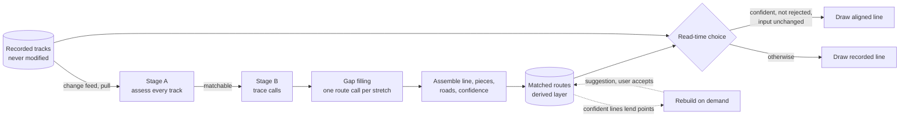
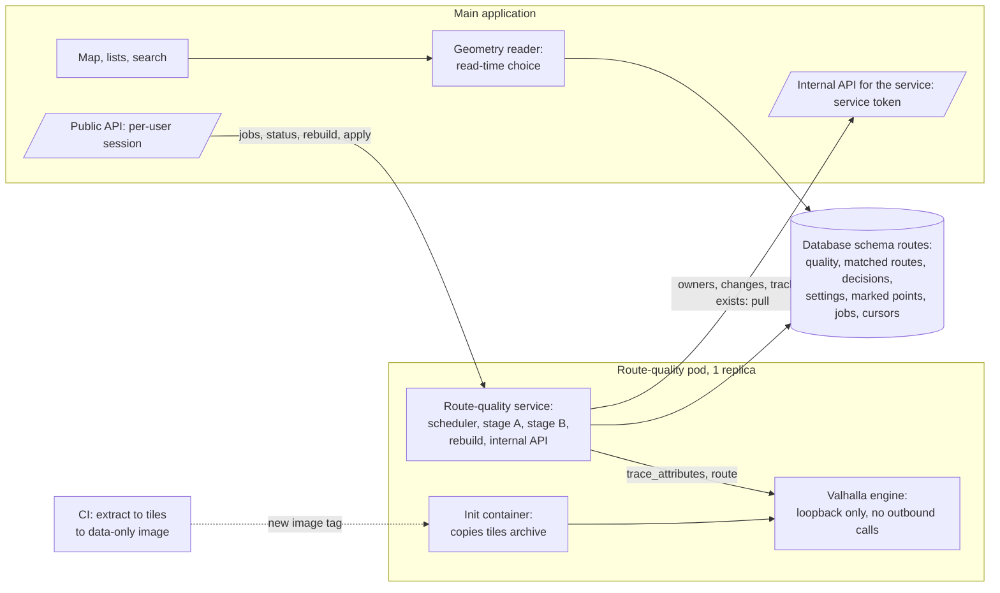
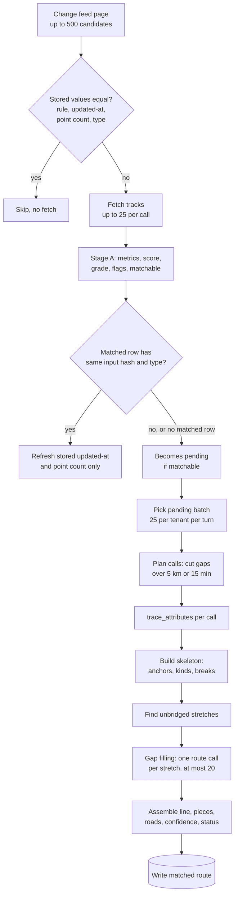
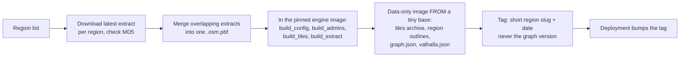
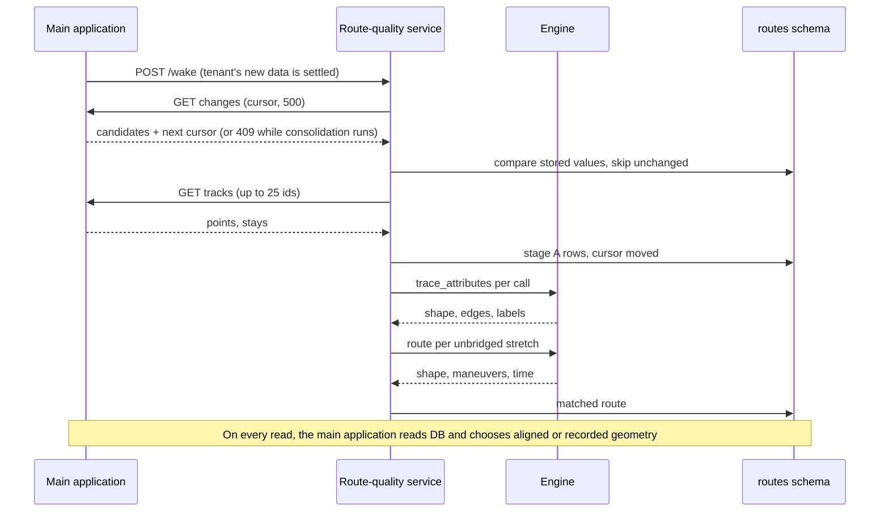
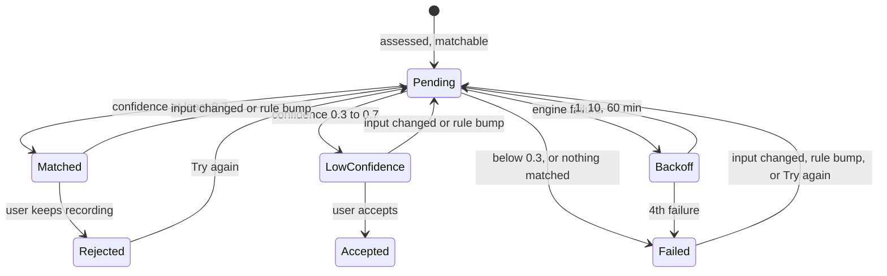
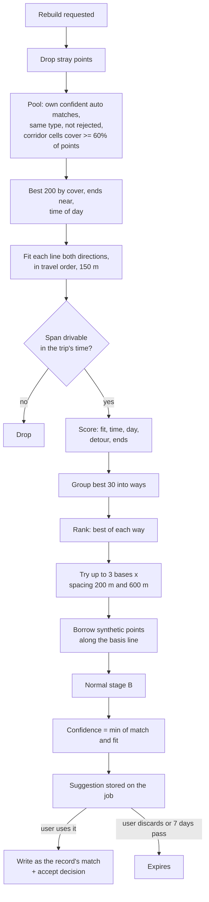

# Route-to-Road Alignment (Map Matching): Design

| | |
|---|---|
| **Document** | Route-to-road alignment design (portable edition) |
| **Version** | 1.0 |
| **Status** | Describes the system as built. Where the original planning documents and the code disagree, this document follows the code. |
| **Date** | 2026-11-01 |
| **Scope** | Assessing recorded GPS tracks, aligning them to the road network, deciding whether to show the aligned line, naming the roads travelled, and rebuilding weak tracks from similar trips |
| **Engine** | Valhalla 3.9.1 (self-hosted), with its Meili map matcher, over an OpenStreetMap routing graph |

---

## 1. Purpose and scope

This document explains how a working system aligns recorded GPS tracks to the road network ("map matching"), why it was built this way, and how to reproduce it. It is written for a team building a **different** system, one that processes vehicle tracks, and it assumes no access to the original code base or data.

**In scope:**

- the alternatives that were considered and why the current design won;
- the architecture: components, data flow, the matching engine and its road graph, job scheduling, storage, internal APIs and reprocessing;
- every algorithm, as pseudocode, with its thresholds;
- the quality model that decides whether an aligned line is used or rejected;
- how road names are extracted and stored;
- how similar trips are found and used to rebuild a weak track;
- failure modes, and guidance for adapting the design to vehicle-fleet tracks.

**Out of scope:** the user interface beyond what the data model needs, authentication details, and the upstream import of tracks from their sources.

## 2. Audience and how to read this document

The reader is an engineer who knows HTTP services, relational databases and basic geometry, but not this system.

- Read **§4 Overview** and **§8 Decision** first for the shape of the design.
- Read **§9 to §14** to implement it. Each algorithm has pseudocode and a list of its constants.
- Use **§15 Parameters** as the single reference for every number.
- Read **§17 Adapting to vehicle-track data** before reusing any threshold: most of them were tuned for sparse, noisy phone location history.

## 3. Glossary

Terms are defined here before the body uses them.

| Term | Meaning |
|---|---|
| **Track** | The ordered list of timestamped points `(t, lat, lon)` recorded for one trip. |
| **Record** | One source's recording of one trip: an id, a source name, a trip type, a track, an update time and a point count. A record has a stable **natural key** `source|externalId` (or `record|<id>` when the source gives no id). |
| **Tenant** | The user who owns a set of records. Every stored row carries a tenant id, and no computation mixes two tenants. |
| **Trip type** | The kind of trip: drive, transit, ride (bicycle), walk, run, hike, flight, or other. Transit carries a **sub-type** from its source (bus, taxi, train and so on). |
| **Resolved type** | The trip type after an upstream consolidation step has merged duplicate records from several sources. The matcher uses the resolved type. |
| **Stay** | A place where the user stayed before or after a trip, with its time window. Some sources provide stays; they are used only for an endpoint check. |
| **Sparse source** | A location-history source that records a trip as a few points: in the motivating data, a median of 60 s and 439 m between points, timestamps rounded to the minute, and positional error of 50 to 100 m. |
| **Dense source** | A device GPS recording: points seconds and metres apart, with error of about 15 m. |
| **Main application** | The system that owns the records and serves users. The route-alignment service is a separate process that reads records from it and writes results to its own database schema. |
| **Upstream consolidation** | A step in the main application, outside this design, that merges duplicate records of the same trip from several sources and settles the resolved type. It keeps a per-tenant work queue; matching waits until that queue is empty. |
| **Map matching** | Working out which roads a recorded track followed: find the candidate roads near each point, then choose the most likely *connected* path through them. |
| **HMM** | Hidden Markov Model. In map matching, the candidate road positions near each point are the hidden states, the GPS point is the noisy observation, and the most likely sequence of states is found with the **Viterbi** algorithm. |
| **Valhalla, Meili** | Valhalla is an open-source (MIT) routing engine for OpenStreetMap data. Meili is its HMM map-matching component, exposed through the `trace_attributes` endpoint. Valhalla's `route` endpoint computes ordinary point-to-point routes. |
| **Routing graph (tiles)** | The road network of a region, built from an OpenStreetMap extract into connected edges with access rules, speeds and turn restrictions. The engine stores it as **tiles**, files that each cover one square of the map. It contains no user data. |
| **Costing** | The engine's travel model: `auto` (car), `bus`, `bicycle`, `pedestrian`, and others. It decides which edges are usable and how fast. |
| **Trace call** | One `trace_attributes` request to the engine: a run of track points in, a matched path out. |
| **Matched label** | The engine's verdict on each input point: `matched` (snapped to a road), `interpolated` (placed on the path between matched points) or `unmatched`. |
| **Anchor** | An input point labelled `matched` or `interpolated` and placed on an edge of the matched path. |
| **Break** | A place where the engine's matched path is discontinuous: it gave up between two points and restarted. |
| **Piece** | A stretch of the stored aligned line, in metres along it, with a **kind**: `observed` (recorded points lie along it), `inferred` (the road was chosen by routing between sparse points), or `gap` (nothing fits; the original straight leg is kept). |
| **Stretch** | A run of the line between two consecutive anchors that contains a gap, and so is a candidate for **gap filling** by a separate routing call. |
| **Matched route** | The derived result for one record: the aligned line, its pieces, roads, confidence, status and provenance. It never replaces the recorded track. |
| **Confidence** | A number from 0 to 1 that answers "is the drawn line a believable road path for this trip?" (§12). |
| **Status** | `matched` (confidence at least 0.7), `low_confidence` (0.3 to 0.7) or `failed` (below 0.3, or nothing matched). |
| **Rule version** | A label for the full set of rules and numbers (currently `routes.v5`). Every stored row carries it; changing the rules bumps it and triggers reprocessing. |
| **Graph version** | `<regions>@<extract date>+valhalla-<engine version>`: identifies the road data a match used. |
| **Input hash** | SHA-256 of the track's times (microseconds) and coordinates rounded to 6 decimals. It tells whether a track's points really changed. |
| **Decision** | A choice the user made about a record's matched route: `reject` (keep the recorded line) or `accept` (use a low-confidence line). Keyed by the natural key, so it survives re-import and reprocessing. |
| **Synthetic point** | A point that was not recorded: borrowed from a similar trip, or marked by the user. It never counts as evidence of where the trip went. |
| **Corridor cells** | The cells of a 0.01° latitude/longitude grid that lie within 200 m of a matched line; used to find similar trips quickly (§14). |
| **Basis** | The similar trip whose line a rebuild borrows points from. |
| **Polyline5 / polyline6** | Google's encoded-polyline format at 5 or 6 decimal places. The engine returns precision 6; the system stores precision 5. |
| **Stage A, stage B** | Stage A is the assessment of a track from its own points, with no engine (§10). Stage B is matching with the engine (§11). |
| **Rollout phase** | Trip types are enabled for matching in phases. "Enabled" types are matched today; "planned" types are assessed but not yet matched; "never" types are not matched at all. |
| **Interactive job** | A job of at most 50 records started by a user who is waiting for it. It runs ahead of background work. |
| **Circuit breaker** | A guard that pauses all engine calls after several consecutive engine failures, then lets one call through to test recovery. |
| **CI** | Continuous integration: the build pipeline outside the production cluster, where the road graph is built. |
| **Init container, `emptyDir`** | Kubernetes terms. An init container runs to completion before a pod's main containers start; an `emptyDir` is a scratch volume that lives as long as the pod. |

## 4. Overview

**The problem.** A sparse source records a car trip as about 13 points, for an average trip of 13.5 km (0.94 points per km across all drives). Drawn point to point, it is a chain of straight lines across fields and buildings. Snapping each point to its nearest road does not help: the road between two points 440 m to 2.8 km apart has to be *inferred* by routing, not snapped.

**The design in one paragraph.** A separate background service pulls changed records from the main application, assesses every track with cheap arithmetic (**stage A**), and sends matchable ones to a self-hosted **Valhalla** engine whose HMM matcher routes between candidate roads (**stage B**). Gaps the matcher cannot bridge are filled with one extra routing call each, accepted only when the route fits the elapsed time and the straight-line distance. Every piece of the result is labelled observed, inferred or gap. A confidence from four factors (coverage, anchor quality, plausibility, continuity) sets a status. The aligned line is stored as a **derived layer** beside the untouched recording, and the read path chooses between the two at read time. Road names come free with the match. For weak tracks, the user can ask for a **rebuild**: points are borrowed from the same user's confidently matched trips that follow the same corridor, or from points the user marks on the map, and the result is offered as a suggestion.



**Key decisions** (rationale in §8):

1. HMM map matching with routing between candidates, not nearest-road snapping.
2. A self-hosted Valhalla engine; no hosted API, so no location history leaves the system.
3. The road graph is built offline in CI and shipped as a read-only image; the runtime never downloads map data.
4. Aligned geometry is a derived layer; the recording is never overwritten.
5. The decision to show a line is made at read time from stored values, so threshold changes cost nothing and stale matches hide themselves.
6. All numbers live in one versioned rule; a rule change reprocesses in the background without hiding the old line.

## 5. Input data and assumptions

### 5.1 What one record provides

| Field | Notes |
|---|---|
| id, source name, external id | The natural key is built from source and external id. |
| resolved type, source sub-type | The sub-type distinguishes bus or taxi from rail. Records imported before the sub-type was kept have none. |
| start, end, updated-at, point count | Updated-at, point count and type are the cheap change check (§9.6). |
| points `(t, lat, lon)` in time order | Thinned evenly to at most 2,000 points, keeping both ends, before the service sees them. Points with the same timestamp keep their recorded order. |
| the stay before and the stay after | Position and time window. Optional. |

### 5.2 The motivating data

| Source kind and trip type | Points per trip | Points per km | Notes |
|---|---|---|---|
| sparse, drive | 13 | 0.94 | 13.5 km on average |
| sparse, walk | 6 | 4.4 | |
| sparse, ride | 23 | 2.0 | |
| sparse, transit | 10 | 0.62 | bus and rail mixed |
| dense, ride | | 91 | does not need matching |
| dense, other device recordings | | 45 to 200 | |
| fitness-summary source | 0 | | no track at all |

Gaps between consecutive points of the sparse source: median 60 s and 439 m, 90th percentile 340 s and 2.8 km. A dense source has a median gap of 2 s and 10 m.

### 5.3 Assumptions the design relies on

- **OpenStreetMap is complete enough** in the covered region that a confident match is almost always the road driven. Where it is not, the confidence check and the user's ability to reject a match are the safeguards.
- **The source's timestamps are honest** to within about a minute. Elapsed time is used to reject implausible routes.
- **Trips repeat.** People drive the same trips again and again; the rebuild feature depends on it. In the motivating data, 88% of weak drives had at least one confidently matched drive with both ends within 500 m.
- **Batch, not real time.** Tracks arrive after the trip, in imports, and the user can wait minutes for a backfill and under a minute for one on-demand fix.

## 6. Requirements and constraints

### 6.1 Functional requirements

| Id | Requirement |
|---|---|
| F1 | Assess every record's track and give it a score (0 to 100), a grade (good, fair, poor) and explanatory flags. |
| F2 | Align matchable tracks to the road network. Label every piece observed, inferred or gap, and give the result a confidence from 0 to 1. |
| F3 | Show the aligned line instead of the recording only when it is confident enough, and let the user keep the recording for good. |
| F4 | Run automatically after every import, backfill existing history once, and run on demand for one record or a batch. |
| F5 | Record which roads each aligned line follows, in travel order with metres on each, and make them searchable. |
| F6 | Rebuild a weak track on demand from similar trips, or through points the user marks, and offer the result as a suggestion. |
| F7 | Never invent a route for a record with no track, and never match types that do not travel on roads (flight, ski, swim, other) or rail. |

### 6.2 Constraints and quality attributes

| Constraint | What it means for the design |
|---|---|
| **Privacy** | No track, point or record id may be sent to a hosted routing or map-matching API. The service's network access is limited to the main application, the database and DNS (plus the secrets store, when one injects its credentials). The engine's configuration makes no outbound calls. |
| **Small hardware** | Runs on low-power ARM64 on-premises nodes with about 3.7 GiB RAM each, shared with the database and the main application. The engine container is limited to 768 MiB. |
| **Offline graph** | The cluster never downloads map data. The graph arrives as a published, versioned image built elsewhere. |
| **Throughput** | The backfill of the largest tenant (about 25,000 records) must finish within 24 h, and a single on-demand fix within 60 s, even during a backfill. |
| **Fairness** | Work is shared round-robin across tenants: with one tenant's backfill running, another tenant's new import is assessed within 5 minutes. |
| **Interactive priority** | Background work must not slow interactive reads of the main application; it yields to them. |
| **Provenance** | Every result records the engine version, graph version and rule version that produced it. |
| **Reprocessing** | A rule change, a new graph, or a changed track must lead to re-matching, without a window in which good lines disappear. |
| **Determinism** | The same input, rule version and graph give the same result; the input hash detects real changes. |
| **Recoverability** | A restart loses no work; the derived tables are backed up with the decisions because rebuilding them costs hours. |
| **Isolation** | Every row is scoped to one tenant; a tenant's similar-trip search sees only its own trips. |

## 7. Alternatives considered

### 7.1 Algorithmic approaches

| Approach | How it works | Strengths | Weaknesses for this data | Verdict |
|---|---|---|---|---|
| **Nearest-segment snapping** | Move each point to the closest road and join the snapped points. | Trivial; no graph search. | With points 440 m to 2.8 km apart, the stretch between them is still a straight line. Snaps to the wrong road at junctions and parallel roads. No notion of a connected path. | Rejected |
| **Routing between sparse points only** | Ask a router for the fastest route from each point to the next. | Gives road-following lines between any two points. | Ignores how far a point is from the road (GPS noise); a noisy point pulls the route into detours and U-turns. No per-point evidence. | Rejected as the primary method; **kept as gap filling** for stretches the matcher cannot bridge, with strict acceptance tests (§11.5). It is also used alone, point to point, for a track where the matcher placed no point at all. |
| **HMM map matching with routing between candidates** | Candidate road positions per point are HMM states; emission probability from distance to the road; transition probability from how plausible the route between consecutive candidates is compared with the straight-line distance and the elapsed time; Viterbi picks the best sequence. | Designed for noisy, sparse traces; returns a connected path; per-point labels. | Gives up ("breaks") on very long gaps or where no route fits; needs a routing graph and an engine. | **Chosen** |
| **Trusting the engine's own match score** | Accept or reject a match by the engine's confidence. | No extra code. | Not comparable across costings; ignores detours and speed. | Rejected. The system computes its own confidence (§12). |
| **Matching every record, including dense recordings** | Align everything. | Uniform. | On foot and bike paths missing from OpenStreetMap, it makes a good recording worse. | Rejected for foot and bike. **Accepted for road vehicles** (rule `routes.v4`), because road search needs every drive's roads and a confident match of a dense drive is as good as the recording. |
| **Synthesising a route for a trip with no track** | Route between the stays before and after. | Fills the map. | Wholly inferred: a guess, not a correction. | Rejected (F7). |

### 7.2 Matching engines

All three open-source engines match with an HMM and route between candidates.

| | **Valhalla (Meili)** | **OSRM `/match`** | **GraphHopper map matching** | **Hosted API** (commercial roads or map-matching services) |
|---|---|---|---|---|
| Sparse traces | Routes between candidates, bounded by route distance and time factors. `breakage_distance` can be raised per request (default 2,000 m). | HMM with routing; splits at large time gaps by default; at most 100 points per request by default. | Handles sparse traces; tuning less documented. | Some expect closely spaced points and do not suit sparse traces; some cap at 100 points per request. |
| Per-point provenance | `matched` / `interpolated` / `unmatched`, distance from trace point, edge index. | Confidence per matching; no observed/inferred label per piece. | Partly. | Varies. |
| ARM64 image | Official multi-arch image. | Official multi-arch image. | No verified official image. | n/a |
| Graph build for a ~115 MB extract | Estimated 1.5 to 3 GiB peak RAM; measured result: 82 tiles, a 199 MB archive. | About 1.5 to 2.5 GiB peak **per profile**. | JVM heap about 1 to 1.5 GiB. | n/a |
| Serving RAM | **Measured:** about 366 MiB anonymous RSS with one server thread and a 32 MiB tile cache; about 477 MiB charged to the container; peak 582 MiB. Tiles load lazily from the archive. | Whole data set in RAM, about 300 to 500 MiB **per profile**; car + bike + foot about 1 to 1.5 GiB in three processes. | About 0.5 to 1 GiB for all profiles. | None locally. |
| Travel modes | car, bus, bicycle, pedestrian from **one** tile set. | One profile per data set and process; no bus profile shipped. | Several profiles in one graph. | Varies. |
| Several regions | Merged into one tile set; RAM grows little. | Each region multiplies in-RAM data. | Heap grows with area. | Inherent. |
| Privacy | Stays local. | Stays local. | Stays local. | **Sends every user's whole location history to a third party.** |
| Licence | MIT | BSD-2-Clause | Apache-2.0 | Commercial, per-call cost |

Rejected options and the condition under which each would be reconsidered:

- **OSRM:** fastest, with an official ARM64 image. But each travel mode is a separate in-RAM data set (foot and bike would roughly triple memory), there is no per-point inferred/observed label, and no bus profile. *Reconsider* if only cars are matched and Valhalla proves too slow; the matcher sits behind an interface so OSRM can be dropped in for cars.
- **GraphHopper:** strong for hiking, but no verified official ARM64 image, a larger JVM footprint on a 3.7 GiB node, and less documented sparse-trace tuning. *Reconsider* for trail matching if Valhalla's pedestrian matching proves poor.
- **Hosted API:** violates the privacy constraint, costs per call, and some do not suit sparse traces.

### 7.3 Where the road graph is built

| Option | Verdict |
|---|---|
| **Build in CI, ship as a data-only image** | **Chosen.** The memory-hungry build never competes with the database; the cluster needs no internet access for map data. |
| Build in the cluster as a scheduled job | Rejected as the default: 1.5 to 3 GiB peak RAM competes with the database, and the cluster would need egress to the extract provider. Kept as the fallback if CI is unavailable (same commands, pinned to the node with free memory, at night). |
| Mount the image directly as a volume (Kubernetes image volumes) | Rejected for now: needs a feature gate and a container runtime that supports it. An init container that copies the archive works everywhere. *Reverse* when image volumes are on by default. |

### 7.4 Where the matching runs and how work arrives

| Option | Verdict |
|---|---|
| **A separate service with the engine as a sidecar, pulling work through an internal API** | **Chosen.** |
| A worker inside the main API process | Rejected: the engine needs more memory than the API pod has, and would share the API's failure domain. |
| The main application writes a queue table that the service drains | Rejected: two processes writing one queue, and the main application would need the service's rules. |
| HTTP push from the main application | Rejected: a push sent while the service restarts is lost. |
| The service reads the main application's tables directly | Rejected: breaks module boundaries. |
| One service instance per tenant | Rejected: one engine and tile cache per tenant multiplies memory. Row-level tenant scoping suffices. |

### 7.5 How results are stored

| Option | Verdict |
|---|---|
| **A derived table beside the recording; the read path chooses** | **Chosen.** |
| Overwrite the recorded polyline with the aligned one | Rejected: the upstream consolidation would depend on the engine, and reverting would need recomputation. |
| One match per consolidated trip | Rejected: the consolidated id changes when another source wins, losing the match and the user's decision. Matching is per source record. |
| A status column on the matched row for the user's revert | Rejected: lost when derived rows are rebuilt. Decisions live in their own table, keyed by natural key. |
| Rebuild derived rows after a restore instead of backing them up | Rejected for now: a rebuild costs hours of engine time and would delay every tenant's work. |

The alternatives for road naming (§13) and for rebuilding (§14) are listed in those sections.

## 8. Decision and rationale

| Decision | Why |
|---|---|
| **HMM matching (Valhalla Meili) with routing between candidates** | The only approach that produces connected, road-following lines from points hundreds of metres apart while weighing GPS noise. Valhalla's per-point labels make provenance (observed vs inferred) possible. |
| **Self-hosted engine, no hosted API** | Privacy: location history never leaves the system. Also no per-call cost. |
| **Valhalla over OSRM and GraphHopper** | One tile set serves car, bus, bicycle and pedestrian; tiles load lazily, so serving RAM was measured at under 600 MiB; official ARM64 image; per-point labels. |
| **Graph built in CI, shipped as an image, pinned to the engine version** | Keeps the memory-hungry build off the small nodes; the runtime needs no internet; tiles must match the engine version, so the same pinned image builds and serves them. |
| **Stage A before stage B** | Assessment is pure arithmetic and cheap. It filters out records that cannot or need not be matched before spending engine time. |
| **Gap filling with strict acceptance tests** | The matcher breaks on long gaps. A single routing call per stretch, accepted only if its time and length fit, recovers most of them without inventing detours. |
| **Own confidence model, "weakest factor decides"** | The engine's score is not comparable across costings and ignores detours and speed. Taking the minimum of four factors avoids penalising sparse data twice (an earlier version multiplied the factors and a sparse trip lost on each). |
| **Derived layer, read-time choice** | The recording is never at risk; threshold changes need no recomputation; a stale match hides itself the moment the record changes. |
| **Decisions keyed by natural key** | A user's "keep the recording" survives re-import, re-consolidation, rule changes and restores. |
| **Pull with a durable cursor** | A restart loses nothing; the main application needs no knowledge of the service's rules. |
| **One engine request at a time, bounded batches, round-robin** | Fits the memory budget (two engine threads did not plateau in memory), shares capacity fairly, and lets interactive work jump the queue. |

Measured results that confirmed the decision (one engine thread, 500 real sparse drives, `breakage_distance` 5 km): median 0.134 s, p95 0.73 s, max 5.0 s per drive; 2.7% of calls refused by the engine; 85% of points matched, 5% interpolated, 7% unmatched; about 1.0 h of engine time for 15,420 drives.

## 9. Architecture

### 9.1 Components



| Component | Responsibility | Notes |
|---|---|---|
| **Route-quality service** | Scheduler, stage A, stage B, gap filling, rebuild, the service's internal API. | .NET, ARM64. One replica. Writes everything in its schema except decisions and settings. Owns the rule. |
| **Routing engine** | Valhalla, a second container in the same pod. | Listens on the pod's loopback only. No database, no user state on disk. Sees only coordinates and times, never a tenant id. |
| **Tiles image** | Data-only image with the tiles archive, the region outlines, `graph.json` and the engine's `valhalla.json`. | System data shared by all tenants; no user data. |
| **Main application** | Owns the records. Exposes a small internal API for the service, and a public API for users. | Writes only decisions in the routes schema; reads the rest. (Settings are read, but no write path is built yet: see §9.5.) |
| **Geometry reader** | Chooses aligned or recorded geometry at read time (§12.3). | Lives in the main application; reads the routes schema. |
| **Database schema `routes`** | All derived and decision data, in the main application's PostgreSQL database. | The service's database role has no grant on any other schema. Array columns and array operators (`@>`, `unnest`) are PostgreSQL features. |

### 9.2 The processing pipeline



### 9.3 The matching engine and its road graph

**Engine configuration** (shipped inside the tiles image, so a configuration change is a tiles-image change):

- Valhalla 3.9.1, pinned by image digest. The same pinned image builds and serves the tiles. Upgrading the engine means rebuilding the tiles in the same change.
- One server thread. Two threads were measured and rejected: memory did not plateau (peak 661 MiB, 1.69 cores).
- A 32 MiB LRU tile cache with hard control (the default is 1 GB); reserved memory released after each request, with reserved-label caps ten times lower than default; route distance and time factors of 3; a candidate grid cache of 20,000; a server timeout of 14 s.
- Map-matching defaults: `gps_accuracy` 75 m, `search_radius` 100 m (`max_search_radius` 150 m), `breakage_distance` 5,000 m, `interpolation_distance` 10 m, `beta` 3, `sigma_z` 4.07. The request may override `mode`, `search_radius`, `gps_accuracy`, `breakage_distance`, `interpolation_distance`, `max_route_distance_factor` and `max_route_time_factor`.
- Trace limits: at most 200 km and 2,000 points per call.
- No tile URL (no tile download), no elevation download, listening on `127.0.0.1` only.

**Graph build** (designed for a monthly CI run plus manual dispatch):



- **`graph.json`** records the regions, extract timestamps, engine version, build commit and the archive size.
- **Graph version** = `<regions>@<extract date>+valhalla-<version>`. It is stored on every matched route. It is never used as an image tag, because it contains `@` and `+`; the tag uses a short slug for the region set (or a hash prefix of the sorted region list) and the date.
- **Delivery.** An init container runs the tiles image and copies the files into an `emptyDir` volume. The volume's size limit is the archive size plus 25%, rounded up to the next 256 MiB, with a floor of 1 GiB. There is no persistent volume, so the pod can start on any node.
- **Regions.** One region at first. More are added on demand into the same tile set, ranked by how many records fall outside coverage (counted per region across all tenants, never per tenant).
- **Coverage check.** Before matching, the service tests the track against the region outlines (§10.3). A track outside every outline is `outside_coverage` and is never sent to the engine.

**Implementation status.** The tiles image in use was built by hand during the engine spike, with the same commands. The scheduled CI workflow and automatic tag bumps are designed but not yet in the repository.

### 9.4 Scheduling

The service runs one loop. Each **turn** visits every tenant in round-robin order.

```text
on start:
  apply schema migrations (retry with backoff)
  backfill missing derived columns of old rows, 200 rows per page, with a pause between pages

loop:
  did = turn()
  if not did: wait until the next poll is due, a wake signal arrives, or the breaker closes

turn():
  refresh the tenant list (at most once per poll interval)
  mark woken tenants' feeds as due
  run the interactive pass
  for tenant in tenants:
    if interactive work is waiting: run the interactive pass again
    kind = run_one_batch(tenant)
    if kind != none: pause (1 s after a match batch, 400 ms otherwise)
  on "main application busy" (HTTP 429): pause for its Retry-After, end the turn

interactive pass:
  for each tenant with a due interactive job, at most one batch per tenant per turn:
    run the tenant's oldest interactive job (a rebuild goes before anything else)

run_one_batch(tenant), the first that applies:
  1. the tenant's oldest due batch job
  2. the change feed, if woken or the poll interval (120 s) has passed: stage A over one page
  3. the orphan sweep, if a week has passed: one page of existence checks
  4. stage B over up to 25 pending records, if the circuit breaker is closed
```

- **Interactive jobs** (at most 50 records, started by a waiting user) run ahead of batch work. A running batch checks for waiting interactive work **between records** and stops after its current record; the interactive job runs; the batch resumes on the next turn.
- **Triggers.** The main application sends a **wake** after it finishes consolidating a tenant's new data; the service also polls every 2 minutes, so a lost wake costs at most one poll interval.
- **Backfill.** A tenant with an empty cursor reads every record once. A job with scope "all" resets the cursor.
- **Jobs** (`assess`, `improve`, `rebuild`) have a scope of up to 2,000 ids, a time range, or everything. A failed job batch backs off 1, 10, 60 minutes, then fails. Finished jobs are kept 7 days.
- **Tenant removal.** A tenant missing from a non-empty tenant list has all its routes data deleted. An empty list or an error is treated as transient and deletes nothing.

### 9.5 Storage: raw versus derived

The recorded track is never modified. Everything the service computes is a derived layer in its own schema.

| Table | Tier | Holds |
|---|---|---|
| `route_quality` | Derived | One row per record: natural key, type and sub-type, input hash, the record's updated-at and point count as assessed, track length, metrics (JSON), score, grade, flags, needs-improvement, matchable reason, rule version, computed-at. |
| `matched_routes` | Derived | One row per matched record: natural key, input hash, the record's updated-at, point count and resolved type at match time; costing; engine, engine version, graph version, rule version; status, confidence; the full line (polyline5, at most 1,000 vertices), a list line (at most 400 vertices) and a density line (at most 80 vertices, about 30 m tolerance); pieces `[{fromM, toM, kind}]`; matched length; roads `[{name, ref, m, fromM}]` and road names (text array); method (`auto`, `similar`, `waypoints`) and basis (JSON); start time, first and last point; corridor cells (bigint array); metrics (JSON); reason; attempts; next attempt time. |
| `route_decisions` | Decision | Natural key, kind (`reject` or `accept`), created-at. Unique per tenant and key. |
| `route_waypoints` | Decision | Natural key, the points the user marked `[[lat, lon], …]` in order. Unique per tenant and key. |
| `settings` | Decision | Per tenant: confidence threshold (default 0.7), shown by default (default on), matched types. The read path honours threshold and "shown by default"; **no endpoint writes this table yet**, so the defaults apply, and the matcher ignores "matched types" (it uses the rule's enabled types). |
| `jobs` | Operational | Per-tenant queue: kind, priority, scope, state, progress, counts, attempts, backoff, cursor, result (a rebuild's suggestion). |
| `tenant_cursors` | Operational | Per-tenant change-feed cursor, last run, last error, orphan-sweep position. |

- Every row carries the tenant id, first in every index.
- **Pieces are in metres along the stored line**, not vertex indexes, so they survive any later simplification.
- Three pre-simplified lines are stored so that no read decodes or simplifies a full line.
- A matched row is about 3 KB; 25,000 records take about 75 MB.
- The whole schema is backed up nightly. Decisions and settings must be, because they cannot be derived; derived rows are, because rebuilding them costs hours of engine time. After a restore they stay valid: the read-time check compares stored values with the restored records, and anything stale is re-matched.

### 9.6 APIs between components

The service pulls its work; the main application only sends hints and user requests.



**The main application's internal API for the service** (service token, accepted only on these paths; never reachable through the public proxy):

| Call | Returns |
|---|---|
| `GET owners` | Ids of tenants who have at least one record. (An "active tenants" filter is planned; today every tenant with data is listed.) |
| `GET changes?tenantId&after=<cursor>&limit=500` | Records whose track or resolved type may have changed after the cursor: id, updated-at, point count, resolved type, natural key, sub-type; the next cursor; whether more wait. The cursor re-reads with 5 minutes of overlap, because a record's updated-at is stamped before its transaction commits. While the tenant's upstream consolidation queue is not empty, it answers **409** so routes are always computed on settled data (an entry waiting out a retry backoff, or one that failed 3 times, no longer holds it back). |
| `GET tracks?tenantId&ids=` (at most 25) | Each record's id, source, external id, resolved type, sub-type, start, end, updated-at, point count, points (thinned to at most 2,000), and the stays before and after. |
| `POST exists {tenantId, ids}` (at most 2,000 ids) | Which records still exist (the weekly orphan sweep). |
| `GET range?tenantId&from&to&after&limit` | Record ids in a time range (time-range jobs). |

While a user's interactive reads are in flight, these calls answer **429** with `Retry-After` to batch calls. Calls for an interactive job carry a priority header and are never refused.

**The service's internal API** (backend token):

| Call | Does |
|---|---|
| `POST /assess {tenantId, scope}` | Queues assessment; 202 with a job id. |
| `POST /improve {tenantId, scope, force?}` | Queues assessment and matching. `force` re-matches even a current match; it never overrides a `reject`. |
| `POST /rebuild {tenantId, recordId, method, waypoints?}` | Queues an interactive rebuild (§14). |
| `POST /apply {tenantId, jobId, recordId}` | Writes a rebuild's suggestion as the record's match; 409 when the track changed or a concurrent apply won. |
| `POST /marks/clear {tenantId, recordId}` | Deletes the user's marked points and makes the record due for an automatic re-match. |
| `POST /wake {tenantId}` | A hint that new data is settled for that tenant. |
| `GET /jobs/{id}?tenantId` | State, progress, counts per outcome, and a rebuild's suggestion. Another tenant's job is "not found". |
| `GET /status?tenantId` | Queued and running jobs, records waiting for a match, re-matches remaining, rule version, an ETA, last run and error, engine health and breaker state, graph version, regions. |
| `GET /health/live`, `/health/ready` | Ready once `graph.json` is read and the engine answers. |

### 9.7 Reprocessing

| Change | Effect |
|---|---|
| A record's updated-at, point count or resolved type changes | The stored match is hidden at once by the read-time check (§12.3). Stage A compares the input hash: if the points are the same, it only rewrites the three stored values (no engine call); otherwise the record is re-assessed and re-matched. |
| The resolved type changes | Re-assessed and re-matched with the new costing. |
| **Rule version bump** | Everything is re-assessed (cheap). Rows of the older rule wait in the normal queue behind new and changed records: `low_confidence` and `failed` first, then `matched`. The old line is served until its replacement is written. |
| Threshold or "shown by default" changes | Nothing is recomputed; the read-time choice applies at the next read. |
| `reject` decision | Never re-matched automatically. "Try again" deletes the decision and queues an interactive forced re-match. |
| A record is deleted | Its derived rows are deleted by the weekly orphan sweep or when a batch finds it gone. Decisions and marked points stay, so a re-import keeps them. |
| **New graph version** | Stored on every new match. **Not implemented:** re-matching existing rows when the graph changes is planned; today, existing rows keep their graph version and only new or changed records use the new graph. |

A re-match that fails never clears a line stored for the same input (§16).

## 10. Stage A: assessment

Stage A runs on every record, with no engine, in batches of 500 with a 400 ms pause.

### 10.1 Per-type profiles

| Type | Phase | Costing | Expected points/km | Straight jump | Max speed |
|---|---|---|---|---|---|
| drive | enabled | `auto` | 2 | 500 m | 200 km/h |
| transit: bus | enabled | `bus` | 2 | 500 m | 130 km/h |
| transit: taxi | enabled | `auto` | 2 | 500 m | 130 km/h |
| transit: rail, subway, tram, ferry, cable car | never | — | — | — | 300 km/h (speed flag only) |
| ride (bicycle) | planned | `bicycle` | 5 | 300 m | 70 km/h |
| run | planned | `pedestrian` | 10 | 150 m | 25 km/h |
| walk, hike | planned | `pedestrian` | 10 | 150 m | 12 km/h |
| flight | never | — | — | — | 1,100 km/h (speed flag only) |
| any other type | never | — | — | — | — |

Only drive and road transit are matched today; foot and bike types are assessed but wait for their phase. Transit's sub-type comes from the source's own text (for example `in_bus`, `in_train`); a transit record with no sub-type is `unknown` and is not matched (no guessing from speed).

### 10.2 Algorithm

```text
assess(type, subtype, points, stay_before, stay_after):
  kind    = transit_kind(subtype) if type == transit else none     # bus | taxi | rail | none
  profile = RAIL_PROFILE if kind == rail else PROFILE[type]
  if kind == taxi: profile.costing = auto

  m = measure(profile, points, stay_before, stay_after)
  if len(points) < 2:
      return {matchable: no_track, score: none, grade: none, flags: [no_track], needs: false}

  score = round(clamp(100
            - 35 * clamp(1 - m.points_per_km / profile.expected_per_km, 0, 1)
            - 35 * m.straight_share
            - 15 * m.implausible_share
            - 15 * (1 if m.endpoint_m > 500 else 0), 0, 100))
  grade = good if score >= 80 else fair if score >= 60 else poor

  flags = []
  if m.points_per_km < profile.expected_per_km: flags += sparse
  if m.straight_share > 0.2:                    flags += straight
  if m.implausible_share > 0:                   flags += implausible_speed
  if m.endpoint_m > 500:                        flags += endpoint_far

  if profile.phase is none:      matchable = rail if type == transit else type_never
  elif type == transit and kind is none: matchable = unknown
  else: matchable = yes if covered(points) else outside_coverage
  if matchable != yes: flags += matchable

  needs = matchable == yes and phase_enabled(profile) and (score < 80 or m.straight_share > 0.2)
  return {score, grade, flags, matchable, needs, metrics: m}

measure(profile, points, before, after):
  for each leg (a -> b):
    d = haversine(a, b); s = b.t - a.t
    length += d
    if d > profile.straight_jump: straight += d; straight_count++
    if s > 0 ? d/s > 1.2 * profile.max_speed : d > 50 m: implausible += d   # a jump with no time
  points_per_km = len(points) / (length / 1000)
  max and 90th-percentile gap, in seconds and in metres        # p90 = sorted[ceil(0.9 n) - 1]
  start_endpoint = haversine(points[0], before) if |points[0].t - before.end| <= 30 min
  end_endpoint   = haversine(points[-1], after) if |after.start - points[-1].t| <= 30 min
  endpoint_m = max(start_endpoint, end_endpoint)
  straight_share = straight / length; implausible_share = implausible / length
```

**Worked examples.** A sparse drive at 0.94 points per km with about half its length in legs over 500 m scores about 64: *fair*, needs improvement. A dense ride at 91 points per km scores 100.

**Needs improvement no longer gates matching.** Since rule `routes.v4`, every matchable record of an enabled type is matched, so that its roads are known (§13). "Needs improvement" still drives the grade, the flags and reporting.

### 10.3 Coverage test

The region outlines are polygon files (outer rings and holes, in the Osmosis `.poly` format the extract provider publishes). A track is **covered** when at least one of up to 64 evenly spaced points (both ends included) lies inside an outer ring and outside every hole of some region. Each region keeps a bounding box for a fast reject before the even-odd ray-casting test.

### 10.4 Change detection

```text
on change-feed page:
  for item in page:
    row = stored quality row
    if row and row.rule == RULE and row.updated_at == item.updated_at
       and row.point_count == item.point_count and row.type == item.type:
        skip                                  # no track fetched
  fetch tracks of the rest (trackless items need no fetch)
  for each: assess, compute input hash, upsert quality row
            if matched row has same input hash and type:
                matched.updated_at, matched.point_count = record's   # no re-match
  move the cursor in the same save
```

A record that cannot be assessed is logged, named in the cursor's last error and skipped, so one bad record never holds the cursor back. If a batch save fails, the batch is saved again one record at a time.

## 11. Stage B: matching

### 11.1 Which records wait for a match

There is no separate queue. Pending work is a query, so a restart loses nothing:

```text
pending(tenant) = quality rows q where
    q.matchable == yes and (q.needs or q.type in ENABLED_TYPES)
  and (no matched row m
       or m.input_hash != q.input_hash or m.type != q.type
       or (((m.rule != RULE and m.method != similar) or m.next_attempt is set)
           and (m.next_attempt is none or m.next_attempt <= now)))
  and no reject decision for q.natural_key

rank: 0 = new, changed, or a due retry
      1 = never matched and not needing improvement, or an older rule's low_confidence / failed row
      2 = an older rule's matched row
order by rank, then most recently updated record first, then id; take 25
```

### 11.2 Planning the engine calls

```text
plan(points):
  segments = split points wherever a leg is longer than 15 min or 5 km     # "cut gaps"
  for each segment with >= 2 points:
    calls = chunk into runs of <= 2,000 points and <= 200 km
    if the last call has 1 point: move one point from the previous call into it
  a segment of 1 point is not sent
```

Cut gaps become `gap` pieces. The 200 km / 2,000-point splits are neither gaps nor breaks.

### 11.3 The trace call

```json
{
  "shape": [{"lat": 0.0, "lon": 0.0, "time": 0}],
  "costing": "auto",
  "shape_match": "map_snap",
  "use_timestamps": true,
  "trace_options": {
    "search_radius": "max(100, gps_accuracy)",
    "gps_accuracy": "75 for the sparse source, 15 for dense sources",
    "breakage_distance": 5000
  },
  "filters": {
    "action": "include",
    "attributes": ["edge.id", "edge.length", "edge.begin_shape_index", "edge.end_shape_index",
      "edge.names", "matched.point", "matched.type", "matched.edge_index",
      "matched.distance_along_edge", "matched.distance_from_trace_point",
      "matched.begin_route_discontinuity", "matched.end_route_discontinuity",
      "shape", "confidence_score"]
  }
}
```

Quoted values in `trace_options` are expressions evaluated per request, not literal strings. Coordinates are sent rounded to 6 decimals, times as Unix seconds. The answer's shape is polyline6.

**Outcome handling:**

| Engine answer | Treatment |
|---|---|
| 2xx | Parsed. An `edge_index` out of range means "no edge". |
| 4xx (a refusal, for example "map_snap failed") | Final for that call: its points stay a gap. Not retried, does not count for the circuit breaker. The first refusal's text is appended to the record's reason when the result has one (status not `matched`). |
| 5xx, 429, invalid JSON, or timeout (15 s client timeout; the engine gives up at 14 s) | An engine failure: the record backs off (§12.5) and the failure counts for the breaker. |
| No connection | The engine is down: the record waits without using an attempt. |

### 11.4 Building the skeleton: anchors, kinds and breaks

The **skeleton** is the line as the trace answers leave it: vertices, the piece kind of the segment into each vertex, the road names of that segment, and the ordered list of nodes (anchors and unmatched recorded points).

```text
place_anchors(answer):
  for each input point i with label matched or interpolated and a valid edge:
    if the label carries the snapped position:
      pos = projection of the snapped point onto the edge's range of shape vertices
    else:
      pos = cum[begin] + clamp(distance_along_edge, 0, 1) * (cum[end] - cum[begin])
    pos = max(pos, previous anchor's pos)          # positions never go backwards

kind of the leg between consecutive anchors a, b:
  broke = a.begin_discontinuity or b.end_discontinuity
          or the edges between a and b are not contiguous (end_shape != next begin_shape)
  if b skips unmatched points (b.index > a.index + 1):
      if broke or any skipped point carries a discontinuity flag: gap
      else: inferred if straight(a, b) > straight_jump else observed     # shape is the road; no route asked
  elif broke: gap, and count one engine break
  else: inferred if straight(a, b) > straight_jump else observed
  if the kind is observed and a or b is synthetic: inferred
```

- The shape before the first anchor and after the last takes the kind of the adjacent leg.
- A call with no answer (refused) or no anchors adds its recorded points as `gap` vertices.
- Points the plan left out of every call are added as `gap` vertices.
- The joint between two calls of the same segment is `inferred` if that leg is longer than the straight jump, else `observed`; the joint after a cut gap is `gap`.
- Only **real** (non-synthetic) anchors count toward the anchor tally and the distance-from-road list.

**Worked example** (a drive; straight jump 500 m). Six points P1 to P6 go in one trace call:

| Leg | Engine labels | Straight distance | Piece kind | Why |
|---|---|---|---|---|
| P1 → P2 | matched, matched | 300 m | observed | Short leg between anchors. |
| P2 → P3 | matched, matched | 1.8 km | inferred | Long leg: the road between them was chosen by routing. |
| P3 → P5 | matched, *unmatched* P4, matched | 900 m | inferred | Skips P4, but the matched shape is continuous, so the shape is used and no route is asked for. |
| P5 → P6 | matched (begin discontinuity), matched | 2.5 km | gap | The engine broke the path: one engine break, and a stretch for gap filling. |

If gap filling then finds an acceptable route for P5 → P6, that stretch becomes inferred and the break counts as bridged.

### 11.5 Gap filling

The matcher leaves stretches it could not bridge: cut gaps, engine breaks, legs that skip unmatched points across a break, and recorded points no call matched. Each gets at most one routing call.

```text
stretches(skeleton):
  if gap filling is off or fewer than 2 nodes: none
  routed_only = no anchors at all
  if routed_only and nodes - 1 > 40: none                       # too many legs; stays failed
  ends = all nodes if routed_only else anchors + the first and last node
  for consecutive ends a, b:
    if any segment between them is a gap:
      stretch(a, b, elapsed = b.t - a.t, straight = haversine, line_m = skeleton length,
              breaks = engine breaks inside, track_m = recorded length,
              start_heading = bearing of the matched shape arriving at a over up to 30 m (none if < 10 m),
              end_heading   = bearing leaving b over up to 30 m)

fill(stretches):
  for each stretch: pre-check
     straight > 60 km                                        -> too_long
     straight / max_speed > elapsed * 1.6 + 120 s            -> rejected_time   (no road could do it)
  order the rest by line_m descending
  cap = unlimited for routed_only, else 20 calls
  for each stretch in order:
    if interactive work is waiting (asked between calls): defer the rest
    if calls >= cap: skipped
    answer = route(stretch, headings with tolerance 45 deg)     # own 5 s timeout
    verdict = judge(stretch, answer)
    if headed and verdict in (rejected_length, rejected_reversal) and calls < cap:
        retry once without headings; keep the retry if accepted, else the first verdict
    on refusal: no_route
    on timeout: timeout; 3 timeouts in a row count once for the breaker and defer the rest
    on another engine error: counts for the breaker; defer the rest
    if the engine is down: the whole record waits

route request: locations = [start, end] as "break" locations, each with heading and
               heading_tolerance when known; same costing; directions_type = maneuvers

judge(s, r):
  if r.length > 60 km:                                               too_long
  if r.length > 2.5 * s.straight + min(500, max(100, 2 * s.straight)): rejected_length
  if back_tracks(r.shape):                                           rejected_reversal
  if r.time > 1.6 * s.elapsed + 120 s:                               rejected_time
  if s.elapsed > 180 s and r.time < 0.1 * s.elapsed:                 rejected_time   # trip went elsewhere
  else:                                                              filled

back_tracks(shape):        # checked from each end
  if length < 150 m: false
  sample every 10 m up to min(length - 50, 600 m); direction = bearing over a 50 m chord
  true if, for a sample i within 300 m of the end and a later sample j at least 150 m further,
       the directions differ by more than 150 deg and the two positions are within 50 m
```

**Why these tests.** The time test rejects a route the trip could not have driven in the elapsed time, and (above 180 s) a route so fast that the trip must have gone elsewhere or stopped. The length test's slack scales with the straight line, so a short stretch cannot hide a loop. The back-track test rejects U-turn loops near an anchor (an anchor placed on the wrong carriageway) but not a motorway loop ramp, which turns 180 to 270° with its way back far from its way out; an earlier version rejected on bearing change alone and wrongly rejected such ramps.

**Measured cost:** 6 to 38 ms more per sparse drive (1 to 4 routes); a noisy 78 km dense drive with 49 stretches made 20 calls, about 150 ms more.

### 11.6 Assembly and storage

```text
assemble(points, skeleton, fills):
  line = []
  walk the skeleton vertices; where an accepted fill starts at this vertex:
     connector from the vertex to the route's first point
     the route's shape as inferred, with the maneuvers' road names
     connector from the route's last point to the stretch's end vertex
     (a connector is inferred, except in a routed-only track where a connector over 20 m is a gap)
     jump to the stretch's end vertex
  otherwise add the vertex with its skeleton kind and road names
  compute factors and confidence (§12.1)
  if no anchor and no accepted fill:
     failed, reason "no_call" (no part had 2 points between cut gaps) or "no_match"
  status = status_of(confidence)
  if status != matched: reason = the weakest factor in words

store(line):
  round vertices to 5 decimals
  simplify to at most 1,000 vertices (keeping vertex indexes)
  map every piece's from/to metres onto the simplified line; merge touching pieces of one kind
  encode polyline5; derive the list line (400 vertices) and the density line (80, ~30 m)
  compute corridor cells (§14.2) and the roads (§13)
```

The reason names the weakest factor in plain words, for example "a 5.1 km stretch with no road that fits the 4 min elapsed", "the road line is 2.7× the recorded track", "the engine broke the path 2 times" or "only 6 of 15 points lie near a road".

## 12. Quality and acceptance model

### 12.1 Confidence

`confidence = min(coverage, anchor_quality, plausibility, continuity)`, rounded to 3 decimals. The weakest factor decides.

| Factor | Formula | What it catches |
|---|---|---|
| **coverage** | (observed + inferred metres) / stored line length | Gaps that nothing filled. |
| **anchor_quality** | max( (anchors − off_road) / points_sent , 0.6 × accepted_share ) | Points the engine could not place, or placed far from their road. `points_sent` and `anchors` count real points only. `off_road` counts anchors farther from their road than the tolerance: 50 m for `auto` and `bus`, 30 m for `bicycle` and `pedestrian`, raised to 100 m for points from the sparse source, and 150 m in a rebuild or in any match through the user's marked points. `accepted_share` = filled stretch length / all stretch length, so a track with one anchor scores no lower than one with none. |
| **plausibility** | 1 when (line − filled) / (track − filled track) ≤ 1.5; linear to 0 at 2.5; **0** when the whole line's length over the trip's duration exceeds the type's max speed | Detours and impossible speeds. Filled stretches are left out of the ratio because each passed its own tests. |
| **continuity** | max(0, 1 − 0.15 × unbridged engine breaks) | Matches the engine had to restart. Cut gaps and 200 km splits are not breaks; breaks inside an accepted fill are bridged. |

**Example.** A sparse drive of 17 points with one 5.1 km cut gap and one engine break: unfilled, coverage is about 0.63; with both stretches routed and accepted, confidence is 0.882 (15 of 17 points matched).

### 12.2 Status

| Confidence | Status | Default treatment |
|---|---|---|
| ≥ 0.7 | `matched` | Drawn by default, if at or above the tenant's threshold and "shown by default" is on. |
| 0.3 to < 0.7 | `low_confidence` | Not drawn. The user may accept it. |
| < 0.3, or nothing matched | `failed` | Not drawn. The reason is shown. |

### 12.3 The read-time choice

The main application decides, on every read, whether to draw the aligned line:

```text
drawable(row, record, decision, settings):
  if row is none or row.tenant != record.tenant or row.line is empty: false
  if decision == reject: false
  if row.updated_at != record.updated_at or row.point_count != record.point_count
     or row.type != record.resolved_type: false               # stale: draw the recording
  return (row.status == matched and row.confidence >= settings.threshold and settings.shown_by_default)
      or (decision == accept and row.confidence >= 0.3 and row.status != failed)
```

- The stale check uses columns the read already has, so it reads no points and hashes nothing.
- Otherwise the **recorded line is drawn**: the fallback is always the original geometry.
- A trip made of several recordings joins each segment's chosen line in time order.
- **What stays on the recording:** speeds, splits, heart-rate analysis, photo placement and same-route comparison always use the recorded points. The aligned line is a drawing and a distance, not a new track.
- **Distance:** a distance reported by the source stays, and the matched length is shown beside it. When the distance was computed from the recorded straight legs (too short for a sparse drive), the matched length replaces it while the match is drawn.
- **Drawing:** observed pieces solid, inferred pieces dashed and fainter, gap pieces thin grey straight legs.

### 12.4 User decisions

| Action | Effect |
|---|---|
| Keep the recording (`reject`) | Never drawn, never automatically re-matched, never used as a similar-trip basis. Wins over every other rule. |
| Use a low-confidence line (`accept`) | Drawn at confidence ≥ 0.3. Also written when a rebuild suggestion is used. |
| Try again | Deletes the decision and queues an interactive forced re-match. |
| Raise the threshold, turn "shown by default" off | Applied at the next read; nothing recomputed. (The read path honours both; the endpoint that sets them is not built yet, §18.) |

### 12.5 Failure handling and backoff

| Situation | Treatment |
|---|---|
| Engine failure (timeout, 5xx) | The record backs off 1 min, 10 min, 60 min; the fourth failure marks it `failed` for good. Counts for the breaker. |
| Engine unreachable | The record waits one backoff step (or until the breaker closes) without using an attempt. An outage never fails records for good. |
| Circuit breaker | 5 consecutive engine failures pause all matching for 10 minutes. Then one call is let through: success closes it, failure re-opens it. Refusals and successes reset the count. |
| Gap-filling timeouts | The result is stored with its gaps and re-matched after 1 minute, at most 3 times; then the result stays. |
| Gap filling stopped by interactive work | Stored with its gaps, re-matched after 1 minute, not counted. |
| A bug or an unstorable row | Logged; the record backs off like an engine failure; the batch continues. |
| **A failed re-match of a row with a line for the same input** | The stored line, pieces and status stay. For an older rule's line, the re-match backs off; once the backoff is spent, the row takes the current rule version (so it is not retried) and keeps its old line. A failure **never clears a line stored for the same input**. |



## 13. Road naming

Road names come from the same engine answers, with no extra call.

### 13.1 Algorithm

```text
names per shape segment:
  trace answer: each edge's names apply to the segment into vertex j, for j in (begin_shape, end_shape]
  route answer (gap fill): each maneuver's street_names apply the same way over its shape range
  names are trimmed, empties dropped, de-duplicated within one edge

while building the line (§11.6), for each added segment of kind observed or inferred:
  for each name on the segment:
    metres[name] += segment length
    first_at[name] = first_at[name] or the line position where the segment starts
  (gap segments and gap connectors add nothing)

keep(roads):
  drop names with metres < 100 or blank
  keep the 40 with the most metres
  order by first_at (travel order)
  for each: {name, ref: name matches ^[0-9]{1,4}[A-Za-z]?$, m: round(metres), fromM: first_at mapped onto the stored line}
```

- The engine lists route numbers and street names together in one `names` array; a name of 1 to 4 digits with an optional letter is a **route number** (`ref`).
- Names are OpenStreetMap's `name` tag in the local language. The graph carries no translated names, and the engine's language option does not change them.
- Names are matched by exact string, so one road accumulates metres across all its segments; a road that is left and rejoined keeps its first position.
- The metres are counted on the full line before simplification, so they are the true length on each road.

### 13.2 Storage and search

- `roads` (JSON `[{name, ref, m, fromM}]`) for display and export, and `road_names` (text array) for search. Both are written in the same update as the line and cleared wherever the line is cleared.
- **Search input** is trimmed; a leading "road", "route", "rd", "hwy", "highway" or the local-language word for "road" is dropped; a route number's letter is upper-cased. A local word that begins many street names (the equivalent of "way") is deliberately kept.
- **Matching:** a route number matches by array containment (`road_names @> ARRAY[x]`), so 431 does not find 4313. Any other text matches by case-insensitive substring over the array elements, with wildcards escaped.
- **Which rows count:** the read-time choice without "shown by default": a road is a fact about a correct match whether or not the user draws matched lines. Rejected, failed and stale rows never count.
- **Cost:** about 86 ms for a route number and 100 ms for a street fragment over 13,300 rows on the small hardware, with only the tenant-first B-tree index. A GIN index (PostgreSQL's inverted index, suited to array containment) is the fallback if it becomes slow.
- A row whose re-match for a newer rule gave up keeps its older line and whatever roads that line had. Rows matched before roads were stored therefore stay **without roads**, and invisible to road search, until their input changes or a later rule re-matches them.

### 13.3 Alternatives considered

| Alternative | Why rejected |
|---|---|
| A separate road table | A second write per match, and delete-and-insert to keep it in step, for a filter one array column serves. |
| Naming roads at read time from the stored line | An engine call on every view, and the main application would need the engine. |
| Looking up OSM way ids for route numbers | The `names` array already carries them. |
| Matching only tracks that need improvement | Road search would miss every well-recorded trip. |
| Searching road names through the general text search | "4" would match every name containing a 4. |

## 14. Similar routes and rebuild

A rebuild is **on demand, for one record, interactive**. It never runs automatically, because a borrowed route is a guess the user should see first.

### 14.1 Overview



### 14.2 Corridor cells (the spatial index)

```text
cell(lat, lon) = floor((lat + 90) / 0.01) * 100000 + floor((lon + 180) / 0.01)

cells(line):
  if fewer than 2 points: []
  sample at every vertex and at most every 100 m between vertices
  for each sample: add every cell touched by a square of +/- 200 m around it
     (dLat = 200 / 110540 deg; dLon = 200 / (111320 * cos(lat)) deg)
  return sorted distinct cells
```

A 0.01° cell is about 1.1 km north-south. Any point within 150 m of the line is within 200 m of a sample (at most 50 m from the nearest spot on the line to a sample), so it lies in one of the line's cells. A 17 km line has about 50 cells. Cells are written with the line on every successful match and every applied rebuild, cleared or kept with the line, and back-filled at start-up for rows matched before cells existed.

### 14.3 Stray points

```text
stray(points, max_speed):            # real points only; none if < 3 points or no max speed
  fast(a, b) = haversine(a, b) / (|b.t - a.t| + 60 s) > 1.5 * max_speed
  inner point i is stray if fast(i-1, i) and fast(i, i+1)
  first point is stray if fast(first, first non-stray inner point)
  last point is stray if fast(last non-stray inner point, last)
clean points = real points that are not stray
```

The rule catches teleports only: with 60 s of slack, a point is stray only when it is several kilometres off within about a minute. Stray points take no part in the pool, fit, span, score or borrowing, but they stay in the points matched and in the output.

### 14.4 The pool

```text
pool(record):
  eligible = this tenant's matched rows where
      status == matched and confidence >= 0.8 and method == auto
      and type == record.type and line exists and id != record.id
      and no reject decision for the row's natural key
  need = ceil(0.6 * len(clean))
  point_cells = [cell(p) for p in clean]
  rows = eligible where
      (cells exist and count(c in point_cells if c in row.cells) >= need)   # counted in the query
      or (no cells yet and both ends within 500 m of the clean first/last points, either way round)
  for each row:
      cover = hits / len(point_cells), or 1 for a row found by its ends
      ends_near = both ends within 500 m of the clean ends, either way round
      keep if cover >= 0.6
  order by cover desc, ends_near first, circular time-of-day difference to the record's first clean point
     (a row without its own start time goes last among equals); take 200
  read the lines and pieces of those 200 only
  preparing = count of eligible rows with no cells yet
```

Counting hits in the query matters: a common home cell is in almost every one of a commuter's rows, so a plain overlap would return nearly all of them. Cover bounds the fit from above, so a row with cover below 0.6 cannot fit.

### 14.5 Fit, span, pace and score

```text
project_along(line, points):            # in travel order
  furthest = 0
  for each point:
    floor = furthest - 150 m
    take the first stretch of the line, from floor onward, that passes within 150 m of the point,
      and the nearest spot on that stretch
    if found: pos = max(spot, floor); furthest = max(furthest, spot); dist = distance
    else:     dist = > 150 m (not along); pos does not advance

score(candidate):
  for direction in (as driven, reversed):
    fit = share of clean points with dist <= 150 m
  keep the direction with the higher fit (a tie keeps the line's own); drop if both < 0.6
  span = position of the last along point - position of the first along point (>= 0)
  if span / (elapsed between those two points + 60 s) > max_speed: drop       # pace
  own = the record's straight-leg length between those two points
  detour = span / own if own > 500 m else 1
  h = circular hour difference between the record's first clean point and the candidate's start (0..12)
  d = 1 if the kinds of day differ
  e = 1 if ends_near
  score = fit
        - 0.15 * min(h, 3) / 3          (0 if the candidate has no own start time)
        - 0.05 * d                      (0 if the candidate has no own start time)
        - 0.15 * clamp((detour - 1.3) / 0.5, 0, 1)
        + 0.05 * e
```

- Reading the line **in travel order** handles round trips and loops correctly, and a trip the other way round does not fit that direction. Projecting each point onto its nearest spot anywhere on the line was measured and rejected: it dropped twins that fitted perfectly.
- The fit dominates: three hours apart costs as much as 0.15 of fit.
- **Kinds of day** are three: each of the two weekend days on its own, and the working days together (so the two weekend days differ from each other too). They are hard-coded for one locale, and the time of day and the day are both read in UTC, not the user's time zone; a night trip near midnight can be counted on the previous day.

### 14.6 Ways (consensus) and rank

```text
best30 = the 30 best candidates by score (ties: more recent first)
ways: in that order, each candidate not yet in a way starts one; every later candidate not yet
      in a way joins it when its own span, sampled every 250 m (both ends included), lies at least
      90% within 150 m of the first member's line
value(way) = best score + 0.1 * size / size of the largest way
order ways by value (ties: more recent best first)
rank = [best of each way] + [the next members of the first way]; take 3

for the report:
  candidates = drives scored (<= 200); agreeing = drives kept
  same_way = way members + other agreeing drives whose span lies 90% along the way's first line
  examples = the best 3 of the basis's way
```

Between two ways of about equal score, the one more trips take wins; a lone detour needs a clearly better score to go first.

### 14.7 Borrowing and the tries

```text
borrow(points, basis_line, spacing):
  project clean points along the basis (travel order)
  for each consecutive pair (a, b) of clean points, both within 150 m of the basis:
    along = pos(b) - pos(a); elapsed = b.t - a.t
    skip if along < 300 m or elapsed <= 0 or along / elapsed > max_speed
    for s = pos(a) + spacing; s < pos(b) - spacing / 2; s += spacing:
      skip if s lies on one of the basis's own gap pieces (mirrored if reversed)
      add synthetic point at basis(s), t = a.t + elapsed * (s - pos(a)) / along
  return all input points (stray ones included) + synthetic, sorted by time
     (a synthetic point never precedes a real point of the same time)

rebuild_similar(record):
  best = none
  for basis in rank (up to 3):
    for spacing in (200 m, 600 m):
      result = stage_b(borrow(points, basis, spacing), off_road tolerance 150 m)
      confidence = min(result.confidence, basis.fit); status = status_of(confidence)
      keep the most confident
      if confidence >= 0.95: stop
  return best    # or "no similar trip" with a reason
```

- **Partial overlap.** Points are borrowed only between two clean points along the basis, so a trip that covers part of the basis takes only that part. Nothing is added before the first point or after the last: a route is never extended to where the recording "probably" began or ended.
- **Synthetic points** make every leg that touches them `inferred`, and confidence counts real points only. The plausibility ratio includes the synthetic points, so it judges the line against the borrowed way.
- **Dense spacing** pins a same-direction twin well; sparse spacing leaves the engine room where a reversed twin runs on the other carriageway or takes another ramp.
- **Measured** on 60 weak drives with an earlier, end-based pool: 6 matched confidently by plain matching, **38 (63%)** by a rebuild, 35 improved by more than 0.05, 1 made worse, 9 with no similar trip. Time per rebuild: median 292 ms, p90 690 ms on a laptop; the small hardware is 1.5 to 3 times slower.

### 14.8 Marked points (`waypoints`)

```text
check: 1 to 50 points, valid coordinates, track has >= 2 points,
       every mark within 5 km of the recorded straight legs           # else outcome "invalid"
place(points, marks):
  for each mark: the leg its projection on the straight legs falls on (first/last leg at the ends)
  within a leg, keep the order marked
  path = real a -> marks -> real b; time each mark linearly by distance along that path
rebuild_waypoints: stage_b(placed points, off_road tolerance 150 m); no fit cap (the user's word)
```

### 14.9 The suggestion and applying it

- The result is **not** stored as the match. It goes on the job: line, pieces, roads, length, status, confidence, the stored match's previous confidence (so the user sees whether it is better), reason, method, the record's input hash, and the basis (candidate, agreeing and same-way counts, reversed, up to 3 examples). Jobs expire after 7 days.
- **Outcomes:** `suggested`, `no_similar` (with "no confident trip runs along these points" or "none of the N nearby trips follows them closely enough", plus "N trips are still being prepared" when rows lack cells), `invalid`, `not_matchable`, `gone`, `no_match` (the engine placed no point).
- **Apply** checks that the job is the tenant's, done, a rebuild of this record with a suggestion, and that the track's input hash and type are unchanged (else 409). In one transaction it writes the matched row with the method and basis, and for `waypoints` stores the marked points; using a `similar` suggestion deletes any marked points. The main application then writes an `accept` decision, so the line is drawn at confidence ≥ 0.3.
- **Lasting:** a `similar` row is not re-matched for a new rule version; it is re-matched as `auto` when the track or type changes. A record with marked points is matched through them on every automatic match. "Try again" re-matches a `similar` row as `auto` and keeps marked points. Clearing marked points makes the row due for an `auto` match.

### 14.10 Alternatives considered

| Alternative | Why rejected |
|---|---|
| Rebuild every weak trip automatically | A borrowed route is a guess; the user should see it first. |
| Average several similar lines | An average of road lines is not a road. |
| Copy the similar trip's line outright | Ignores where this trip's own points went and its timing. |
| Time borrowed points from the similar trip's timing | A matched line keeps no times; this trip's own times are what make it physically possible. |
| Stop at the first confident result | On a real trip the first reversed try gave 0.70 where a later one gave 0.85. |
| Pool by both ends within 500 m (the first version) | A recording that starts late, stops early or ends on a stray point has no such twin, though dozens of trips run along its points. |
| Widen the end distance to 2 km | Matches every trip into a town. |
| PostGIS for the corridor query | A new database extension for one query; grid cells give the same answer with plain arrays. |
| A GIN index on cells | Every index leads with the tenant id, which needs an extra extension in GIN; one tenant's rows are few enough to filter. |
| Choose by time of day alone | Hundreds of trips share any morning hour; time ranks, the way decides. |
| Extend the line to the usual end place | An invented stretch; marking the way is the user's tool for that. |

## 15. Parameters

All engine-facing numbers are configuration; the rest are constants of the rule version.

### 15.1 Engine and calls

| Parameter | Value | Meaning |
|---|---|---|
| Engine concurrency | 1 | Requests in flight. |
| Engine server threads | 1 | Two did not plateau in memory. |
| Trace call timeout | 15 s | Client side; the engine gives up at 14 s. |
| `search_radius` | max(100 m, `gps_accuracy`) | Candidate search radius. |
| `gps_accuracy` | 75 m sparse, 15 m dense | Per-source GPS error. |
| `breakage_distance` | 5,000 m | The engine breaks the path beyond this. 3 km dropped 4.3% of points; 10 km took 1.85× as long. |
| Cut gap | > 5,000 m or > 15 min | Cut before the call; becomes a gap. |
| Max points per call | 2,000 | Engine `max_shape`. |
| Max distance per call | 200 km | Engine trace `max_distance`. |
| Max points per track | 2,000 | Thinned evenly, ends kept, by the main application. |
| Tile cache | 32 MiB LRU | Engine default is 1 GB. |
| Route factors | 3 | Meili `max_route_distance_factor`, `max_route_time_factor`. |

### 15.2 Stage A

| Parameter | Value | Meaning |
|---|---|---|
| Implausible speed | > 1.2 × type max, or > 50 m with no time | Per leg. |
| Endpoint window | 30 min | A stay counts within this of the track's end. |
| Endpoint far | 500 m | Flag and score penalty. |
| Score weights | 35 density, 35 straight, 15 speed, 15 endpoint | Out of 100. |
| Grades | good ≥ 80, fair 60 to 79, poor < 60 | |
| Needs improvement | score < 80 or straight share > 0.2 | For matchable types. |
| Coverage samples | up to 64 points | Any one inside an outline covers the track. |
| Per-type profile | §10.1 | Expected points/km, straight jump, max speed. |

### 15.3 Gap filling

| Parameter | Value | Meaning |
|---|---|---|
| Enabled | true | |
| Max stretch / route length | 60 km | Longer stays a gap. |
| Time limit | elapsed × 1.6 + 120 s | Route time must not exceed. |
| Lower time limit | elapsed × 0.1, only when elapsed > 180 s | Route faster than this is rejected. |
| Length limit | 2.5 × straight + min(500 m, max(100 m, 2 × straight)) | |
| Back-track | > 150° within 50 m, ≥ 150 m further along, within 300 m of an end; 50 m chords, 10 m samples | |
| Heading | over up to 30 m of matched shape (none under 10 m), tolerance 45° | |
| Max calls per track | 20 | Longest stretches first. |
| Routed-only max legs | 40 | |
| Routed-only connector | > 20 m is a gap | |
| Route call timeout | 5 s | |
| Timeouts in a row | 3 | Count once for the breaker; stop filling. |
| Fill retries | 3 | Re-matches after fill timeouts. |
| Routed-only weight | 0.6 | Anchor-quality floor scale. |

### 15.4 Confidence and display

| Parameter | Value | Meaning |
|---|---|---|
| Off-road tolerance | 50 m `auto`/`bus`; 30 m `bicycle`/`pedestrian`; 100 m for the sparse source; 150 m in a rebuild or a match through marked points | An anchor farther than this from its road is off-road. |
| Plausibility | 1 at ≤ 1.5 ×, 0 at 2.5 ×; 0 above max speed | |
| Continuity | −0.15 per unbridged break | |
| Matched | ≥ 0.7 | |
| Low confidence | ≥ 0.3 | |
| Default display threshold | 0.7 | Per tenant. |
| Accept floor | 0.3 | |
| Stored line | ≤ 1,000 vertices; list 400; density 80 at ~30 m | |

### 15.5 Roads

| Parameter | Value |
|---|---|
| Minimum metres | 100 m |
| Max roads per line | 40 (longest kept) |
| Route-number pattern | `^[0-9]{1,4}[A-Za-z]?$` |

### 15.6 Similar routes and rebuild

| Parameter | Value | Why |
|---|---|---|
| Pool confidence | ≥ 0.8, method `auto` | Only lines the matcher placed confidently on its own are lent. |
| Cell | 0.01° | A corridor is tens of cells; cheap overlap. |
| Cell buffer / sampling | 200 m / ≤ 100 m | Guarantees a point within 150 m of a line is in its cells. |
| Near | 150 m | Twice the sparse source's `gps_accuracy`. |
| Back | 150 m | GPS noise may step back along the line, not more. |
| Least fit / least cover | 0.6 | Most points must follow the way. |
| Candidates | 200 | Bounds projection work. |
| Ends near | 500 m | A bonus and the fallback for rows without cells. |
| Stray | 1.5 × max speed, 60 s slack | Teleports only. |
| Detour free | 1.3, full penalty at 1.8 | Roads run longer than sparse straight legs. |
| Score weights | 0.15 time (to 3 h), 0.05 day, 0.15 detour, 0.05 ends | Fit stays the main term. |
| Ways | best 30, sample 250 m, 90%, bonus 0.1 | Consensus at bounded cost. |
| Tries | 3 bases × 200 m and 600 m; stop at 0.95 | |
| Borrowed leg | ≥ 300 m | Shorter gains nothing. |
| Marked points | 1 to 50, within 5 km | |
| Suggestion lifetime | 7 days | |

### 15.7 Scheduling and resilience

| Parameter | Value |
|---|---|
| Stage A batch / pause | 500 records / 400 ms |
| Stage B batch / pause | 25 records / 1 s |
| Interactive job | ≤ 50 ids |
| Job scope | ≤ 2,000 ids |
| Change feed page / overlap | 500 / 5 min |
| Tracks per call | 25 |
| Poll interval | 120 s; 30 s after a 409 |
| Backoff | 1, 10, 60 min, then failed |
| Breaker | 5 failures, 10 min pause |
| Orphan sweep | every 7 days, 2,000 ids per page |
| Job retention | 7 days |
| Resources | service 50m/96Mi request, 500m/256Mi limit; engine 500m/512Mi request, 1000m/768Mi limit |

## 16. Failure modes and edge cases

Engine failures, backoff, the circuit breaker and failed re-matches are covered in §12.5. This section lists the remaining cases.

| Case | Behaviour |
|---|---|
| Fewer than 2 points | `no_track`: never matched, and no route is invented. |
| Type never matched (flight, rail, other) | Assessed; `type_never` or `rail`; no engine call. |
| Transit with no sub-type | `unknown`; not matched until the record is re-imported with its sub-type. |
| Track outside every region outline | `outside_coverage`; never sent to the engine. |
| Every leg longer than the cut gap | No trace call (`no_call`); routed point to point if at most 40 legs. |
| Engine places no point | Routed point to point if at most 40 legs; otherwise `failed` with `no_match`. |
| Engine refuses one call (4xx) | That call's points are a gap; the rest of the track is still used. |
| Engine hung | Client timeout 15 s; the engine container's liveness probe restarts it only after 5 failures 30 s apart, so a long trace does not trigger a restart. |
| Engine fails during a rebuild | The rebuild job fails at once (the user is waiting and can retry); while the breaker is open, a rebuild waits instead. |
| Duplicate timestamps (one segment's end equals the next one's start) | Kept in recorded order; any other order makes the track run backwards and no fill fits. |
| Timestamps rounded to the minute | Legs can have zero elapsed time. The implausible-speed metric counts such a leg as implausible only above 50 m; stray detection adds 60 s of slack; the gap filler's lower time limit applies only above 180 s. |
| A loop ramp in a filled stretch | Accepted; only a true back-track near an end is rejected. |
| An anchor on the wrong carriageway | The headed route may force a U-turn; rejected for length or back-track, then retried once without headings. |
| Record changes while a match is stored | The match is hidden at the next read; it is re-matched only if the input hash changed. |
| Upstream consolidation re-runs and touches every record | The feed returns them all; the stored values decide, so only real changes are fetched. |
| Rebuild while the track changes | Apply answers 409; the user rebuilds again. |
| Two concurrent applies | One wins; the other gets 409, never half a change. |
| Tenant removed | All of its routes rows are deleted. A transiently empty tenant list deletes nothing. |
| One bad record in a batch | Logged, skipped, backed off; it never heads every batch or holds the cursor. |
| Interactive work arrives mid-batch | The batch stops after its current record; gap filling stops between calls and defers the rest. |
| Main application busy | 429 to batch calls; the turn pauses for `Retry-After`. |
| Database restored from backup | Derived rows stay valid; stale ones are hidden and re-matched. |

## 17. Adapting to vehicle-track data

The design was tuned for **sparse, noisy, minute-rounded phone location history**. Fleet vehicle tracks are usually the opposite: dense, regular, accurate, continuous, and in large volume. The architecture carries over almost unchanged; many numbers do not.

### 17.1 What carries over as is

- **HMM matching with a self-hosted engine**, behind a matcher interface.
- **Stage A before stage B**, so cheap checks filter work before engine calls.
- **Derived layer, read-time choice, decisions keyed by natural key.**
- **Pieces with provenance** (observed, inferred, gap) in metres along the line.
- **Confidence as the minimum of independent factors**, with a reason naming the weakest.
- **Gap filling with time and length acceptance tests**, essential for tunnels, garages and dropouts.
- **Rule version, input hash and graph version** for reprocessing and provenance.
- **Offline graph built in CI**, pinned to the engine version.
- **Durable pull cursor, bounded batches, per-tenant round-robin, interactive priority, backoff, circuit breaker.**

### 17.2 Input differences and what to change

| Vehicle-track property | Impact | Recommended change |
|---|---|---|
| **Dense, regular sampling** (1 to 30 s) | Long tracks hit the 2,000-point call limit; most legs are short, so "straight jump" and "points per km" checks never fire. | Down-sample before matching (for example one point per 5 to 10 s or per 25 to 50 m, always keeping turns and stops). Recompute expected points per km for the sampling rate. |
| **Accurate GPS** (often 3 to 10 m), sometimes with HDOP (horizontal dilution of precision, the receiver's own estimate of how much satellite geometry degrades a fix) | 75 m and 15 m `gps_accuracy` are too loose; candidates on parallel roads compete. | Set `gps_accuracy` from the device class or per-point accuracy (5 to 15 m) and `search_radius` to 25 to 50 m. Lower the off-road tolerance to match. |
| **Continuous streams, not trips** | No trip boundaries; long idle periods. | Segment into trips first (ignition events, or stops longer than N minutes), as a separate upstream step. Each trip becomes a record with its own natural key. |
| **Stationary jitter** at stops, depots and traffic lights | Many points within metres create spurious U-turns, loops and engine breaks. | Collapse stationary runs (speed below a few km/h for more than a few seconds) to one point before matching. |
| **Known vehicle type** (car, van, truck, bus, motorcycle) | Costing and speed limits are known exactly. | Map vehicle class to costing: `auto`, `truck` (with height, weight, length and hazmat options), `bus`, `motorcycle`, `motor_scooter`, `taxi`. Set per-class max speed (for example 90 to 110 km/h for trucks) for plausibility and stray detection. |
| **Device-reported speed and heading** | Extra evidence not used here. | Use speed to detect stops and implausible jumps directly; use heading, where the engine version supports it per point, to disambiguate carriageways. Check the engine's API before relying on it. |
| **Tunnels, underground car parks, urban canyons** | Real gaps in a dense track. | Keep gap filling. Reduce the cut-gap distance (for example 1 to 2 km) and `breakage_distance` (1 to 2 km): in dense data a long gap is an anomaly, not the norm. Keep the elapsed-time test. |
| **Many vehicles, large volume** | One engine thread will not keep up. | Run several engine replicas or threads on larger hardware (re-measure memory per thread), parallelise by vehicle, and keep bounded batches for fairness. Consider OSRM for car-only throughput. |
| **Real-time requirements** | `trace_attributes` matches a finished trace. | For live views, match a sliding window (for example the last 2 to 5 minutes with overlap) and finalise only the part behind the overlap; run the full batch match after the trip ends and let it replace the live result through the same derived-layer mechanism. |
| **Fixed and repeated routes** (bus lines, delivery rounds) | The similarity machinery becomes more valuable. | Build the similar-trip pool per vehicle or per route, not per user. Use it to detect deviations from an expected route, not only to repair weak tracks. Make the kinds of day and the time zone configurable and local. |
| **Driver privacy and data protection** | Fleet data is personal data about drivers. | Keep the self-hosted engine, the egress lockdown and tenant-first scoping; add retention limits. |

### 17.3 Parameters to re-tune

| Parameter (§15) | Current value | Direction for dense vehicle tracks |
|---|---|---|
| `gps_accuracy` | 75 m / 15 m | 5 to 15 m, per device |
| `search_radius` | ≥ 100 m | 25 to 50 m |
| `breakage_distance`, cut gap | 5 km / 15 min | 1 to 2 km / 2 to 5 min |
| Max points per call | 2,000 | Keep; down-sample instead |
| Expected points/km, straight jump | 2 /km, 500 m | From the sampling rate, for example 20 /km and 150 m |
| Max speed per type | 200 km/h drive | Per vehicle class |
| Off-road tolerance | 50 m (100 m sparse) | 15 to 25 m |
| Plausibility ratio | 1.5 to 2.5 × | Tighter, for example 1.2 to 1.6 ×, because dense straight legs already follow the road |
| Gap-fill time factor and slack | 1.6 × + 120 s | Tighter for regular sampling, for example 1.3 × + 60 s |
| Gap-fill lower time limit | 0.1 × above 180 s | Keep; it catches stops inside gaps |
| Display threshold | 0.7 | Re-measure against labelled trips |
| Similar-trip near distance, fit | 150 m, 0.6 | 30 to 50 m, 0.8 |
| Stray slack | 60 s | 5 to 10 s |
| Batch sizes, pauses, engine threads | 25 / 1 s / 1 thread | Size to hardware and volume |

**Re-measure before you trust any threshold.** The original numbers were set against real production data, then adjusted after measuring (for example, `breakage_distance` was chosen by running 3, 5 and 10 km on 500 real trips). Do the same with a few hundred labelled vehicle trips.

## 18. Open questions and future work

| Item | Status |
|---|---|
| Re-match existing rows when the graph version changes | Designed (lowest priority, oldest first, round-robin, old line served until replaced); **not implemented**. |
| Scheduled CI build of the tiles image and automatic tag bumps | Designed; **not in the repository**. The current image was built by hand with the same commands. |
| Foot and bicycle matching | Profiles defined; phase not enabled. Risk: trails missing from OpenStreetMap. |
| Rail matching on a rail graph | Not planned for now. |
| More regions | Added on demand into the same tile set. |
| Time zone and kind of day in the similar-trip score | Read in UTC with a hard-coded weekend; should use the user's time zone and locale. |
| Per-tenant settings (threshold, shown by default, matched types) | Stored and read with defaults; **no endpoint writes them yet**, and the matcher does not read "matched types". |
| Decision expiry for deleted records | Designed as 30 days; not seen in the implementation (decisions are kept). |
| Erasing a tenant's routes rows on request | Rows are deleted when a tenant leaves the tenant list; an explicit per-tenant erase contributor is not built. |
| Placing photos and other time-stamped items on the aligned line | Planned; today they stay on the recorded straight legs. |
| Totals using the matched distance in reports | Partly done: the matched length replaces a straight-leg distance in lists and detail, not yet in aggregate reports. |
| A GIN index on road names | Not needed at current volume; the reverse if road search slows. |
