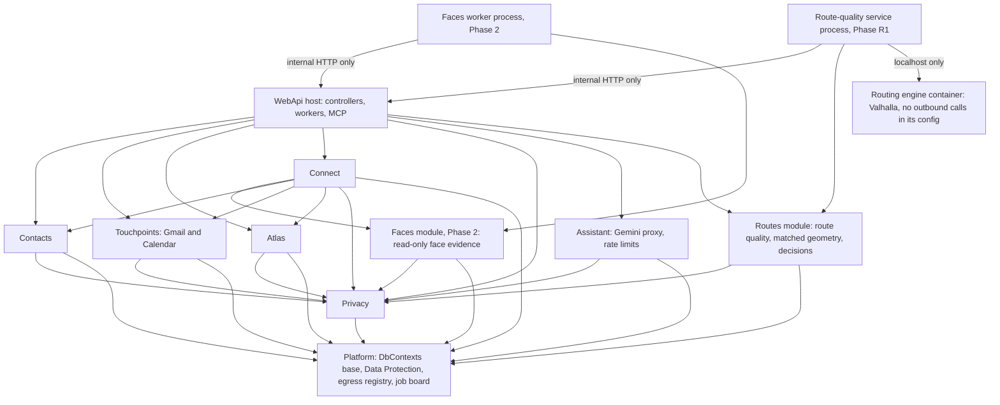
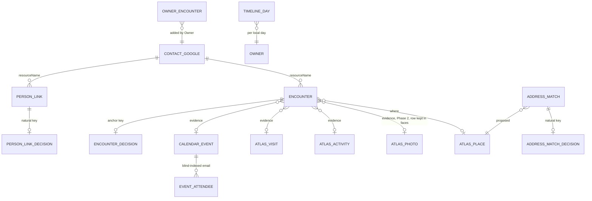
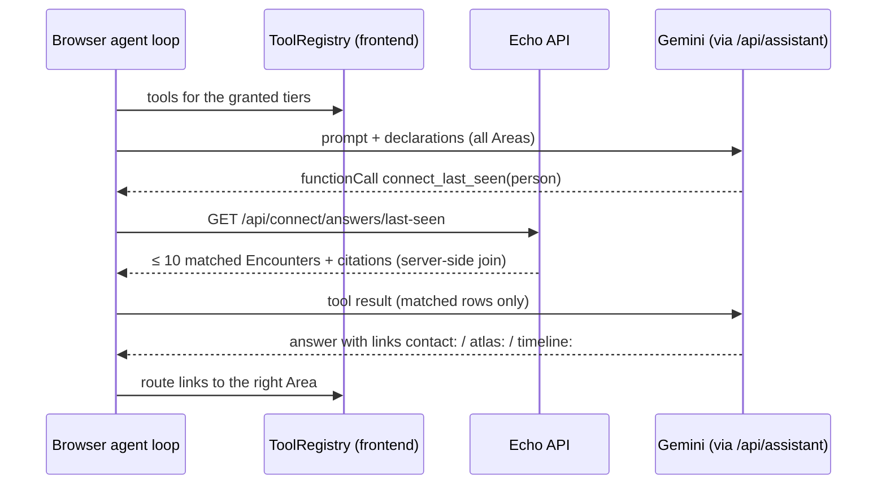
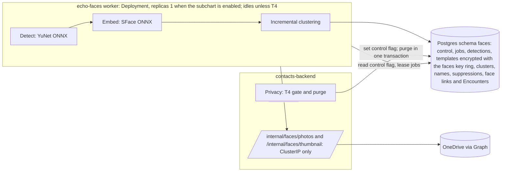
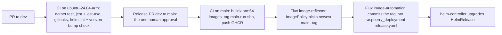
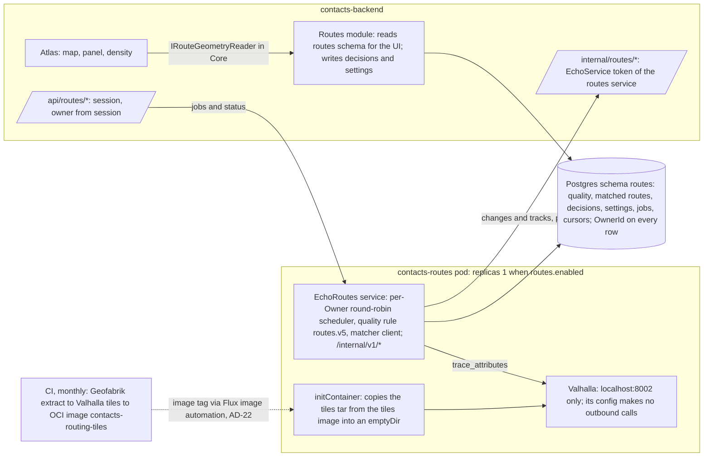

# Architecture: Echo

## 0. How to Read This Document

This is the brownfield architecture for **Echo**, derived from the PRD ([prd.md](prd.md)), its addendum ([prd-addendum.md](prd-addendum.md)), the as-built inventories ([contacts-as-built.md](contacts-as-built.md) and [atlas-as-built.md](atlas-as-built.md)), and a check of the code at `dev @ 1e05abc`. Where this document needed a requirement changed, the change was made in the PRD; the architecture does not narrow a requirement on its own. It does three things:

1. It describes the system **as it is** (§2), so nobody re-decides what the code has already settled.
2. It fixes the **invariants** that every future Echo feature must keep (§3). These are binding.
3. It defines the **target architecture** for the Proposed and Planned requirements (§4, §5).

Every decision is an `AD-n` block. Its **Binds / Prevents / Rule** lines are the contract. **Context / Decision / Alternatives / Consequences** give the ADR record. `[ADOPTED]` means the existing code already settled it, and the decision ratifies it. Where a PRD Open Question blocks a decision, the AD states the **default** chosen and how to **reverse** it. AD ids are stable: amend a Rule in place and never renumber. AD-28 to AD-31 were added after the Owner's answers of 2026-10-28 and sit in the section they belong to, not in id order. AD-32 to AD-36 (route quality) follow them, in §5A.

Echo has **several users** (PRD Q-1, answered 2026-10-28). Each one is **the Owner** (they/them) of their own data, and no user sees another's. The first Owner is also the **admin** (manages the allowlist) and the **operator** (runs the cluster and the system backups). Tenancy is a first-class invariant (AD-28). No secret value appears here. Secrets are named by their Vault path only.

## 1. Design Paradigm

**A modular monolith, layered per module, in which immutable source records feed rebuildable projections.**

- **Modular monolith.** There is one ASP.NET backend process (`ContactsApi`) and one React SPA. Echo grows by adding **modules**, not services: Contacts, Touchpoints, Atlas, Connect, Assistant, Privacy, Platform. There are two exceptions, each a separate process because of its compute and its isolation: the Phase 2 face worker (AD-20), and the route-quality service with its routing engine (AD-33).
- **Layered per module.** Each module keeps the three-project layering the solution already has:

  | Layer | Project | Holds |
  |---|---|---|
  | Domain and integration logic | `ContactsApi.Infrastructure/<Module>/` | entities, DbContext, pure algorithms (fusion, derivation), third-party clients |
  | Host | `ContactsApi.WebApi/` | controllers, hosted workers, MCP tools, middleware, DI wiring |
  | Shared kernel | `ContactsApi.Core/` | exception types and the cross-module interfaces in AD-2 (`ITierGate`, `IOwnerDataContributor`, and so on) |

  In practice, `Core` is thin today and Atlas logic lives in `Infrastructure/Atlas`. This is ratified: new modules follow the Atlas pattern, with no repository or unit-of-work abstractions on top of EF Core.
- **Sources feed projections.** Data flows one way: *Source Records* (imported, never edited) → *Derived projections* (fusion, Person Links, Encounters, Timeline digest, Face Clusters), which can be dropped and rebuilt → read models. The Owner's decisions sit in their own tables and are re-applied on every rebuild (AD-4). This is the pipes-and-filters shape that Atlas fusion already uses, extended to all of Echo.

## 2. The System as Built

*This section is descriptive. It records `dev @ 1e05abc` and the live Flux manifests, and the code owns these facts from here on.*

### 2.1 Context and Deployment


### 2.2 Facts the Architecture Starts From

| Concern | As built |
|---|---|
| Backend | `ContactsApi` on `net9.0`: Core / Infrastructure / WebApi; Swagger at `/`; `/health`; Serilog compact JSON to the console and to files |
| Frontend | WebKit/BlueFiber template running standalone: React 18.3.1, TS 5.7.2 strict, MUI 6, Redux Toolkit 2.4 (Contacts), `useState` in `AtlasHome.tsx` (Atlas), react-router 7, one `BackendApiClient` |
| Shell | `SiteShell` with a rail for `/contacts` and `/atlas`; `/` opens the last Area used |
| Identity | Google OAuth code flow on the server; the `sub` is the Owner id; a 7-day Redis session; `app.UseAuthentication()` is commented out, and each controller resolves the Owner through `GoogleTokenService`; any Google account that completes sign-in gets a session (no allowlist, no roles) |
| Contacts store | Google People API, with no local copy. Per-owner state is in Redis under `refresh-token:`, `optins:`, `activity:` and `self-emails:` keys; dismissals are in localStorage |
| Atlas store | Postgres schema `atlas`: 16 migrations, `OwnerId` on every row, indexes that lead with `OwnerId`, no PostGIS, EF history table `atlas.__ef_migrations`; `AtlasMigrator` applies migrations at startup |
| Workers | `ActivityWorker` (Gmail/Calendar scans, 3 at once); `AtlasFusionWorker` (fusion queue, then idle tasks: photo placement 500 per batch with 400 ms pauses, efforts, place identification); `AtlasSyncWorker` (Sports Tracker); `PhotoSyncWorker` (OneDrive delta every 30 min) |
| Assistant | The agent loop runs in the browser (`assistant/agent.ts`). The backend proxies Gemini (`/api/assistant/generate`, `/search`). Each Area passes its own `Toolset` (`declarations`, `systemPrompt`, `execute`). Rate limits are counted in memory |
| MCP | `/api/mcp`, ModelContextProtocol.AspNetCore 2.3.0, stateless HTTP; `atl_` bearer tokens stored as SHA-256 hashes; Atlas tools only |
| Errors | The `ApiResponse{success, data, error{code, message, details, timestamp}}` envelope from `ExceptionHandlingMiddleware` and from controllers; MCP returns plain 401/503 text |
| Secrets | The Vault Agent Injector renders `secret/data/contacts` into env vars (the HelmRelease sets `vault.enabled: true`; the chart default is `false`, with a K8s Secret as fallback); `VaultConfigurationService` serves local development |
| Encryption at rest | ASP.NET Data Protection protects refresh tokens, the Activity Snapshot, own addresses and source secrets; **the key ring is in the same Redis** (`DataProtection-Keys`) |
| Deployment | Helm umbrella `helm/contacts` 0.4.2. Flux in `raspberry_deployment` tracks branch `main` of this repository. Images `contacts-frontend` and `contacts-backend` on GHCR, tag `latest`, `pullPolicy: Always`, built by hand with `docker buildx` for arm64, then `kubectl rollout restart`. There is no `.github/workflows` |
| Resources | backend 500m CPU / 512Mi; Postgres 500m / 512Mi; Redis 200m / 128Mi. rasp02 has 3.7 GiB of RAM in total and hosts Postgres and Redis `[ASSUMPTION AA-11: node memory and placement come from the live cluster, not from either repository]` |
| Observability | The ConfigMap sets `OTEL_EXPORTER_OTLP_ENDPOINT` and `JAEGER_ENDPOINT` (pointing at another app's namespace), but no OpenTelemetry package is referenced, so the config is dead |
| Degradation | Without a DB connection string, Atlas switches itself off and Contacts keeps working; Redis uses `AbortOnConnectFail=false`; a session-load failure returns 503 `SESSION_STORE_UNAVAILABLE` instead of a sign-out |

## 3. Invariants and Rules

*Every future Echo feature must keep these. A change to any of them is an architecture update, not a story-level call.*

### Module Dependency Direction



An arrow means "may call or reference". There is no reverse edge. In particular, **Atlas, Contacts and Touchpoints never reference Connect**, and the server-side **Assistant** module (the Gemini proxy and its rate limits) references no domain module: the browser agent loop composes the domain tools (AD-17). The **Faces worker** process reaches Echo data only through the backend's `/internal/**` API and its own `faces` tables (AD-20). The **route-quality service** works the same way, with its own `routes` tables (AD-33). **Atlas never references Routes.** It reads the geometry to draw through `IRouteGeometryReader`, which is declared in `Core` and implemented by Routes (AD-34). Where they must notify Connect (a Contact merge, an ingest window), they raise a signal through an interface declared in `Core` that Connect implements (AD-2).

### AD-1 — One backend process; Echo grows by modules [ADOPTED]

- **Binds:** all modules; FR-31 to FR-50; NFR-09, NFR-10.
- **Prevents:** a feature team adding its own service, database or auth path, which would split the Owner's session and identity, and add a third container to a 3.7 GiB node (AA-11).
- **Rule:** New capability is a module inside `ContactsApi`, with its own folder in `Infrastructure/` and controllers or workers in `WebApi/`. A new deployable needs a new AD. Two are sanctioned so far: the face worker (AD-20), and the route-quality service with its routing engine (AD-33).
- *Context:* Contacts and Atlas already share one process, session, shell and Gemini proxy. *Alternatives:* microservices per Area (rejected: memory, auth duplication, no operational benefit at a handful of users). *Consequences:* one release unit; a heavy feature competes for the same 500m CPU, which AD-8 governs.

### AD-2 — Module boundaries and cross-module contracts

- **Binds:** Contacts, Touchpoints, Atlas, Connect, Assistant, Privacy, Platform, Faces; FR-28, FR-31, FR-33, FR-38, FR-39, FR-47 to FR-49.
- **Prevents:** Connect reaching into `AtlasDbContext` internals and breaking with every Atlas migration; Atlas growing references to people; two modules each owning a table.
- **Rule:** Each table is owned by exactly one module and lives in that module's schema (AD-10). Another module reads it only through the owning module's service (for example `AtlasService` query methods), never through the other module's DbContext. Notifications that run against the dependency arrow go through interfaces in `ContactsApi.Core`: `IContactMergeListener`, `IIngestWindowListener` and `ITierRevocationHandler`. Every module that stores owner data implements `IOwnerDataContributor` (export and erase, AD-19).
  - The **Assistant** module owns `GeminiService`, `/api/assistant/*` and the rate-limit counters. It is a pass-through: it never calls another module to fetch data for the model. Domain data reaches Gemini only as tool results the browser fetched from the owning module's API (AD-17).
  - The **Faces** module owns the `faces` schema (AD-20). Connect reads face evidence only through `IFaceEvidenceReader` (declared in `Core`, implemented by Faces), which returns nothing unless T4 is granted.
- *Alternatives:* a shared single DbContext (rejected: it couples migrations and blocks dropping the `faces` schema whole). *Consequences:* Connect reads Atlas through query methods that are added to `AtlasService` as needed. Joins across schemas are done in C# over time windows that each module can bound.

### AD-3 — Owner scoping and authentication on every path [ADOPTED for scoping]

- **Binds:** every table, query, worker, REST route, Assistant tool and MCP tool; NFR-07, NFR-16; FR-01, FR-29, FR-32.
- **Prevents:** a query or tool that trusts an owner id from a request body or tool argument; a new route left unauthenticated.
- **Rule:**
  1. Every stored row carries `OwnerId` (the Google `sub`), and every index leads with it.
  2. The Owner is resolved **only** from the session (REST) or from the token (MCP), never from input.
  3. In Phase 0, authentication becomes middleware. Two schemes are registered, `EchoSession` (the Redis session cookie) and `EchoPat` (the `atl_` bearer token), and `app.UseAuthentication()` and `UseAuthorization()` are enabled. The first internal service to ship adds a third scheme, `EchoService`: that is the route-quality service in Phase R1 (AD-33), or the face worker in Phase 2 (AD-20). Each service has its own token, so a token identifies the service that calls. A service token never identifies an Owner: the backend puts the `ownerId` on each request from the session or PAT (rule 2), and the service passes it back on every call (AD-28). A **fallback policy requires an authenticated principal** on `/api/**` **and** `/internal/**`. Only `api/auth/*`, `/health` and the legal pages are marked `[AllowAnonymous]`; nothing under `/internal/**` ever is. The `EchoPat` scheme is accepted only on `/api/mcp`. `/internal/**` accepts only `EchoService`, and `EchoService` is accepted nowhere else. A test enumerates every endpoint and fails if one under `/api/**` or `/internal/**` lacks a policy.
  4. A test fixture with two Owners proves that neither a session nor a token can read or change the other Owner's rows, and that the `EchoAdmin` policy (AD-29) reads no Owner's data. It runs for every module, route, MCP tool, worker queue and cache (AD-28). It is a **hard gate** (NFR-07): it runs on every PR, blocks the merge on a failure, and must pass before any user other than the first Owner is allowlisted.
- *Context:* today the scoping is correct, but it is enforced per controller by hand. *Alternatives:* keep the per-controller helpers (rejected: a new route can silently skip them). *Consequences:* `GoogleTokenService.UserIdKey` becomes a claim; MCP owner resolution moves from inline middleware into the `EchoPat` handler.

### AD-4 — Three data tiers: Source, Derived, Decision [ADOPTED for fusion]

- **Binds:** Atlas fusion, Person Links, Encounters, address matches, the Timeline digest, Face Clusters; P-1, P-5; FR-19, FR-20, FR-33 to FR-36, FR-44; NFR-12.
- **Prevents:** a derivation that edits a source record; an Owner decision lost on rebuild because it was stored as a flag on a derived row.
- **Rule:**
  - **Source** tables are written only by import, sync or an Owner edit of that record. Derivations never update them.
  - **Derived** tables are written only by the derivation worker (AD-15). Each one can be truncated per Owner and rebuilt from Sources plus Decisions with an identical result, apart from evidence timestamps.
  - **Decision** tables (`fusion_decisions`, `person_link_decisions`, `encounter_decisions`, `address_match_decisions`, owner-created Encounters, face cluster names and suppressions) are keyed by **natural keys** (resourceName, identifier hash, anchor kind and anchor id), never by a derived row's surrogate id. They are re-applied on every run.
  - Each derived row records the `rule_version` that produced it.
- *Alternatives:* status columns on derived rows (rejected: they are lost when the rows are rebuilt). *Consequences:* "Rebuild all" is always safe. It is a Privacy and debugging tool as well as a recovery path.

### AD-5 — Proposals and etags; Echo-derived data never enters Google [ADOPTED]

- **Binds:** Contacts writes, the Assistant, enrichment, Connect (FR-36, FR-37), MCP; P-2, P-3; FR-05, FR-10, FR-15, FR-28; SM-C4.
- **Prevents:** a silent overwrite of a Contact; Person Links or Encounters written into Google custom fields, which would then sync to the phone.
- **Rule:**
  - Every write to Google People goes through `ContactsController` with the etag the Owner saw. A 412 becomes `CONTACT_CONFLICT` and is never retried with a fresh etag without the Owner seeing it.
  - The Assistant, enrichment and Connect produce **Proposals** (a diff plus the base etag) that only the Owner applies.
  - Echo-derived data (links, Encounters, matches, clusters) is stored only in Echo's Postgres.
  - MCP direct writes are allowed **only** on the `atlas` schema (the P-3 exception). MCP tools for people and Connect are read-only (AD-18).
- *Consequences:* FR-37 ("write my home address") goes through the same Proposal apply path as an Assistant change.

### AD-6 — One tier gate decides what Echo may read

- **Binds:** T1 to T4, the background place-lookup switch and the address-lookup switch; every reader of tier-gated data: workers, REST, the Timeline, Assistant tools, MCP, export; FR-31, FR-40, FR-43, FR-46, FR-47; P-6.
- **Prevents:** a Connect join or a Timeline row that shows T1 or T4 data after revocation; each feature keeping its own opt-in flag (today `optins:` in Redis plus scope checks).
- **Rule:**
  - `ITierGate` (implemented in the Privacy module, backed by `privacy.tier_state`) is the only authority on whether a tier is granted.
  - Every tier-gated read checks it **at read time**, as well as at derivation time. Items from a tier that is not granted are **omitted**, not masked. An endpoint that needs a missing tier returns 403 `TIER_NOT_GRANTED` with the tier in `details`.
  - Revoking a tier calls every registered `ITierRevocationHandler` for that tier, synchronously, before the revocation is reported as done (AD-19).
  - Google scope checks stay as a second line of defence, not the first.
- *Consequences:* a derived row can briefly outlive its tier until the purge finishes, but it is never served.

### AD-7 — Third-party egress is registered, counted and switchable

- **Binds:** every outbound call to a third party: Google APIs, Gemini, Nominatim, Photon, Overpass, Microsoft Graph, Sports Tracker and any future source; PRD §5.2; FR-47; NFR-11; SM-C3.
- **Prevents:** a new feature adding an unlisted third party or sending new kinds of data; a Privacy Center whose counts miss a path.
- **Rule:**
  - Server-side egress uses **named `HttpClient`s registered in the Platform egress registry** (`EgressParty`: id, purpose, data kinds, tier, kill-switch key). Each one carries a `DisclosureCountingHandler` that increments `privacy.disclosure_counters` (owner, party, kind, UTC day, calls, Gemini tokens) and refuses when its tier or switch is off.
  - The browser talks to third parties directly only for map tiles, which are listed in the register.
  - Adding a party, or a new data kind sent to an existing party, needs a registry entry **and** an update to PRD §5.2 in the same PR.
  - Face data (detections, templates, cluster centroids) is never placed in a payload to any registered party (AD-20).
- *Consequences:* the existing named clients (`gemini`, Sports Tracker, OneDrive, `GeoLookupClient`) are wrapped, with no change in behaviour. A process that needs no third party, such as the routing engine (AD-32), gets no registry entry; its pod's network policy allows egress only to in-cluster peers and DNS. The background-lookup switch (FR-47) is the kill-switch of the place-identification idle task.

### AD-8 — The Raspberry Pi resource envelope [ADOPTED]

- **Binds:** all workers and queries, the Timeline, derivation, faces; NFR-09, NFR-10; the PRD risk "Pi capacity".
- **Prevents:** a background job that starves interactive requests; a design that assumes PostGIS, a GPU or more memory.
- **Rule:**
  - No PostGIS and no Postgres extensions beyond core. Use bounding-box and `(OwnerId, Lat, Lon)` index pre-filters with exact distance in C#, as `Geo.cs` does.
  - Background work runs in **bounded batches with pauses** (the reference is 500 items with 400 ms pauses). It is single-flight per Owner, resumable from persisted progress, shared **round-robin across Owners** (AD-30), and yields while an interactive request for any Owner is in flight.
  - Echo is sized for **a handful of users** (PRD A-10, default allowlist maximum 10). Adding users beyond that is an architecture update, not an allowlist edit.
  - Every list endpoint and tool has a hard cap (§6).
  - Compute that needs more than 256 MiB of working set, or minutes of CPU per item, runs outside the API pod (AD-20).
  - Every new pod declares requests and limits and fits the node budget recorded in `raspberry_deployment`.
- *Consequences:* first passes take hours or days (A-4). This is accepted and made visible through the job board (AD-25).

### AD-9 — One error envelope and code vocabulary [ADOPTED]

- **Binds:** all REST endpoints, new and old; frontend error handling; NFR-10.
- **Prevents:** Connect or Privacy returning ProblemDetails or bare strings that the shared `BackendApiClient` cannot handle.
- **Rule:**
  - REST answers use `ApiResponse<T>` `{success, data, error{code, message, details, timestamp}}`.
  - Codes are `UPPER_SNAKE`, unique across modules, and documented beside the existing ones.
  - New codes: `TIER_NOT_GRANTED` (403), `DECISION_CONFLICT` (409, a decision made against a stale derived state), `EXPORT_IN_PROGRESS` (409), `FACES_DISABLED` (403), `DERIVATION_NOT_READY` (503), `NOT_INVITED` (403, sign-in by an account not on the allowlist, AD-29), `USER_CAP_REACHED` (409, the allowlist maximum, AD-29), `OWNER_QUOTA_EXCEEDED` (429, a per-Owner cap, AD-30), `ROUTES_UNAVAILABLE` (503, the route-quality service cannot be reached, AD-33).
  - MCP keeps MCP-native tool errors, with the same code strings in the message text.
  - Unavailability is 503 with `Retry-After`, never a sign-out.

### AD-10 — Postgres is the only durable store; one schema per module; Redis can be lost

- **Binds:** all Owner state; NFR-04, NFR-05, NFR-12; FR-12, FR-13, FR-33 to FR-49.
- **Prevents:** new durable state put in Redis or localStorage again; cross-module foreign keys that block a per-schema purge.
- **Rule:**
  - Durable Owner state lives in Postgres, in the owning module's schema: `atlas` (as is), `people` (Contacts and Touchpoints state), `connect`, `privacy`, `platform`, `faces` (Phase 2) and `routes` (Phase R1, AD-34).
  - Each schema has its **own DbContext and migration history table** in that schema. A generalised startup migrator (`EchoMigrator`, the successor of `AtlasMigrator`) applies them in a fixed order. There are no foreign keys across schemas; references are plain id columns, as `photos.ActivityId` already is.
  - Redis holds only the session, short caches, rate-limit counters and the read mirror of the Data Protection key ring (AD-12). Losing it costs at most a sign-in.
  - localStorage holds only UI preferences.
- *Context:* the refresh tokens, opt-ins, Activity Snapshot and own addresses exist only in Redis, with expiries; dismissals exist only in localStorage. *Alternatives:* Redis with persistence (AOF) as the system of record (rejected: no backup story, no queries, a single local-path PVC); one shared `echo` schema (rejected: blocks the atomic purge of `faces`, and blurs ownership). *Consequences:* see the migration plan in §4.4. If Postgres is down, Contacts still runs (sign-in included, because the key ring is mirrored, AD-12), but Touchpoints, Connect, Atlas and the Assistant's people tools answer 503. The PRD's NFR-10 states this behaviour as test (a); §4.4 gives the mechanism.

### AD-11 — Sensitive text about other people is encrypted, with blind indexes for lookup

- **Binds:** the `people`, `connect` and `faces` schemas; NFR-08; FR-12, FR-33, FR-34, FR-36, FR-44.
- **Prevents:** plain-text email addresses, names, event titles, locations or postal addresses of third parties sitting in a Postgres dump; each module inventing its own crypto.
- **Rule:**
  - Columns holding third-party PII text (email addresses, display names, calendar titles and locations, postal addresses, evidence snippets) and all secrets are stored **encrypted with a Data Protection protector** whose purpose names the module and column, for example `Echo.Connect.PersonLinks.Value.v1`.
  - Equality lookup uses a separate **blind-index column**: HMAC-SHA256 over the normalised value, keyed from Vault (`secret/data/contacts`, key `Echo__BlindIndexKey`).
  - Face templates are encrypted the same way, but with the separate faces key ring (AD-20), never the main one.
  - Times, coordinates, ids, counts and confidences stay in plain form so they can be queried.
  - The `atlas` schema stays as it is: it holds the Owner's own movements, and its secrets are already protected.
- *Consequences:* joins on an email address are equality joins on the blind index. "Contains" search over these columns happens in memory after a time-bounded fetch, which is acceptable at the Owner's scale.

### AD-12 — The Data Protection key ring lives apart from the data, protected by Vault

- **Binds:** Platform; NFR-08, NFR-05, NFR-10; every encrypted column; the session and OAuth cookies.
- **Prevents:** a single Redis loss making every encrypted value unreadable; keys stored in plain form beside the data they protect; a Postgres outage taking Contacts sign-in down with it.
- **Rule:**
  - **Record.** Keys are persisted to Postgres `platform.data_protection_keys` and **wrapped with `ProtectKeysWithCertificate`**, using an X.509 certificate held in Vault (`secret/data/contacts`, key `DataProtection__Certificate`) and injected as a file.
  - **Mirror.** A composite `IXmlRepository` (`MirroredKeyRepository`) also writes every wrapped key to Redis (`DataProtection-Keys`, the key it uses today, no expiry). Reads go to Postgres first and fall back to the Redis mirror when Postgres is unreachable. A new key is written to Postgres first and to Redis second, so a key never exists only in Redis. At start, and after Postgres comes back, the mirror is reconciled from Postgres.
  - **No key creation without the record.** If Postgres is unreachable when Data Protection wants a new key, the write fails, the current key stays in use (Data Protection creates keys about two days before expiry and retries), and a `job_runs` error is raised. Keys are never minted into Redis alone.
  - The application name `ContactsApi` is kept, so existing ciphertext stays readable.
  - Before cut-over, a one-shot migration copies the existing keys out of Redis into Postgres and wraps them.
  - Backups contain the wrapped keys. A restore therefore needs Vault's copy of the certificate, and that certificate is kept in Vault's own backup.
  - Only the API process reads this ring. The face worker has its own ring (AD-20).
- **Failure modes (explicit):**

  | State at backend start or during operation | Key ring from | Result |
  |---|---|---|
  | Postgres up, Redis up | Postgres | normal |
  | Postgres down, Redis up | Redis mirror | session and OAuth cookies readable; Contacts sign-in, browse and edit work (NFR-10 a); Postgres-backed modules answer 503 |
  | Postgres up, Redis lost | Postgres | sessions lost, so the Owner signs in again; mirror rebuilt; no data lost |
  | Postgres down, Redis lost or emptied | none | Echo down: `/health` reports not ready and the SPA shows "unavailable"; recovers when Postgres returns (NFR-10 d). Contacts needs Redis for its session anyway, so it was down regardless |
  | Vault sealed | n/a | the pod does not start (Vault Agent init); this is the one manual step NFR-10 c allows |
- *Alternatives:*
  - Postgres only (rejected: a backend started during a Postgres outage cannot read any cookie, so Contacts goes down with the database, which breaks NFR-10).
  - A Vault KV-backed key ring (rejected for now: the app would need its own Vault write credentials at runtime instead of the injector's read-only rendering; reconsider with Vault Transit).
  - A K8s Secret volume or file-backed ring (rejected: keys could not roll, and a file on a local-path PVC pins the backend to one node).
  - Vault Transit (rejected for now: no transit engine is set up; reconsider if one is).
- *Consequences:* losing Redis no longer loses data, and losing Postgres no longer stops Contacts. Losing the Vault certificate loses data, so the Vault backup becomes part of NFR-05. The Redis mirror holds only wrapped keys, which are useless without the Vault certificate (NFR-08 holds).

### AD-28 — Tenancy is a first-class invariant: everything is scoped to one Owner

- **Binds:** every table, Redis key, worker queue, cache, MCP token, Assistant tool, file, log line and backup; every module; NFR-07, NFR-08; FR-01, FR-44, FR-46 to FR-49, FR-51; PRD §2.2 (Q-1).
- **Prevents:** one Owner's data reaching another through a shared cache, a queue item processed under the wrong owner, a geocode or name cache keyed only by its input, a face template compared across Owners, or a file or export that mixes Owners.
- **Rule:**
  - **Tables.** Every table that holds user data has `OwnerId` (AD-3). The only tables without it are **system tables**, listed here and nowhere else: `platform.data_protection_keys`, `faces.data_protection_keys`, `platform.allowlist` and `platform.user_roles` (AD-29), and the EF history tables. A test fails if any other entity lacks `OwnerId`.
  - **Redis.** Every key that holds user data starts with `echo:{OwnerId-hash}:` (sessions, rate-limit counters, name cache, any future cache). Purging an Owner is a prefix scan. Only the Data Protection mirror is unscoped.
  - **Queues and jobs.** Every queue item and job (`fusion_queue`, `connect.derivation_queue`, `faces.jobs`, `routes.jobs`, Touchpoints scans, source syncs) carries `OwnerId`, and the worker sets the ambient owner from the item, never from a previous item. A worker never holds two Owners' data in one batch.
  - **Caches.** Caches are per Owner even where the input looks neutral: `connect.geocode_cache` is keyed by (OwnerId, text blind index), so one Owner's lookups never reveal another's addresses.
  - **Tokens and grants.** PATs, Google grants, Microsoft grants and Sports Tracker sessions are per Owner and resolve to exactly that Owner (AD-3, AD-18).
  - **Faces.** Clustering and matching run over one Owner's templates at a time. No query or job compares templates across Owners (AD-20).
  - **Files.** Exports are streamed per Owner (AD-19). No user data is written to shared disk.
  - **Backups** are system-level: one encrypted dump holds every Owner's data (AD-24). A restore is all-or-nothing, and re-applies every Owner's consent ledger and erase receipts before serving (AD-24).
  - **Logs** carry the Owner id hashed, never in clear (§6).
  - **Admin is not an Owner role.** The admin role (AD-29) manages the allowlist and reads usage counters. It never reads another Owner's rows.
- *Context:* the code is already scoped per `sub` (AD-3), but with one Owner a leak had nowhere to go. *Alternatives:* a schema or a database per Owner (rejected: migrations multiply and the Pi's memory does not allow it at a handful of users; row scoping plus the hard-gate tests suffices); Postgres row-level security (deferred: a second line of defence worth adding if a leak is ever found, but EF Core with one app role does not need it to pass NFR-07). *Consequences:* a shared cache that is "obviously harmless" still needs the owner prefix.

### AD-30 — Per-Owner fairness and caps in workers and egress

- **Binds:** every hosted worker and idle task, the face worker, the route-quality service (AD-36), the egress registry (AD-7), `GeminiService`; NFR-09, NFR-11, NFR-18, NFR-21; FR-28, FR-52, FR-57.
- **Prevents:** one Owner's first photo pass or full re-fusion starving everyone else on the Pi; one Owner using up the global Nominatim rate or the global Gemini cap.
- **Rule:**
  - **Round-robin.** Each worker keeps one queue per Owner and takes **one bounded batch per Owner per turn**, in round-robin order (the AD-8 batch size and pauses). An Owner with a large backlog gets no more than one batch per turn. A newly queued Owner is served on the next turn, which keeps a new import's start under 5 min (NFR-18).
  - **Concurrency.** Touchpoints scans stay at 3 concurrent overall, at most 1 per Owner.
  - **Caps.** Gemini (as today) and geocoder lookups have **per-Owner** per-minute and per-day caps, plus a global daily cap, counted in Redis under the owner prefix (AD-28) so they survive a pod restart. A cap returns `OWNER_QUOTA_EXCEEDED` (429) to that Owner only.
  - **Shared rate.** The global Nominatim limit of 1 req/s is a single token bucket shared round-robin across Owners, so one Owner's backlog cannot hold it.
  - **Scheduled syncs** (OneDrive every 30 min, Sports Tracker every 6 h, FR-52) are spread across Owners with jitter, not fired together.
  - The admin page shows each Owner's queue depth and usage against caps (AD-29), not their data.

## 4. Target Echo Architecture

### 4.1 Connect Layer (Phase 1)



`CONTACT_GOOGLE` is the Google People record. It is not stored (P-1). `CALENDAR_EVENT` and `EVENT_ATTENDEE` belong to the `people` schema (Touchpoints). The `ATLAS_*` entities belong to `atlas`. Everything else is in `connect`.

### AD-13 — A Person is anchored on the Contact's resourceName; Person Links follow merges

- **Binds:** Connect; FR-10, FR-33, FR-38, FR-39, FR-41; P-5, P-8; NFR-13.
- **Prevents:** a second "person" id space that drifts from Google; links orphaned by a merge; a twin pair counted as two people.
- **Rule:**
  - The **Person id is the primary Contact's `resourceName`**. `connect.person_links` holds (OwnerId, resourceName, kind ∈ `email | attendee | contact`, value encrypted + blind index, status ∈ `confirmed | proposed`, evidence JSON, rule_version). Links of kind `face_cluster` have the same shape but live in `faces.person_links` (AD-14, AD-20).
  - A `contact` link joins an unmerged Hebrew/English twin to the primary (P-8).
  - Rejections live in `person_link_decisions`, keyed by (OwnerId, resourceName, kind, value blind index), and suppress the proposal for ever.
  - Links that follow from the Contact's own fields are re-derived as `confirmed`. Name matches reuse `Activity/NameMatcher` (bilingual) and are only ever `proposed`.
  - **Merge:** after Google confirms a merge, `ContactsController.merge` calls `IContactMergeListener`. Connect then re-points links, decisions, owner-created Encounters and address matches from the deleted resourceNames to the kept one, in one transaction. The re-point is idempotent.
  - **Deletion outside Echo:** a People API sync token detects deleted resourceNames on the next derivation run. Their links are removed, and their decisions are kept for 30 days in case of a restore, then removed.
  - Connect never persists Contact fields. It reads the Contacts it needs through People API at derivation time (with the stored refresh token) and keeps them in memory.

### AD-14 — Calendar events are stored under T1; Encounters come from a deterministic, versioned rule

- **Binds:** Touchpoints (`ActivityWorker`), Connect; FR-12, FR-34, FR-35, FR-36, FR-41, FR-42, FR-47 (address lookup); PRD §5.2; P-4, P-6, P-9; SM-2, SM-3; A-7, A-8.
- **Prevents:** Encounters that cannot be explained; thresholds that differ between the Assistant and the UI; rejected Encounters coming back.
- **Rule:**
  - **Events.** `ActivityWorker` persists the calendar events it already reads to `people.calendar_events`: event id, start and end, status, the Owner's response, title and location (encrypted), plus `people.calendar_event_attendees` (blind-indexed emails). Rows are written only while T1 is granted, cover the same 365-day window, and are purged on T1 revocation. Reading all calendars (FR-16) only adds rows.
  - **Rule `encounter.v1`** (defaults from A-8, held per Owner in `connect.settings` JSON, editable like fusion settings):
    - candidate = event with an attendee who has a Person Link × an Atlas Visit or Fused Activity;
    - overlap ≥ 50% of the shorter interval;
    - declined or cancelled events are excluded;
    - if the event has a location **and the address-lookup switch is on**, the location text is geocoded once (cached in `connect.geocode_cache` through the registered Nominatim client) and must be ≤ 500 m from the Visit or track. With the switch off, or when geocoding finds nothing, the event is treated as having no location;
    - confidence = time agreement × location agreement, as in fusion; it is capped at 0.6 with no location; nothing is stored below 0.5;
    - a confirmed address match (FR-36) adds `address_match` evidence.
  - **Address matches (FR-36), rule `address.v1`.** Runs only while the address-lookup switch is on. Each postal address of a Contact (read through People API at derivation time, never stored in plain text, AD-11) is geocoded through the same cached Nominatim client. A match is proposed when the geocoded point is **≤ 100 m** from a Place (default, editable in `connect.settings`), and only the nearest Place within that radius is proposed. Places the Owner typically stays at for 6 h or more (their home and work) are never proposed for another person. Matches go to `connect.address_matches` as `proposed`, and `address_match_decisions` (keyed by OwnerId, resourceName, address blind index, Place id) holds confirm and reject.
  - **Address lookup switch (PRD FR-47, §5.2).** It is an entry in the consent ledger (AD-19), **off by default**. The Nominatim registry entry (AD-7) lists three data kinds: `coordinates` (background place lookup, its own switch), `event_location_text` and `postal_address_text` (both behind address lookup; event locations also need T1). Turning it off stops new lookups at once; cached geocodes for free text are deleted, and derived rows that used them are rebuilt without location evidence.
  - **Anchor key.** Each Encounter is keyed by (OwnerId, resourceName, anchor kind, anchor id). The anchor kinds are `calendar_event`, `visit` (address evidence, or an Owner attachment to a Visit), `activity` (an Owner attachment to an Activity, FR-35), `day` (an Owner attachment to a day, anchor id = the local date `yyyy-mm-dd`, FR-35) and, in Phase 2, `photo`. `encounter_decisions` uses the same key, so a confirm or reject survives a rebuild.
  - **Origins and evidence kinds** (one list, used by the addendum and §6): `origin` ∈ `derived | owner`; evidence kinds ∈ `calendar_event | visit | activity | address_match | photo_face`. A "face-only" Encounter is a `derived` one whose only evidence kind is `photo_face`.
  - **Owner-created Encounters** (FR-35) are decision-tier rows with `origin = owner`, anchored on an Activity, a Visit or a day. They are never touched by derivation.
  - **Face evidence stays in `faces`.** No row in `connect` holds face evidence. `face_cluster` Person Links, Encounters with any `photo_face` evidence, and the Owner's decisions on them live in `faces.person_links`, `faces.encounters` and `faces.encounter_decisions`, in the same shapes and with the same keys as their `connect` counterparts. Connect's read APIs, the Timeline digest builder and the answer endpoints merge them in through `IFaceEvidenceReader` (AD-2) only while T4 is granted. A calendar-anchored Encounter in `connect` and a photo-anchored one in `faces` for the same Person and overlapping time are shown together under "Why?". This keeps the whole face footprint in the schema that backups exclude (AD-20, AD-24).
  - **Tiers.** Each Encounter stores the set of tiers its evidence needs (calendar → T1, Visit or Activity → T3, Photo face → T4; address evidence also needs the address-lookup switch). Owner-created Encounters need T0 only. Tier revocation removes an Encounter whose remaining evidence no longer meets its threshold, and the read path hides it at once (AD-6).
  - **Disagreeing evidence** is stored in `conflicts` JSON and shown under "Why?" (FR-42).
  - **What answers may cite:** confirmed Encounters, and derived ones labelled "likely". Rejected Encounters are never cited.
  - Changing the rule bumps `rule_version` and queues a full rebuild.

### AD-15 — One derivation worker runs all projections, in order

- **Binds:** `AtlasFusionWorker` (renamed `DerivationWorker`), Connect, the Timeline; NFR-09, NFR-12, NFR-14; FR-19, FR-27, FR-33, FR-34, FR-36, FR-40.
- **Prevents:** several hosted workers racing over the same Owner's data and the same CPU; Connect derivation reading half-fused Atlas data.
- **Rule:**
  - One hosted worker drains per-Owner queues, round-robin across Owners (AD-30). `fusion_queue` stays as it is, and `connect.derivation_queue` holds time windows plus a `full` flag, with backoff.
  - When idle, it runs the registered `IIdleTask`s in a fixed order: fusion → source clock calibration (AD-31) → photo clock and placement → efforts → place identification (gated by the AD-7 switch) → **Person Links → address matches → Encounters → Timeline digest**.
  - Producers enqueue windows through `IIngestWindowListener`: Atlas ingest, a OneDrive sync, a Touchpoints scan or refresh, a decision, or a settings change.
  - Each task follows AD-8 (batches, pauses, progress) and publishes to the job board (AD-25).
  - Fusion for a window always completes before Connect derives over it.

### 4.2 Unified Timeline (Phase 1)

### AD-16 — The Unified Timeline is a per-day digest, filtered by tier when it is read

- **Binds:** Connect (owner of `connect.timeline_days`), the Timeline Area, the Assistant and MCP timeline tools; FR-40, FR-38, FR-39; NFR-09; Q-6.
- **Prevents:** a `UNION` over seven tables per request on the Pi; a cached day that still shows data from a revoked tier.
- **Rule:**
  - `connect.timeline_days` holds (OwnerId, local_date, items JSON, built_at, rule_version). Each item has: kind, start and end, source module, source id, **tier**, and resourceNames. Names are not stored. Item kinds: Activity, Visit, Encounter, meeting, email-touchpoint aggregate, photo group, health highlight.
  - Email touchpoints are a **count per Person per day**. Message rows are never stored (Q-6, answered 2026-10-28: the Owner chose the count).
  - Days are cut in the Owner's configured time zone, default `Asia/Jerusalem`, stored in `connect.settings`.
  - The worker rebuilds the days touched by each queued window.
  - `GET /api/timeline/days?from&to&person&place&type&area` (≤ 31 days per call) reads the digest, **drops items whose tier is not granted now** (AD-6), and resolves names from the client's loaded Contacts or from a short Redis cache.
  - **Name cache.** Key `echo:{OwnerId-hash}:names:{resourceName}` (AD-28 prefix), value = display name and phonetic name only, **encrypted with the protector `Echo.Connect.NameCache.v1`** (AD-11: third-party names are never stored in plain text, Redis included), **TTL 15 minutes**, no sliding. It is a cache only (AD-10): a miss reads People API. It is purged per Owner on sign-out, on T0 revocation and by erase (AD-19), and it is never exported.
  - Detail views are fetched from the owning Area's API.
- *Alternatives:* a `UNION` query with time paging (rejected under NFR-09); a SQL materialised view (rejected: a full refresh, no per-day rebuild). *Consequences:* the Timeline lags ingest by one worker cycle (≤ 5 min idle wake), and shows "building" through `DERIVATION_NOT_READY` until a day exists.

### 4.3 One Assistant and MCP (Phase 1)



### AD-17 — One Assistant: a frontend tool registry, with Connect joins done on the server

- **Binds:** `assistant/agent.ts`, every Area's toolset, Connect answer endpoints, `GeminiService`; FR-28, FR-31, FR-41, FR-42; NFR-11; P-3, P-4; Q-5; SM-C3.
- **Prevents:** Gemini receiving bulk lists of people with places; Areas each building their own Assistant; links that open the wrong Area; the token budget growing without anyone noticing.
- **Rule:**
  - The agent loop stays in the browser [ADOPTED]. A **`ToolRegistry`** composes `Toolset`s from every Area: contacts, `atlasToolset`, and new `connectToolset` and `timelineToolset`. Each tool registers its name (prefixed by Area), its tier, its declaration and `execute`. Tools whose tier is not granted are left out of the declarations, and the system prompt states which tiers are missing, so the model says so rather than working around it.
  - **Connect tools execute on the server.** `/api/connect/answers/*` (last-seen, who-was-at, where-with) does the join and returns **at most 10 matched records with citations** (record kind, id, confidence, status). These endpoints never return lists that pair people with places beyond the matched rows. With no evidence, they return the nearest touchpoint instead (FR-41).
  - Contacts tools that run outside `/contacts` lazily load the Redux contacts slice.
  - **Links** use one scheme, routed by a single `linkRouter`: `contact:<resourceName>`, `atlas:activity/<id>`, `atlas:place/<id>`, `atlas:visit/<id>`, `timeline:<yyyy-mm-dd>`.
  - Writes remain Proposals (AD-5).
  - The Gemini disclosure text is extended per FR-31.
  - **Per-Owner switch (Q-5).** `connect_*` tools read the Owner's "Let Gemini word answers about people and places" entry in the consent ledger (AD-19, default on). With it off, the tool result is rendered in the UI as plain cards with citations and is **not** returned to the model; the model receives only "results shown to the user".
  - The Gemini rate-limit counters move from memory to Redis, per Owner (AD-30), so they survive a pod restart.
  - A unit test fails if the serialised declarations of the composed registry are larger than 2× the largest single-Area toolset at `1e05abc` (a proxy for NFR-11). The real per-question tokens are recorded in `privacy.disclosure_counters`.
- *Alternatives:* moving the agent loop to the server (deferred: larger change, no requirement needs it yet); router-selected tool subsets per question (deferred until the 2× budget is breached). *Q-5 (answered 2026-10-28):* the model sees matched results only, and each Owner can switch that off (plain cards, above).

### AD-18 — MCP tokens carry scopes; people and Connect are read-only over MCP

- **Binds:** `access_tokens`, the `EchoPat` scheme, MCP tool classes; FR-29, FR-32, FR-41; NFR-16.
- **Prevents:** an Atlas-only token reading people; MCP writing to Contacts with no Proposal review; face data reaching an external AI.
- **Rule:**
  - `atlas.access_tokens` gains `Scopes` (`atlas`, `people`). Existing tokens migrate to `atlas`.
  - MCP tools are split into classes per module: `AtlasMcpTools` (as is), plus `PeopleMcpTools` and `TimelineMcpTools`, which are read-only. Each tool checks its scope **and** `ITierGate`.
  - People tools mint Google access from the Owner's stored refresh token (now in Postgres, §4.4). If none exists, they answer `TIER_NOT_GRANTED`.
  - MCP never returns face boxes, templates or cluster data. A face-evidenced Encounter cites only the photo id.
  - Remote clients still pass Cloudflare Access. `[ASSUMPTION AA-10: the Access policy is configured in Cloudflare and is not visible in either repository; PRD A-9.]`

### 4.4 Contacts State Moves from Redis to Postgres (Phase 0)

This applies AD-10 and AD-11 to the existing state. The shapes are kept, so the change is a storage swap behind the existing services (`GoogleTokenService`, `ScopePreferences`, `ActivityStore`).

| Today (Redis or browser) | Target (`people` / `privacy`) | Encrypted |
|---|---|---|
| `refresh-token:{sub}` (180 d sliding) | `people.google_grants` (refresh token, granted scopes, updated_at); no expiry, deleted on revoke | yes |
| `optins:{sub}` (365 d) | `privacy.tier_state` + `privacy.consent_events` (AD-19) | no (contains no PII) |
| `activity:{sub}` (90 d sliding) | `people.activity_snapshots` (one encrypted JSON blob per Owner, same `ActivitySnapshot` shape) | yes |
| `self-emails:{sub}` | `people.own_addresses` (value + blind index) | yes |
| dismissals (localStorage) | `people.dismissals` (kind, key blind index, until) | key only |
| session | stays in Redis | n/a |

- **Cut-over.** On first read, a service that finds no Postgres row copies the Redis value (lazy migration). After one release with no reads from Redis, the Redis paths are removed.
- **Degradation (PRD NFR-10 test a).** Contacts browsing and editing need only Google, the session (Redis) and the key ring, which is mirrored in Redis (AD-12). If Postgres is down:
  - Cookies stay readable, so existing sessions continue and a new sign-in completes.
  - The refresh token cannot be read or written, so silent refresh fails. When the session's Google access token expires (about hourly), the backend sends the Owner to sign in again instead of returning an error. The OAuth callback tolerates a failed refresh-token write: it logs it, raises a `job_runs` error and completes a session-only sign-in. The next sign-in after Postgres returns stores the token.
  - Contacts browsing and editing need only T0, which every signed-in session has, so they do not consult `privacy.tier_state`. Features that need T1 or above answer 503 while it is unreachable.
  - Touchpoints, Connect, the Timeline, Privacy and Atlas answer 503 `DERIVATION_NOT_READY` or `ATLAS_NOT_READY` with `Retry-After`, and the SPA shows "temporarily unavailable". The Owner is never signed out by a 503 (AD-9).
  - This is exactly what the PRD's NFR-10 now requires (the PRD was amended to allow the hourly re-sign-in); the architecture does not narrow it further.

### 4.5 Privacy Center, Consent, Export and Delete

```mermaid
sequenceDiagram
  participant O as Owner (Privacy Center)
  participant P as PrivacyController
  participant G as TierGate / consent ledger
  participant H as ITierRevocationHandler[] (modules)
  participant Goo as Google OAuth revoke
  O->>P: revoke T1
  P->>G: append consent_event(revoked T1); tier_state = off
  P->>H: purge(owner, T1): snapshot, calendar events, own addresses, attendee links, derived Encounters
  H-->>P: counts deleted
  P->>Goo: revoke grant (full token)
  P-->>O: receipt; re-consent T0 plus the tiers still granted
```

### AD-19 — The consent ledger, revocation orchestrator and per-module export and erase contributors

- **Binds:** the Privacy module (`privacy` schema), every module that stores Owner data; FR-46, FR-47, FR-48, FR-49, FR-50; NFR-04, NFR-08; P-6.
- **Prevents:** a new table that export or delete forgets; revocation that deletes data but leaves the Google grant, or the reverse; an export left on disk.
- **Rule:**
  - **Consent ledger (per Owner).** `privacy.consent_events` is append-only and keyed by `OwnerId`: tier, action, scopes, at, actor. `privacy.tier_state` is its current projection per Owner. The background-lookup switch, the address-lookup switch (off by default, AD-14), the Gemini-wording switch (on by default, AD-17) and per-source connections are entries in the same ledger. One Owner's ledger never changes another's state.
  - **Revoking a tier** runs its handlers (AD-6), then, if the tier is a Google one, **revokes the whole Google grant** (Google does not revoke scopes one by one) and asks the Owner to re-consent T0 plus the tiers that remain. It writes a receipt to `privacy.receipts`.
  - **Register.** The Privacy Center reads `privacy.disclosure_counters` (AD-7), PAT metadata and source connections. It never reads content.
  - **Contributors.** Each module implements `IOwnerDataContributor` with `ExportAsync(owner, ZipWriter)` and `EraseAsync(owner)`. A **test enumerates every EF entity type with an `OwnerId` across all DbContexts** and fails unless its module's contributor covers it.
  - **Export (FR-48).** `GET /api/privacy/export` **streams** a zip to the browser: JSON per table, GPX per Activity, CSV for health, and `manifest.json` with counts and a note on where Contacts and Photos live (Google Takeout, OneDrive). Nothing is written to disk on the server. Secrets, token hashes and blind indexes are excluded. Face data is included only with `?faces=true` (AD-20). nginx gets a dedicated `location /api/privacy/export` with `proxy_buffering off` and a 600 s timeout.
  - **Export is per Owner (FR-48).** It contains only the calling Owner's rows; the contributor test also checks that a two-Owner fixture exports nothing of the other Owner (AD-28).
  - **Erase (FR-49, Phase 1).** Erase runs every contributor's `EraseAsync` for one Owner in dependency order, then revokes that Owner's Google and Microsoft grants and Sports Tracker session, deletes their PATs, sessions and Redis prefix (AD-28), and returns a receipt. The receipt's `OwnerId` hash is the only row kept, and a restore re-applies it (AD-24). The admin can start erase for a user removed from the allowlist (AD-29); the admin gets only the receipt.
  - **Legal pages (FR-50)** are static routes in the SPA (`/privacy-policy`, `/terms`), served by nginx without authentication.

### 4.6 People in Photos (Phase 2, T4)



### AD-20 — Face recognition runs in its own worker, on Echo's own hardware, in a schema that can be dropped

- **Binds:** the Faces module, the `faces` schema, the echo-faces image and Deployment, Connect (face-cluster links and face evidence), Privacy; FR-43, FR-44, FR-45, FR-48; NFR-08, NFR-09, NFR-12, NFR-14; PRD §5.3; A-4; Q-2.
- **Prevents:** face compute starving the API pod or the 3.7 GiB node; templates leaving Echo's infrastructure; face data surviving revocation in backups, derived rows or the export; unnamed faces kept beyond review; one Owner's faces matched against another's.
- **Rule:**
  1. **Process.** A separate .NET worker (`EchoFaces`, same solution, image `contacts-faces`, arm64) uses Microsoft.ML.OnnxRuntime on the CPU. Default models: **YuNet** for detection and **SFace** for embeddings, from the OpenCV Zoo (MIT and Apache-2.0 licences). InsightFace weights are not used, because they are licensed for non-commercial research only. It runs at a low `PriorityClass` with requests of 50m CPU and 64Mi, limits of 1000m CPU and 1Gi, on a node chosen by a values key.
  2. **On and off without replica toggling.** Flux owns the replica count, so the app never scales the Deployment: a runtime scale would be reverted on the next reconcile. The faces subchart has `faces.enabled` (default `false`), set in `raspberry_deployment`; when enabled, `replicas: 1` is fixed. At runtime the worker is switched by a flag in the database: the T4 handler in the Privacy module writes `faces.control` (OwnerId, enabled, changed_at). The worker polls it every 60 s. While no Owner has `enabled = true`, it holds no models in memory, leases no jobs and causes no Graph traffic, so it stays within its 64Mi request. When T4 is granted it loads the models and starts leasing; on revocation, the purge (rule 7) runs first, then `enabled = false` makes the worker drop its in-memory state within one poll. The backend also refuses every `/internal/faces/*` call for an Owner without T4, so a worker that has not yet seen the flag gets nothing.
  3. **Photos and pixels through the internal API only.** The worker never reads another module's tables. It gets photo ids from `GET /internal/faces/photos?after=&limit=` (ids, taken-at and video flag only, paged, ≤ 500) and pixels from `GET /internal/faces/thumbnail/{photoId}` (a medium thumbnail fetched through Graph). Both are **cluster-internal**, authenticated by the `EchoService` scheme with a service token (`secret/data/contacts`, key `Faces__ServiceToken`), and not routed by nginx (AD-3). Pixels exist only in memory and are never stored. **Photos only:** `/internal/faces/photos` never returns videos, and the worker never requests them (Q-2, answered). New photos reach the worker as jobs that the backend enqueues in `faces.jobs` through `IIngestWindowListener` after a OneDrive sync.
  4. **Database access.** A DB role `echo_faces` may read and write only the `faces` schema. It has **no** grant on `atlas`, `platform`, `people`, `connect` or `privacy`.
  5. **Its own key ring.** Face templates and suppression centroids are encrypted with a **separate Data Protection ring**: application name `EchoFaces`, persisted in `faces.data_protection_keys`, wrapped with a separate certificate (`secret/data/contacts-faces`, key `Faces__DataProtection__Certificate`), protector purpose `Echo.Faces.Templates.v1`. Only the face worker and the backend's Faces module can unwrap it. The worker never sees the main ring (AD-12), so it cannot decrypt tokens, snapshots or Connect columns. Dropping the Owner's `faces` rows deletes the ring's ciphertext with them.
  6. **Jobs and storage.** Jobs are leased from `faces.jobs` in batches of 50 with pauses, round-robin across Owners (AD-30), and are resumable. Progress goes to the job board. Clustering runs over one Owner's templates only; no job or query compares templates across Owners (AD-28). Clusters are never linked to a Contact without an Owner action. Naming a cluster writes `faces.cluster_names` and a `face_cluster` Person Link in `faces.person_links`. Encounters with face evidence are written to `faces.encounters` by the derivation worker through the Faces module (AD-14). "Never recognize" deletes the cluster and keeps only a minimal suppression centroid inside `faces`.
     - **Named people only (Q-2, answered).** New unnamed clusters are offered in a **review session** (`faces.review_sessions`: OwnerId, opened_at, closed_at). When the Owner closes the session, or 30 days after it opened if it is left open, every cluster from it that was not named is deleted with its detections and templates, and its photos are marked scanned. Only named clusters, their faces and suppression centroids remain.
  7. **Revocation** is **synchronous**, in one transaction over the `faces` schema: delete every Owner row (detections, templates, clusters, names, suppressions, face Person Links, face Encounters and their decisions, jobs), and set `faces.control.enabled = false`. Then rebuild the affected Timeline days without face items and write a receipt. Nothing in `connect` holds face data, so nothing there needs purging. This is far inside the 24 h window.
  8. **Backups exclude the `faces` schema** (`pg_dump --exclude-schema=faces`). Because every face-derived row lives there (rule 6, AD-14), no backup holds face data, and deletion is complete when the receipt is written. The schema can be rebuilt from Photos plus consent.
  9. Faces never pass through AD-7 egress, Gemini or MCP.
- *Alternatives:* running inside the API pod (rejected: the 512Mi limit, AD-8); cloud face APIs (rejected by the PRD); Python with insightface (rejected: the licence, plus a second runtime and crypto stack); scaling the Deployment between 0 and 1 from the app (rejected: Flux reverts it, and the app would need RBAC on its own Deployment); sharing the main key ring and SELECT on `atlas.photos` (rejected: the worker could decrypt all of Echo's secrets and would bypass AD-2); keeping face links and face Encounters in `connect` and purging them (rejected: `connect` is backed up, so copies would outlive revocation by up to the 8-week retention of AD-24). *Default for "offload":* on the cluster. *Reverse* by running the same image on an operator-owned machine joined to the headscale tailnet, with Postgres reachable only over the tailnet. That still counts as Echo's own infrastructure. *Consequences:* the first pass over 157k Photos is a sizing assumption to validate with a 1,000-photo spike before Phase 2 is committed (a few days at about 1 Photo/s, including the Graph fetch).

## 5. Phase 0 Platform Decisions



### AD-21 — Secrets live only in Vault; committed values are removed and rotated

- **Binds:** this repository, `raspberry_deployment/apps/contacts`, the chart; NFR-01; SM-6.
- **Prevents:** credentials in tracked files; drift between the chart defaults and Vault.
- **Rule:**
  - No tracked file holds a credential. `appsettings.json` keeps keys with empty values only, and the Google OAuth client id moves to configuration. `values.yaml` drops `dbPassword` and `googleClientSecret` defaults. The chart default becomes `vault.enabled: true`, and the K8s Secret fallback takes only `existingSecret`.
  - The Postgres password comes from an `existingSecret` that is created outside git. The inline Postgres password in `raspberry_deployment/apps/contacts/release.yaml` is in scope too.
  - **Rotate:** the Vault dev token found in `appsettings.json`, the Postgres application password, and any OAuth client secret that has ever been committed. New values are written to `secret/data/contacts` only.
  - **gitleaks** (`gitleaks/gitleaks-action@v3`) runs on every PR and blocks on a finding.
  - Rewriting git history is optional after rotation.

### AD-22 — CI builds arm64 images; Flux image automation deploys them

- **Binds:** `.github/workflows`, GHCR images, `raspberry_deployment`; NFR-02; SM-6.
- **Prevents:** hand builds; the `latest` tag with `pullPolicy: Always`, where a pod restart silently changes the version; chart edits that Flux ignores.
- **Rule:**
  - GitHub Actions on **native `ubuntu-24.04-arm` runners**. `[ASSUMPTION AA-9: these runners are available to this private repository on the Owner's GitHub plan (reported generally available for private repositories since 2026-01-29); this cannot be checked from the repository. Fallback: QEMU buildx on x64, below.]`
  - Every PR runs xUnit, Jest with jest-axe, gitleaks, `helm lint`, and a check that fails when `helm/**` changed without a chart version bump.
  - A push to `main` builds `contacts-frontend` and `contacts-backend` (and `contacts-faces` from Phase 2), tagged `main-<run>-<shortsha>`. `latest` is no longer deployed.
  - In `raspberry_deployment`, enable the image-reflector and image-automation controllers. They are absent from the Flux 2.7.5 install today; the image APIs went GA in 2.7. Add an `ImageRepository` and `ImagePolicy` per image, and an `ImageUpdateAutomation` that writes the tag into `release.yaml` through setter markers, with `pullPolicy: IfNotPresent`.
  - The one human approval is the dev → main release PR. Merge-to-running is ≤ 30 min.
- *Alternatives:* QEMU buildx on x64 (slower, kept as a fallback); a self-hosted runner on the Pi (rejected: it competes for the node budget). *Consequences:* a rollback is a revert of the tag commit in `raspberry_deployment`.

### AD-23 — Move to .NET 10 LTS in Phase 0

- **Binds:** every backend project and image, including the face worker; NFR-17 (supported runtimes, PRD Phase 0), NFR-02, NFR-16.
- **Prevents:** running an unsupported runtime. .NET 9 support ends on **2026-11-10**, and .NET 10 LTS is supported to 2028-11-14.
- **Rule:** `TargetFramework` becomes `net10.0`. `Microsoft.AspNetCore.*`, EF Core and Npgsql move to their 10.x lines, and the base images to `mcr.microsoft.com/dotnet/aspnet:10.0` (arm64). Do this first in Phase 0, before the new DbContexts are added.

### AD-24 — Nightly encrypted off-node backups with a restore drill each phase

- **Binds:** Platform operations, `raspberry_deployment`; NFR-05, NFR-10; FR-49; PRD §5.2; Q-8 (answered 2026-10-28); SM-6.
- **Prevents:** losing data when a node or a local-path volume is lost; backups that cannot be decrypted (keys missing) or that resurrect face data or erased users; the backup key sitting beside the backups.
- **Rule:**
  - **System-level, not per user.** One backup job, run by the operator, dumps the whole database, so each backup holds every Owner's data, encrypted (AD-28). Owners do not configure or see backups.
  - A CronJob runs `pg_dump -Fc --exclude-schema=faces` at 03:00 Asia/Jerusalem and encrypts the dump with `age` before it leaves the pod. The CronJob holds only the `age` **recipient** (public key). The `age` **identity** (private key) is held in Vault, `secret/data/contacts-backup`, and is **never stored in Drive**.
  - It uploads to the **operator's Google Drive** through rclone, into one backup folder. It keeps 14 daily and 8 weekly copies, so any backup expires at most about 8 weeks after it was taken.
  - **Drive access (decision, logged 2026-10-28): OAuth with the `drive.file` scope**, not a service account. `drive.file` reaches only the files the backup job created, not the rest of the operator's Drive, and is a non-sensitive scope, so it needs no Google verification. It uses a **separate OAuth client** from Echo's sign-in client, so the Drive scope never appears on any user's consent screen and is never mixed with the exact-scope sign-in (AD-26). The operator consents once; the refresh token is stored in Vault (`secret/data/contacts-backup`). A service account was rejected: it has no Drive storage of its own outside a Workspace shared drive, so it cannot simply write into a personal Drive.
  - The upload is a Google Drive disclosure, listed in PRD §5.2 and registered as a system egress party (AD-7), counted under a system owner, not under any user.
  - **What erasure means for backups.** Face data never enters a backup (AD-20). Other data deleted by a tier revocation or by erase (FR-49) stays in older backups until they expire, at most about 8 weeks later. A restore re-applies, before the backend serves anything, every Owner's consent ledger (every tier revoked after the backup was taken has its handlers re-run) and every erase receipt (that Owner's rows are erased again). Restored data from a revoked tier or an erased Owner is purged again and never served.
  - The Vault data and its unseal material are backed up separately, and **never to the same Drive folder**, so Drive alone never holds both ciphertext and key. Vault holds the DP certificate (AD-12), the blind-index key (AD-11) and the `age` identity.
  - A restore into a scratch namespace is run and recorded once per phase.
- *Alternatives:* OneDrive (replaced by the Owner's answer to Q-8); per-user backups into each user's own Drive (rejected by the Owner: backups are system-level); a NAS or a bucket (not chosen). *Reverse* by changing the rclone remote. Nothing else changes.

### AD-25 — Observability: delete the dead OTel config; make background jobs visible

- **Binds:** chart ConfigMap, Platform, all workers; NFR-14; FR-47.
- **Prevents:** config that claims tracing that does not exist; workers whose failures the Owner cannot see.
- **Rule:**
  - Remove `OTEL_EXPORTER_OTLP_ENDPOINT` and `JAEGER_ENDPOINT` from the chart. They point at another app's collector, and no SDK uses them. OpenTelemetry is **deferred** until a collector runs for Echo (see Deferred).
  - Serilog compact JSON to the console is the log contract. The file sink (`logs/contacts-api-.log`) is removed. The root filesystem is read-only, and only `/tmp` is writable, so it cannot write anyway. Container logs are already shipped by the cluster's Fluent Bit DaemonSet to Seq.
  - `platform.job_runs` holds (owner, job, state ∈ queued, running, succeeded, failed, progress, last_success, last_error). Every worker and idle task writes to it, and `GET /api/platform/jobs` serves the job board and the usage view (from `disclosure_counters`).

### AD-26 — Google OAuth in Production, unverified, with exact-scope requests [ADOPTED for scopes]

- **Binds:** `AuthController`, `ScopePreferences`, the Google Cloud project; NFR-03, NFR-19; FR-01, FR-46, FR-47, FR-51; Q-1, Q-3 (both answered 2026-10-28).
- **Prevents:** the forced weekly re-consent caused by Testing mode; a token that carries both `gmail.metadata` and `gmail.readonly`, on which Gmail refuses content reads (T2 would break).
- **Rule:**
  - Publish the OAuth app to **Production, unverified**, in Phase 0 (Q-3). Every user sees Google's "unverified app" warning, and the app may have **at most 100 users in its lifetime**. This needs the FR-50 pages first. Keep `access_type=offline`.
  - **Restricted scopes.** `gmail.metadata` (T1) and `gmail.readonly` (T2) are restricted. They stay available to invited users under the unverified warning. Verification plus a yearly CASA assessment is the gate before opening beyond the invited circle (NFR-19); AD-29's allowlist maximum keeps Echo well under the 100-user cap until then.
  - **Keep exact-scope requests [ADOPTED].** Every sign-in asks for exactly the scope set of the tiers the Owner holds, computed by `ScopePreferences.ScopesFor` (T0 base, plus T1, or T2 with `gmail.readonly` replacing `gmail.metadata`). **Do not set `include_granted_scopes`.** Adding a tier re-requests the full set, so no tier is dropped; the existing two-step "ask again for the missing scopes" flow in `AuthController` stays.
  - Revoking a tier revokes the whole grant and re-consents with the remaining set (AD-19), which follows from exact scopes.
  - The source of the tier set moves from `optins:` in Redis to `privacy.tier_state` (§4.4); the request logic does not change.
- *Context:* the code avoids `include_granted_scopes` on purpose: `ScopePreferences.cs:25-28` and `AuthController.cs:74-75` record that Gmail refuses content reads when the token also carries `gmail.metadata`. Ending the 7-day expiry depends only on the publishing status, not on incremental scopes.
- *Alternatives:*
  - `include_granted_scopes=true` (rejected: the token would accumulate `gmail.metadata` and `gmail.readonly` together after a T1 → T2 upgrade, and T2 content reads would fail; it also makes the token's scopes depend on history rather than on the tier state).
  - One Google grant per tier, with separate refresh tokens (rejected: Google issues one grant per client and account, so a second consent replaces or merges the first; it would also double the revocation paths).
  - Dropping `gmail.metadata` and using `gmail.readonly` for T1 as well (rejected: T1 would then hold a permission that can read every message body, against PRD §5.1).
- *Consequences:* Epic 7's claim that `include_granted_scopes` is used is **superseded**, not made true (§13; PRD NFR-06).
- *Next step (NFR-19, not scheduled):* submit for verification of the Contacts and Calendar scopes, and pass CASA for the Gmail scopes, before Echo opens beyond the invited circle. If CASA is not pursued, T1 and T2 cannot be offered beyond that circle.

### AD-27 — "Echo" is the product name in the app only

- **Binds:** the SPA shell, the signed-out home, `<title>`, the Assistant system prompt; FR-03; Q-4 (answered 2026-10-28: in-app name only).
- **Prevents:** a partial rename that breaks Flux, OAuth redirects or Vault paths.
- **Rule:** The product name comes from one constant (`ECHO_PRODUCT_NAME`). The repository, chart, images, namespace, Vault path `secret/data/contacts`, the DP application name `ContactsApi`, cookie names and `global.publicUrl` (`https://contacts.mayaffit.com`) keep their names. No infrastructure rename is planned (Owner decision, Q-4).

### AD-29 — Invite-only sign-in: an allowlist and an admin role

- **Binds:** `AuthController` (OAuth callback), the `EchoSession` scheme, a new `AdminController`, the `platform` schema; FR-01, FR-49, FR-51; NFR-07, NFR-18, NFR-19; PRD §2.2 (Q-1).
- **Prevents:** any Google account getting a session; an admin role that can read users' data; the user count drifting toward Google's 100-user lifetime cap.
- **Rule:**
  - **Allowlist.** `platform.allowlist` (email encrypted + blind index, AD-11; status ∈ `invited | active | removed`; invited_by; invited_at; first_sub). It is a system table (AD-28). In the OAuth callback, before anything is stored, the backend checks the ID token's verified email against the blind index. If it is not `invited` or `active`, the callback revokes the grant it just received, stores nothing, and returns `NOT_INVITED` (403) to a static "invitation needed" page. On the first successful sign-in, `first_sub` is bound, and later sign-ins match on `sub`.
  - **Admin role.** `platform.user_roles` (OwnerId, role = `admin`). The first admin is bootstrapped from configuration (`secret/data/contacts`, key `Echo__BootstrapAdminEmail`) on first sign-in; there is no UI to grant the role. An `EchoAdmin` authorization policy guards `/api/admin/**` only.
  - **What the admin sees.** Allowlist entries, last sign-in, queue depth and usage against caps (from `privacy.disclosure_counters` and `platform.job_runs`), and the lifetime count of distinct users. Admin endpoints never call a module's data API, and the AD-3 isolation fixture asserts this.
  - **Limits.** `Echo__MaxUsers` (default 10, PRD A-10) caps `invited + active` entries; adding beyond it returns `USER_CAP_REACHED` (409). The lifetime distinct-user count is kept because removed users still count toward Google's cap.
  - **Removal.** Marking an entry `removed` deletes that Owner's sessions and Redis prefix, disables their PATs and stops their scheduled syncs. The admin can then start that Owner's erase (AD-19) and receives only the receipt.
- *Alternatives:* open sign-up (rejected by the Owner, Q-1); Google Workspace domain restriction (not applicable to personal accounts); an allowlist in Helm values (rejected: every invite would be a deploy, and emails would sit in git).

### AD-31 — Samsung Health times are calibrated against matched GPS sources

- **Binds:** Atlas import (Samsung Health parser), `AtlasFusionService`, the derivation worker; FR-19, FR-26, FR-34, FR-53; P-1, P-9; AD-4.
- **Prevents:** health trends and Encounters built on shifted times; correcting a source record in place, which would break P-1.
- **Rule:**
  - **Calibration set.** Fused pairs of a Samsung Health exercise session with a Sports Tracker or GPX track (fusion already records their start-time conflicts).
  - **Detect.** Per Owner and per period (split at DST changes), the median signed start-time difference over the pairs. A median near a whole number of hours with a tight spread is taken as a clock offset (for example local time stored as UTC). Periods without pairs take the nearest period's offset, as `PhotoClock` does.
  - **Store and apply.** Offsets live in `atlas.source_clock_offsets` (OwnerId, source, period start and end, offset, pair count, rule_version), a derived table (AD-4). The raw source time is never edited; the importer and fusion read the corrected time through one function. New imports apply the current offsets; a change in offsets enqueues re-fusion of the affected windows, so existing rows are corrected by recomputation.
  - **Visible.** Each corrected record shows its raw and corrected time ("Why?", P-9), and the job board reports the median absolute difference vs matched GPS sources. The Phase 0 exit is under 60 s.
  - It runs as an idle task right after fusion (AD-15) and never compares across Owners (AD-28).

## 5A. Route Quality and Road Matching (Phases R1 to R3)

*This section covers PRD FR-55 to FR-63 and NFR-20 and NFR-21. Its AD ids follow AD-31, which is why the section comes after §5. The plan is `docs/planning/epic-12-route-quality.md`. Like every module, Routes is bound by tenancy (AD-28) and by the round-robin fairness of AD-30; this section applies those rules and adds no scheme of its own.*

### 5A.1 The Problem in Numbers

The first Owner's production data, primary records, 2026-10-28:

| Source and type | Count | Points per Activity | Points per km | Notes |
|---|---|---|---|---|
| google-timeline drive | 15,420 | 13 | 0.94 | 13.5 km on average |
| google-timeline walk | 7,311 | 6 | 4.4 | |
| google-timeline ride | 1,043 | 23 | 2.0 | |
| google-timeline transit | 473 | 10 | 0.62 | bus and rail mixed (AD-35) |
| google-timeline flight | 102 | | | never matched |
| sports-tracker ride | 387 | | 91 | dense; does not need matching |
| google-fit | | | 45 to 200 | dense |
| samsung-health (all) | | 0 | | no track at all |

- **Google Timeline gaps:** median 60 s and 439 m; 90th percentile 340 s and 2.8 km; 65,797 gaps longer than 1 km.
- **Sports Tracker gaps:** median 2 s and 10 m.

Drawn point to point, a Timeline drive is a chain of straight lines. That is the defect the Owner reported. Matching such a trace means **routing between candidate roads** over hundreds of metres or kilometres, not just snapping each point to the nearest road.

### 5A.2 Components



- **Routes module** (`ContactsApi.Infrastructure/Routes/`, `RoutesDbContext`, schema `routes`). It is one module that runs in two processes, as Faces does (AD-20): the route-quality service and the backend.
- **Route-quality service** (`EchoRoutes.Worker`, image `contacts-routes`, .NET 10, arm64). This is the "separate algorithmic service" the Owner asked for. It owns the quality rule, the scheduler and the matcher client. It serves every Owner, one Owner's batch at a time.
- **Routing engine** (Valhalla, AD-32). It runs as a second container in the same pod and listens on the pod's loopback only. It has no database and no user state on disk, and its config makes no outbound calls (no tile fetch, no external services). A NetworkPolicy applies to the whole pod, not to one container, so the pod's egress rule (AD-32 rule 7) covers the engine too. It sees only coordinates and times, never an `ownerId`.
- **Tiles image** (`contacts-routing-tiles:<slug>-<yyyymmdd>`, AD-32 rule 3). This is a data-only image built in CI. It holds the routing graph and the region outlines. It is system data, shared by every Owner, with no user data in it.

### AD-32 — The matching engine: self-hosted Valhalla, with the routing graph built in CI

- **Binds:** the route-quality service, the routing engine container, the tiles image and its CI workflow; FR-56, FR-57, FR-60; NFR-20, NFR-21; PRD §5.2 (Geofabrik row); P-6; SM-C3; A-12, A-13.
- **Prevents:** sending any Owner's location history to a hosted API; an engine that cannot run on arm64 or within the Pi budget; a routing graph built on the Pi that competes with Postgres for rasp02's 3.7 GiB; a graph that the cluster downloads from the internet at run time.

#### What these are

- **Map matching.** A recorded track is a list of GPS points. Map matching works out which roads or paths those points actually followed. For each point, it finds the nearby roads that could explain it. It then picks the most likely *connected* way through them, using how far each point is from each road and how plausible the route between consecutive points is. Where points are far apart, the stretch between them is filled with the most plausible route. The usual method is a **Hidden Markov Model** (HMM). The roads near each point are the possible "hidden states", the GPS point is the noisy "observation", and the best sequence of roads is found with the Viterbi algorithm. All three engines below work this way.
- **Routing graph (tiles).** A routing engine cannot search raw map data quickly. It first converts an OpenStreetMap extract of a region into a **routing graph**: the roads and paths as connected edges, with what each allows (cars, bikes, walkers), its speed and its turn restrictions. Building it is a one-off, memory-hungry step. Serving it is much lighter. Valhalla cuts the graph into **tiles**: small files, each covering one square of the map, that are loaded only when needed. The graph is public map data and holds nothing about any Owner.
- **Valhalla.** An open-source routing engine built on OpenStreetMap data. Mapzen started it in 2015 (with Mapillary), and the community has maintained it since 2018 in the `valhalla` GitHub organisation. It is written in C++ under the MIT licence. Its map-matching component is **Meili**, an HMM matcher that uses Valhalla's own router between candidate roads. Meili labels every input point `matched`, `interpolated` or `unmatched` and gives its distance from the road. One tile set serves every travel mode (car, bus, bicycle, pedestrian). It is typically used for turn-by-turn directions, travel-time areas (isochrones) and matching GPS traces. It is one of the three engines that openstreetmap.org offers for directions.
- **OSRM (Open Source Routing Machine).** An open-source routing engine built on OpenStreetMap data. It started at the Karlsruhe Institute of Technology, and the Project-OSRM community maintains it. It is written in C++ under the BSD-2-Clause licence. Its **`/match`** service is an HMM matcher over OSRM's own very fast router, and it returns a confidence for each matched piece. Each travel mode (car, bike, foot) is a separately built and separately served data set. It is typically used for very fast car routing and distance tables at scale. It is the default car router on openstreetmap.org.
- **GraphHopper.** An open-source routing engine built on OpenStreetMap data. GraphHopper GmbH maintains it with its community. It is written in Java under the Apache-2.0 licence. Its **map-matching module** (now part of the main project, served at `/match`) is an HMM matcher over GraphHopper's router. One graph can hold several profiles. It is typically used for car, bike and hiking routing, including outdoor and hiking map sites, and in GraphHopper's commercial Directions API.
- **Hosted APIs** (Google Roads API, Mapbox Map Matching and similar). These are commercial services: Echo would send each track to them and get a snapped line back.

#### Comparison

Image availability was checked on 2026-10-28. Resource figures for the Israel extract (Geofabrik `israel-and-palestine`, **115 MB** `.osm.pbf`) were estimates when the engine was chosen. The story 12.1 spike (round 2, 2026-10-29, Valhalla on rasp02 with 500 real Timeline drives) **measured** the Valhalla figures: **82 tiles in a 199 MB tar**; with one server thread, anonymous RSS plateaus at **about 366 MiB**, about **477 MiB** is charged to the container and the peak is **582 MiB**; about **0.83 cores** while busy (AA-15, closed). The other columns stay estimates.

| | **Valhalla (Meili)** | **OSRM `/match`** | **GraphHopper map matching** | **Hosted API** |
|---|---|---|---|---|
| Sparse traces (about 440 m and 60 s apart) | Routes between candidates, bounded by `max_route_distance_factor` and `max_route_time_factor` (default 5 each). `breakage_distance` defaults to **2,000 m** and must be raised per request (the p90 gap is 2.8 km), which the `meili.customizable` setting allows | HMM with routing between candidates. Splits the trace at large time gaps by default (`gaps=split`). At most 100 points per request by default | HMM with routing between candidates. Handles sparse traces, but its tuning is less documented | Google Roads `snapToRoads` expects points close together and does not suit sparse traces; Mapbox allows 100 points per request |
| Per-point provenance | Yes: `matched`, `interpolated` or `unmatched`, `distance_from_trace_point`, and the edge index | Per matching: confidence and waypoints; no inferred or observed label per piece | Per edge and point, partly | Varies |
| arm64 image | **Official** `ghcr.io/valhalla/valhalla`: multi-arch `linux/amd64` + `linux/arm64` (`latest`, `latest-arm64`; release `3.9.1`) | **Official** `ghcr.io/project-osrm/osrm-backend`: multi-arch `linux/amd64` + `linux/arm64` (`v26.10.0`) | **No official image verified.** Community `israelhikingmap/graphhopper` is multi-arch for `latest`, `12.0-pre3`, `11.0` and `10.2` | n/a |
| Build for Israel | estimate: about 1.5–3 GiB peak RAM, 10–30 min on 4 vCPU. **Measured tiles: 82 tiles, a 199 MB tar** | about 1.5–2.5 GiB peak per profile; 3 profiles mean 3 builds | JVM heap about 1–1.5 GiB | n/a |
| Serving RAM | **measured:** anonymous RSS plateaus at about 366 MiB with one server thread and a 32 MiB LRU tile cache (the default is 1 GB); about 477 MiB charged to the container, peak 582 MiB. Tiles are read from the tar on demand | the whole data set in RAM, about 300–500 MiB **per profile**; car + bike + foot is about 1–1.5 GiB in three processes | JVM about 0.5–1 GiB for all profiles | none on the cluster |
| Travel modes | car, bus, bicycle, pedestrian from **one** tile set | one profile per data set and process; no shipped bus profile | several profiles in one graph | varies |
| Several regions | Several extracts can go into one tile set; tiles load lazily, so RAM grows little | each region multiplies the in-RAM data set | one graph; the heap grows with area | inherent |
| Privacy | stays on the cluster | stays on the cluster | stays on the cluster | **sends every Owner's whole location history to a third party**, against P-6, SM-C3 and NFR-20 |
| Licence | MIT | BSD-2-Clause | Apache-2.0 | commercial terms, cost per call |

#### Decision

- **Rule:**
  1. **Engine.** Valhalla, image `ghcr.io/valhalla/valhalla`, the `3.9.x` line, **pinned by digest**. Story 12.1 confirms with `docker manifest inspect` that the pinned digest lists `linux/arm64`. The same pinned image builds the tiles and serves them, because tiles must match the engine version. Upgrading Valhalla means rebuilding the tiles in the same change.
  2. **Matching call.** `trace_attributes` with `shape_match=map_snap`, the per-type costing and `trace_options` of AD-35, and `use_timestamps=true`. The engine config sets `meili.customizable` to `["mode","search_radius","gps_accuracy","breakage_distance","interpolation_distance","max_route_distance_factor","max_route_time_factor"]`, `service_limits.trace.max_distance` to 200 km (spike 12.1's config) and `service_limits.trace.max_shape` to 2,000 (the AD-36 simplification limit). The service splits a trace longer than 200 km into consecutive calls of at most 200 km and 2,000 points each, at an input point, and joins the results; the split is not a `gap` and is not counted by continuity (AD-35 rule 6). Valhalla returns shapes as polyline6; the service decodes them and re-encodes at precision 5 (Google encoding, as `Geo.cs` does) before storing.
  3. **Graph built in CI, never on the cluster.** The GitHub Actions workflow `routing-tiles.yml` runs monthly (on the 2nd at 02:00 UTC) and on manual dispatch. Geofabrik publishes new extracts daily, so each run takes the latest extract of each region in `routing/regions.txt` and checks its MD5 sum; its timestamp goes into `graph.json`. When there is more than one region, overlapping extracts (neighbouring countries share border areas) are merged with `osmium merge` into one `.osm.pbf` before the build, so no way is built twice. It runs `valhalla_build_config`, `valhalla_build_admins`, `valhalla_build_tiles` and `valhalla_build_extract` inside the pinned image. It then publishes a data-only image, `ghcr.io/<owner>/contacts-routing-tiles:<slug>-<yyyymmdd>`. The tag must be at most 128 characters of `[A-Za-z0-9_.-]` (no `+` or `@`), so `<slug>` is short: `il` for `israel-and-palestine` alone, otherwise `r` and the first 10 hex digits of the SHA-256 of the sorted region list (the full list is in `graph.json`). The image is built `FROM busybox` (pinned by digest), so the initContainer can run `cp` from it. The image holds `valhalla_tiles.tar`, the Geofabrik `.poly` outlines of its regions, `graph.json` (regions, extract timestamps, Valhalla version, build sha) and the engine's `valhalla.json`. The engine runs with that config as shipped (the chart keeps a reference copy in `charts/routes/files/valhalla.json` and templates nothing over it), so a config change is a tiles-image change. The runner is `ubuntu-24.04-arm` (AA-9). The fallback is x64: the spike confirmed that tiles built on x64 load on arm64 (AA-16, closed).
  4. **Delivery.** Flux image automation (AD-22) writes the new tiles tag into `raspberry_deployment`. Until that exists, CI opens a tag-bump PR there. The pod's initContainer runs the tiles image itself and copies the tar into an `emptyDir`. The `emptyDir`'s `sizeLimit` (and the ephemeral-storage request and limit, AD-36 rule 1) is set per region set in the chart values: the tar's size plus 25%, rounded up to the next 256Mi, with a floor of 1Gi; for Israel alone (a 199 MB tar) that is the 1Gi floor. CI writes the tar size into `graph.json`, and the tag-bump PR updates the value with the tag. There is **no PersistentVolume**, so the pod can start on either node. *Alternative considered:* a Kubernetes image volume (the `ImageVolume` feature) would mount the tiles image read-only with no copy, but it needs the feature gate and a containerd that supports it, which depends on the k3s release on the nodes. **Decision: the busybox initContainer**, because it works on any k3s and any runtime. *Reverse* when the cluster's k3s enables image volumes by default.
  5. **Graph version** = `<regions>@<extract date>+valhalla-<version>`. It is stored on every matched route (AD-34). It is never used as an image tag (it contains `@` and `+`). From Phase R2, a new version triggers a background re-match (AD-34 rule 7); in R1, existing matches keep their version.
  6. **Regions (decision Q-13).** R1 and R2 build `israel-and-palestine` only. In R3, regions are added **on demand**: the operator adds a region to `regions.txt` from the "outside coverage" list, ranked by activity count, and it is built into the **same** tile set. The list the operator sees is a per-region count summed over all Owners, with no Owner ids and no Activity data, like the admin's usage counters (AD-29). Each Owner sees only their own counts. Before matching, the service tests an Activity's bounding box against the region outlines. One outside every outline is `outside_coverage` and is not sent to the engine. The cluster never downloads map data.
  7. **No egress to the internet.** A NetworkPolicy selects pods, not containers, so the rule is per pod. The `contacts-routes` pod's egress is allowed only to the backend Service (its port), Postgres (5432) and cluster DNS (`kube-dns` in `kube-system`, port 53 UDP and TCP); everything else is denied. That the **engine** makes no outbound calls is a property of its config, not of the policy: the Valhalla config has no tile URL (`mjolnir.tile_url` unset, so no tile fetch) and calls no external service, and the engine listens on `127.0.0.1` only. **Backend ingress on `/internal/routes/*` is limited to the routes pod.** A NetworkPolicy on the backend pod admits, besides its existing peers (the frontend's nginx), the `contacts-routes` pod on the backend port and no other pod. That policy is **opt-in** (`routes.backendIngressPolicy.enabled`, default off; review R1): once on it cuts off every peer it does not list, so the operator lists the live peers (an ingress controller, an in-cluster tunnel, metrics) in `extraBackendIngressFrom` first; until then the two path checks below hold the line. A NetworkPolicy works at L3/L4 and cannot see paths, so the path is enforced in two more places: nginx never proxies `/internal/**`, so no other peer can reach it through the frontend, and the `EchoService` scheme accepts `Routes__ServiceToken` only on `/internal/routes/*` (AD-33 rule 2). The Geofabrik download happens in CI and carries no user data (PRD §5.2).
- *Alternatives:*
  - **OSRM** (rejected): it is the fastest, and an official arm64 image exists. But each travel mode is a separate in-RAM data set, so R2 (foot and bike) would roughly triple the memory. It also gives no per-point inferred or observed label, and it ships no bus profile. *Reverse* if R2 is dropped and the spike shows Valhalla too slow: OSRM car-only is a drop-in for R1 behind the same matcher interface (`IRouteMatcher`).
  - **GraphHopper** (rejected): it is strong for hiking. But there is no verified official arm64 image, its JVM footprint is larger on a 3.7 GiB node, and its sparse-trace tuning is less documented. Reconsider for R2 hikes if Valhalla's pedestrian matching on trails proves poor.
  - **A hosted API** (rejected): it would send every Owner's whole location history out, against P-6, NFR-20 and SM-C3, and Google's snapping does not suit sparse traces anyway.
  - **Building the graph in the cluster as a Job** (rejected as the default): its peak RAM (about 1.5–3 GiB) competes with Postgres on rasp02, and the cluster would need egress to Geofabrik. It stays the fallback if CI is unavailable: the same commands run in a Job pinned to the node with free memory, at night.
- *Consequences:* map data is at most about a month old. A Valhalla upgrade and a tiles rebuild ship together. Adding regions grows the image and the `emptyDir` (sized per region set by rule 4), but RAM grows little.

### AD-33 — Route quality is a separate service with an internal API; it pulls work from the backend

- **Binds:** the `EchoRoutes` worker, its Deployment (subchart `helm/contacts/charts/routes`, `routes.enabled`, default `false`), the Routes module, the backend's `/api/routes/*` and `/internal/routes/*`, the `EchoService` scheme (AD-3), MCP and Assistant tools; FR-55 to FR-59; NFR-07, NFR-14, NFR-16, NFR-18, NFR-20, NFR-21; AD-1, AD-2, AD-15, AD-28, AD-30.
- **Prevents:** matching inside the API pod (the engine needs more than AD-8's 256 MiB); a service that reads `atlas` tables directly; an owner id taken from the browser; lost triggers after a restart; one Owner's backfill starving another Owner.
- **Rule:**
  1. **Process and data.** The service is a separate Deployment (AD-1 sanctions it), with `replicas: 1` fixed while it is enabled (as in AD-20). It reaches Atlas data **only** through the backend's `/internal/routes/*`. It writes only the `routes` schema, through DB role `echo_routes`, which has no grant on any other schema. The backend's Routes module uses the same `RoutesDbContext`. It reads quality and matched routes for the UI and writes **only** `route_decisions` and `settings`. The service writes everything else in `routes`.
  2. **Authentication.** There are two tokens in Vault: `Routes__ServiceToken` (the service calls the backend) and `Routes__BackendToken` (the backend calls the service). The routes pod reads them, with its `Routes__ConnectionString`, from its own path `secret/data/contacts-routes`, through a role that reads that path only; the backend keeps equal copies of the two tokens in `secret/data/contacts`, so its role is not widened (review R1). Both are checked by the `EchoService` scheme on `/internal/**` (AD-3); `Routes__ServiceToken` is accepted only on `/internal/routes/*`. Neither route is proxied by nginx. A service token identifies the service, never an Owner. **On the pull path the service supplies the `ownerId`** (rule 5: `owners`, `changes`, `tracks` and `exists` take it as a parameter, because no session exists), so `Routes__ServiceToken` can read any Owner's tracks. That makes it a powerful token, and it is contained by: backend ingress from the routes pod only (AD-32 rule 7); the token accepted on `/internal/routes/*` and nowhere else; those endpoints being read-only and returning only what route matching needs (ids, types, times, points, Visit endpoints); Vault paths readable only by the routes service account (`contacts-routes`) and the backend's (`contacts`); and rotation with the other secrets (AD-21).
  3. **Tenancy (AD-28).** The service is one more AD-28 worker, with no tenancy rules of its own:
     - Every `routes` row has `OwnerId`, first in its indexes (AD-3 rule 1). Every job in `routes.jobs` and every cursor in `routes.owner_cursors` carries `OwnerId`, and the service sets the ambient owner from the job, never from the previous one. A batch never holds two Owners' records.
     - Every internal request carries `ownerId`. On the backend-to-service path (`/api/routes/*` to `/internal/v1/*`) the backend fills it **only** from the session or the PAT (AD-3 rule 2), never from the browser's request body. On the pull path (rule 5) the service supplies it, taken only from `GET owners` and the job or cursor it is working on (rule 2 covers what that means for the token). The backend checks on every `/internal/routes/*` call that the records asked for belong to that `ownerId`.
     - Every query in the service filters by `ownerId`. A job or status asked for under another owner answers 404.
     - The two-Owner isolation fixture (AD-3 rule 4, the NFR-07 hard gate) covers both processes, every `/api/routes/*` and `/internal/routes/*` route and, from R2, the three MCP tools.
  4. **The service's API** (`/internal/v1`, cluster-only):

     | Call | Does |
     |---|---|
     | `POST /assess` `{ownerId, scope}` | queues assessment; 202 `{jobId}` |
     | `POST /improve` `{ownerId, scope, force?}` | queues assessment and matching. `force` skips the "needs improvement" gate but **never** overrides a `reject` decision; 202 `{jobId}` |
     | `GET /jobs/{jobId}?ownerId=` | state, progress, counts per outcome |
     | `GET /status?ownerId=` | that Owner's queued per priority, running, last run, last error; the engine and graph version, regions |
     | `POST /wake` `{ownerId}` | a hint that new data is fused for that Owner; 204 |
     | `GET /health/live`, `/health/ready` | ready once the engine answers and the graph version is known |

     The scope is `{activityIds: ≤ 500}`, `{from, to}` or `{all: true}`. A job of ≤ 50 ids that the Owner started from the UI or MCP is `interactive`; everything else is `batch`.
  5. **The backend's internal API for the service** (`/internal/routes`):
     - `GET owners`: the ids of Owners who have Atlas data and are on the allowlist as `active` (AD-29). Ids only. An Owner who is removed or erased drops out, and the service deletes their cursor.
     - `GET changes?ownerId&after=<cursor>&limit=500`: source records whose track, or whose fused type, may have changed after the cursor, with the next cursor. It is built from `activities.UpdatedAt` and `activity_fusion.UpdatedAt`; an Atlas migration adds `(OwnerId, UpdatedAt)` indexes. Each item carries the record's id, `UpdatedAt`, `PointCount` and fused type. While that Owner's `fusion_queue` is not empty, it answers `409 DERIVATION_NOT_READY`, so routes are always computed on settled fusion (AD-15 order).
       - *Re-fusion makes everything look changed.* A fusion run deletes and re-inserts the window's `activity_fusion` rows (`AtlasFusion`), and saving fusion settings queues a full re-fusion, so after either every record in the window is returned. The service therefore **skips** an item whose `UpdatedAt`, `PointCount` and fused type equal the values stored on its `route_quality` and `matched_routes` rows (AD-34 rule 1): the feed is a candidate list, and the stored values decide.
       - *Cluster dissolves must move `UpdatedAt`.* Both places that reset `ClusterId` with `ExecuteUpdate` (the fusion run's reset of the window, and the import delete's reset of records whose primary was deleted) also set `UpdatedAt` on the rows they reset, so a record that leaves a cluster, and whose fused type or drawn track therefore changes, is seen by the feed. Because the fusion run resets and then re-sets every clustered record of its window, it sets `UpdatedAt` only on records whose `ClusterId` after the run differs from before it; otherwise every re-fusion would touch every clustered record and hide its match until re-verified (AD-34 rule 3).
     - `GET tracks?ownerId&ids=` (≤ 25): for each record its id, source, external id, fused type, the source's raw type (AD-35), start and end, points `(t, lat, lon)` (≤ 5,000; longer tracks are simplified), and the positions and times of the Visits just before and after.
     - `GET exists?ownerId&ids=`: which records still exist, for the weekly orphan sweep.
     - **Yielding (AD-8).** While an Owner's map or timeline read is in flight (`POST /api/atlas/search`, `/api/atlas/histogram`, `GET /api/atlas/activities/{id}` and the timeline reads; only these count as interactive load), `owners`, `changes`, `tracks` and `exists` answer `429` with `Retry-After` to **batch** calls. Calls made for an `interactive` job carry the header `X-Echo-Priority: interactive` and are **never** refused, so "Fix this route" cannot be blocked by the map reads of the Owner who asked for it. The panel's polling of route job status (`GET /api/routes/jobs/{id}`, `GET /api/routes/status`) is not interactive load and never causes a 429.
  6. **Triggers.**
     - *After ingest:* the service **pulls**. Each Owner has a durable cursor in `routes.owner_cursors`. The service polls `changes` for each Owner every 2 minutes, and right away on `POST /wake`, which the backend's fusion worker sends after it drains an Owner's queue. A missed wake costs at most one poll interval. A restart loses nothing.
     - *Backfill:* the first run with an empty cursor reads every record of that Owner. A new Owner's backfill joins the round-robin like any other work (AD-36 rule 4).
     - *On demand:* the UI and MCP call the backend's `/api/routes/*`, which resolves the Owner and any query into ids (≤ 2,000) and calls `POST /improve` or `POST /assess`.
     - *Re-match:* see AD-34.
  7. **The backend's public API** (`/api/routes`, `EchoSession`, T3): `GET activities/{id}` (quality, matched route, decision), `POST assess`, `POST improve` (`{activityIds}` or an Atlas query), `GET status`, `GET jobs/{id}`, `PUT activities/{id}/decision` (`reject`, `accept` or `none`), `GET` and `PUT settings`, and `GET summary?<atlas query>` (for FR-59). Errors use the AD-9 envelope. If the service is down, the reads still work from the `routes` schema, and the writes answer 503 `ROUTES_UNAVAILABLE` with `Retry-After`.
  8. **MCP and Assistant (Phase R2)** (scope `atlas`, AD-18): `atlas_route_quality` (one Activity, or a summary for a query), `atlas_improve_routes` (ids ≤ 500 or a query; returns the job) and `atlas_route_status`. They write only derived data, so they fall within the P-3 exception. The Owner comes from the token (AD-3).
  9. **Job board.** The backend's `GET /api/platform/jobs` includes the service's `/status` for the signed-in Owner (AD-25). If the service cannot be reached, it shows "route-quality service unavailable". The admin page shows each Owner's route queue depth, not their data (AD-29, AD-30).
- *Alternatives:*
  - **A worker inside the backend** (rejected): the Owner asked for a separate service, the engine cannot live in the 512Mi API pod (AD-8), and the engine would share the API's failure domain.
  - **The backend writes a queue table that the service drains** (rejected): two processes would write one queue, and the backend would have to know the service's rules. The pull cursor keeps the backend unaware and loses nothing.
  - **HTTP push only** (rejected): a push sent while the service is restarting is lost.
  - **The service reads `atlas` directly** (rejected: AD-2, as in AD-20).
  - **One service per Owner** (rejected): one engine and tile cache per Owner would multiply the memory on the Pi; AD-28 row scoping with the hard-gate tests suffices, as it does for the backend.
- *Consequences:* the service can be switched off (`routes.enabled: false`) with no effect on Atlas beyond the original lines coming back. The backend gains four small internal endpoints and two indexes.

### AD-34 — Matched geometry is a derived layer; the read path chooses it; decisions use natural keys

- **Binds:** the `routes` schema, `IRouteGeometryReader`, the Atlas map, the panel and density reads, export and erase, the nightly backup; FR-56, FR-58, FR-59; P-1, P-4, P-5; NFR-05, NFR-12; AD-4, AD-10, AD-19, AD-24, AD-28.
- **Prevents:** a matched line written over `track_points` or `activities.Polyline`; fusion that depends on the routing engine; an Owner's revert lost on re-match, re-fusion, re-import or a restore; a stale match shown after the track or type changed.
- **Rule:**
  1. **Tables** (schema `routes`, `Guid` PKs, `OwnerId` first in every index, AD-28):

     | Table | Tier | Holds |
     |---|---|---|
     | `route_quality` | Derived | one row per source record: `ActivityId`, `SourceKey`, the type used, the raw source type, `InputHash` (SHA-256 of the points' times and coordinates rounded to 1e-6, computed by the service from `tracks`, never on a read), the record's `SourceUpdatedAt` and `PointCount` as assessed, track length, `Metrics` JSON, `Score`, `Grade`, `Flags`, `NeedsImprovement`, `Matchable` (`yes`, `no_track`, `type_never`, `outside_coverage`, `rail`, `unknown` for transit with no source type), `RuleVersion`, `ComputedAt` |
     | `matched_routes` | Derived | one row per matched source record: `ActivityId`, `SourceKey`, `InputHash`, the record's `SourceUpdatedAt`, `SourcePointCount` and fused type at match time (the cheap read-time check of rule 3), costing, `Engine`, `EngineVersion`, `GraphVersion`, `RuleVersion`, `Status` (`matched`, `low_confidence`, `failed`), `Confidence`, `Polyline` (Google encoded at precision 5, converted from Valhalla's polyline6, ≤ 1,000 vertices, as `Geo.cs` does; read by the detail view only), `ListPolyline` (the same line simplified to the recorded lines' 400-vertex budget, for lists, search and the map) and `DensityPolyline` (80 vertices at ~30 m, for the density map), so no read decodes or simplifies a full line (review R1), `Pieces` JSON `[{fromM, toM, kind: observed / inferred / gap}]`, where `fromM` and `toM` are metres along the stored line, so pieces survive any later simplification of it (vertex indexes would not), `MatchedDistanceM`, `Roads` JSON `[{name, ref, m, fromM}]` and `RoadNames` (text[]): the roads the line follows (AD-37), `Method` (`auto`, `similar`, `waypoints`) and `Basis` JSON (AD-38), `StartLat`, `StartLon`, `EndLat`, `EndLon` (the record's first and last point, AD-38), `MetricsAfter` JSON, `Reason`, `Attempts`, `NextAttemptAt`, `ComputedAt` |
     | `route_decisions` | Decision | `SourceKey`, `Kind` (`reject` or `accept`), `CreatedAt`; unique per (OwnerId, SourceKey) |
     | `settings` | Decision | per-Owner JSON: threshold (default 0.7), matched types, shown by default (default on, decision Q-14) |
     | `route_waypoints` | Decision | the points the Owner marked for a record (AD-38): `SourceKey`, `Points` JSON `[[lat, lon]…]` in the order marked, `CreatedAt`; unique per (OwnerId, SourceKey) |
     | `jobs`, `owner_cursors` | Operational | the per-Owner job queue with priority, scope, progress and backoff; the per-Owner pull cursors |

     `SourceKey` is the **natural key** `source|externalId`, or `activity|<id>` for a manual record without an external id (AD-4). Rows are about 3 KB per matched route, so about 75 MB for the first Owner's 25,000 records, and less for each smaller Owner (A-10).
  2. **Matching is per source record, not per fused Activity.** The record whose track the fused Activity shows is what gets matched: the primary record, or each segment record of an outing. (Fusion's `FieldSources.track` holds only a source name, such as `google-timeline`; the track is always the primary record's.) A record keeps its id across re-imports, and its decisions keep their natural key, so re-fusion never invalidates a match.
  3. **Choosing the geometry, at read time.** `IRouteGeometryReader.ChooseAsync(owner, recordIds)` (declared in `Core`, implemented by Routes, used by Atlas) returns the matched polyline and its pieces for a record **only if** all of these hold:
     - the record and the matched row belong to `owner`;
     - its stored `SourceUpdatedAt`, `SourcePointCount` and fused type equal the record's current `activities.UpdatedAt`, `PointCount` and fused type. These are columns already on the rows Atlas reads, so the check costs nothing; no points are read or hashed on a read. When the change feed reports a record whose values differ, the service fetches its track and compares `InputHash`: if the points are the same (the record changed in some other way), it only rewrites the three stored values, with no engine call; otherwise it re-assesses and re-matches;
     - there is no `reject` decision;
     - either `Status = matched`, the confidence is at least the Owner's threshold and "shown by default" is on, **or** (Phase R2) there is an `accept` decision and the confidence is at least 0.3.

     Otherwise Atlas draws the original, as it does today. An outing of several recordings joins each segment's chosen line in time order, as `Fusion` joins polylines today. **Fusion never reads `routes`,** and `activity_fusion.Polyline` stays the recorded geometry. Its only change is to record in `FieldSources` when the distance is the record's own track length (rule 5).
     - **The DTO.** `ActivitySummary` (`AtlasDtos.cs`, and `types.ts` in the SPA) gains `geometry: 'matched' | 'recorded'` and an optional `pieces: [{fromM, toM, kind}]`, present only when `geometry` is `matched`; `Polyline` then holds the matched line. The fields are filled by `IRouteGeometryReader`, so lists, the map and the panel all agree.
  4. **What stays on the original.** The track analysis (speeds, splits, HR zones, best efforts), photo placement, same-route comparison and the Activity's points always use the **source points**. The matched line is a drawing and a distance, not a new track. Photos on an inferred leg therefore stay at their position interpolated on the straight leg, off the drawn road, until a Phase R2 story (epic story 12.12) places them on the matched line by time.
  5. **Distance: the source's stays; a straight-line fallback is replaced.** When the fused distance came from the source (FR-19), it stays, and `MatchedDistanceM` is shown beside it as "on roads". But fusion falls back to the record's own track length (`TrackM`, `Fusion.DistanceOf`) when the source reports no distance or less than half of it, and for a Timeline drive that track length is the sum of the straight legs, which is too short. Fusion records this case as `FieldSources.distance = "track"`. When it holds and a matched route is chosen (rule 3), the matched length **replaces** the distance in the panel, the lists and Insights totals; when the Owner reverts, or the match stops being chosen, the straight-line distance is restored, because nothing was overwritten (the choice is made at read time).
  6. **The map.** Pieces of kind `observed` are drawn as a solid line in the type's colour. `inferred` pieces are drawn dashed at lower opacity. A `gap` keeps the original straight leg, thin and grey. The density view uses the chosen line, simplified as today. **The selected Activity** is drawn today from the full source track points of the detail endpoint (`GET /api/atlas/activities/{id}`, `ActivityDetail.Points`; `AtlasMap.tsx` draws `selectedTrack` as one polyline), which would draw an opened drive straight again. So:
     - the detail endpoint returns the chosen geometry (the matched line and its pieces, through `ActivityDetail.Summary`) **and** the source points, unchanged;
     - the map draws the selected Activity from the chosen pieces, styled as above, and shows the source points as small markers on top, so the Owner sees what was recorded;
     - the chart's hover marker stays on the source points, which carry the heart rate and the time.
  7. **Re-assess and re-match triggers.**

     | Change | Effect |
     |---|---|
     | the record's `UpdatedAt`, `PointCount` or fused type change | the old match is hidden at once by rule 3; the service compares `InputHash` and, if the points changed, re-assesses and re-matches, otherwise only rewrites the stored values |
     | the fused type changes (the Owner retypes, or re-fusion picks another type) | re-assess and re-match with the new costing |
     | a new graph version (Phase R2; in R1 existing rows keep their graph version and only new matches use the new graph) | re-match `matched` and `low_confidence` rows at the lowest priority, oldest first, round-robin across Owners (AD-36). The old row is served until its replacement is written, so nothing flickers |
     | `RuleVersion` bump | re-assess everything (cheap); re-match only if the matching part of the rule changed |
     | threshold or "shown by default" changes | nothing is recomputed; rule 3 applies at the next read |
     | a type is enabled in settings | queue `improve` for that type, for that Owner |
     | `reject` | no automatic re-match of that record again. "Try again" in the panel deletes the decision and queues an interactive `improve` |
     | the record is deleted | the weekly orphan sweep (`exists`) deletes its derived rows; decisions stay for 30 days in case of a re-import, then are deleted (as AD-13 does) |
  8. **Export and erase** (AD-19). The Routes module's `IOwnerDataContributor` exports decisions, settings, quality metrics, and matched routes as GeoJSON with the piece kinds, and erases every `routes` row of the Owner. It is gated like Atlas data (T3).
  9. **Backups: the whole `routes` schema is backed up, not rebuilt (decision).** The nightly system backup to the operator's Google Drive (AD-24) includes `routes`, encrypted like everything else. Decisions and settings **must** be backed up, because they cannot be derived. The derived tables (`route_quality`, `matched_routes`) are backed up too, although they could be rebuilt: rebuilding costs the Pi up to about 11.5 h of matching for the first Owner alone (AD-36), which would hold every Owner's route work behind it after a restore, while the rows add only about 75 MB to a dump. They hold nothing that `atlas` does not already hold in the same backup (a line along the Owner's own tracks). After a restore they stay valid, because rule 3 checks the stored `UpdatedAt`, point count and type against the restored records, and anything stale is re-matched by the triggers of rule 7. The restore re-applies erase receipts to `routes` as to every schema (AD-24). If a backup without `routes` is ever restored, the derived tables are rebuilt by the backfill (an empty cursor), and only decisions are lost. *Reverse* by excluding the two derived tables with `--exclude-table-data`, if dump size ever matters more than restore time.
- *Alternatives:*
  - writing the matched line into `activity_fusion.Polyline` (rejected: fusion would depend on the engine, and a revert would need a re-fusion);
  - one match per fused Activity (rejected: the fused id changes when another primary wins, so the match and decision would be lost);
  - a status column on `matched_routes` for the Owner's revert (rejected by AD-4: it is lost on rebuild);
  - backing up only decisions and settings, and rebuilding the rest after a restore (rejected for now: see rule 9).

### AD-35 — The quality model and the per-type profiles, rule `routes.v5`

- **Binds:** the route-quality service; FR-55, FR-56, FR-59; A-11; decisions Q-11, Q-12, Q-14; the Atlas ingest (raw source type).
- **Prevents:** matching a hike on a trail that OpenStreetMap lacks, a flight, or a dense recording that is already good; a confident-looking but wrong match; a route invented for an Activity with no track; thresholds that differ between the UI, the insights and MCP.
- **Rule:**
  1. **Stage A: assessment** (pure C#, on the source points, every record, no engine). It computes: point count; track length; points per km; the largest and 90th-percentile gap in seconds and metres; the **straight share** (the share of track length in legs longer than the type's straight-jump length) and its count; the **implausible-speed share** (legs faster than 1.2 × the type's maximum); and the **endpoint distance** (the first and last point against a Visit that ends or starts within 30 min, flagged above 500 m). Fewer than 2 points gives `no_track`. **No route is synthesised for it** (decision Q-11): it is never sent to the engine, and no line is drawn between the Visits before and after.
  2. **Score** (0–100, records with a track only):
     `100 − 35 × densityDeficit − 35 × straightShare − 15 × implausibleSpeedShare − 15 × (endpoint > 500 m)`, where `densityDeficit = clamp(1 − pointsPerKm / expected, 0, 1)`. The grade is **good** at 80 or above, **fair** at 60–79 and **poor** below 60.
  3. **Needs improvement** = the type is matchable in an enabled phase, **and** (score < 80 **or** straight share > 0.2), **and** the track is inside map coverage.
     - *Example:* a Timeline drive (0.94 points per km, about half its length in legs over 500 m) scores about 64, so it is **fair** and needs improvement.
     - *Example:* a Sports Tracker ride (91 points per km) scores 100 and is never matched.
     - **Needs improvement no longer decides whether a record is matched (`routes.v4`, AD-37 rule 4).** Every matchable record of a type in an enabled phase is matched, so that its roads are known. A dense drive is matched too; "needs improvement" still drives the grade, the flags and Insights.
  4. **Per-type profiles:**

     | Type | Phase | Valhalla costing | Expected points per km | Straight jump | Max speed | `search_radius` | `breakage_distance` |
     |---|---|---|---|---|---|---|---|
     | drive | R1 | `auto` | 2 | 500 m | 200 km/h | 100 m | 10 km |
     | transit (bus, taxi) | R1 | `bus` (taxi: `auto`) | 2 | 500 m | 130 km/h | 100 m | 10 km |
     | transit (train, subway, tram, ferry, cable car) | never (decision Q-12) | n/a | n/a | n/a | 300 km/h | n/a | n/a |
     | ride | R2 | `bicycle` (Hybrid) | 5 | 300 m | 70 km/h | 50 m | 5 km |
     | run, walk | R2 | `pedestrian` | 10 | 150 m | 25 km/h (run), 12 km/h (walk) | 50 m | 3 km |
     | hike | R2 | `pedestrian`, with tracks and paths preferred | 10 | 150 m | 12 km/h | 50 m | 3 km |
     | flight, ski, swim, other | never | n/a | n/a | n/a | flight 1,100 km/h, for the speed flag only | n/a | n/a |

     - `gps_accuracy` is a **per-source GPS error** in the rule, separate from fusion's location tolerance (which measures how far two sources' records of the same moment may be apart, a different thing): Google Timeline **75 m** (its points are typically 50–100 m off); dense GPS sources (Sports Tracker, Google Fit, GPX and other device recordings) **15 m**. `search_radius` is the per-type value in the table, never below `gps_accuracy`.
     - Gaps longer than `breakage_distance`, or longer than 15 min, are cut before the call and become `gap` pieces.
  5. **Transit sub-type.** Atlas ingest keeps the source's own type text in a new source column, `activities.SourceType` (for example `in_bus` or `in_train`), which is written only by import (AD-4). The backend's ingest already receives the raw type (it normalises `a.Type` with `AtlasService.NormalizeType`), so the backend stores it before normalising; no importer changes. A transit record with a bus or taxi `SourceType` is matched. Records imported before that change have no `SourceType`: in R1 they are **not matched** and are marked `Matchable = unknown` (no guessing from speed or confidence). Re-importing the Timeline fills the column, and the record then shows in the change feed and is matched if it is a bus or taxi. Rail is **left as recorded** (decision Q-12).
  6. **Stage B: matching and confidence (v2, `routes.v2`).** The confidence answers "is the drawn line a believable road path for this trip?". `confidence = min(coverage, anchorQuality, plausibility, continuity)`: the weakest factor decides, so sparse data is not penalised twice (v1 multiplied four factors, and a sparse Timeline drive lost on each). The factors, all stored in `MetricsAfter` with the formula:
     - `coverage`: the share of the stored line that is `observed` or `inferred` (rule 7); `gap` length counts against it;
     - `anchorQuality`: the input points sent that Valhalla labels `matched` or `interpolated` **and** that lie within the anchor tolerance of their road, over the points sent. The tolerance is 50 m (30 m on foot or bike), and 100 m for Google Timeline points, whose `gps_accuracy` is 75 m (`Routes__OffRoadTimelineM`). Accepted routes lift it: `anchorQuality = max((anchors − off-road) / sent, Routes__GapFillRoutedOnlyWeight (0.6) × the accepted share of the stretches' line)`, so a drive with one anchor scores no lower than one with none;
     - `plausibility`: 1 when the stored length is at most 1.5 × the track length, falling linearly to 0 at 2.5 ×, and 0 when the stored length over the duration exceeds the type's maximum speed. The length ratio leaves out the filled stretches (line and track): every filled leg has already passed its own tests (rule 7);
     - `continuity = max(0, 1 − 0.15 × unbridged breaks)`: the engine's breaks (rule 7) that no accepted route bridged. Gaps cut before the call (rule 4) and the 200 km splits (AD-32 rule 2) are not breaks.

     *Example:* a Timeline drive of 17 points with one 5.1 km pre-split gap and one engine break scored 0.65 in v1 (0.882 × 0.867 × 0.85); with both stretches routed it scores 0.882 (15 of 17 points matched). Unfilled, its coverage is about 0.63. When the status is not `matched`, `Reason` names the weakest factor (for example "a 5.1 km stretch with no road that fits the 4 min elapsed" when the only route was too slow), and "Fix this route" shows it with the confidence.

     `Status` is **matched** at 0.7 or above, **low_confidence** from 0.3 to 0.7 (not drawn; from Phase R2 offered in the panel with "Use this route") and **failed** below 0.3. A `matched` route is shown by default (decision Q-14) unless the Owner has raised their threshold or turned the default off (AD-34 rule 3).
  7. **Provenance: from Valhalla's labels to piece kinds.**
     - **Anchors.** Input points that Valhalla labels `matched` or `interpolated` are observed anchors. Each is placed on the returned shape using its `edge_index` and `distance_along_edge`, which gives its position in metres along the line (the `fromM` and `toM` of the pieces).
     - **Legs between two anchors** are **observed** when the input leg is no longer than the type's straight-jump length, and **inferred** when it is longer (the road between them was chosen by routing).
     - **Gaps.** A leg that skips an `unmatched` point is **observed** or **inferred** by the rule above when the matched shape between its anchors is continuous (no engine break); across a break it becomes a **gap**: the original straight leg is kept.
     - **Breaks.** The engine's own breaks come from `edge_index` (a point with no edge) together with the `begin_route_discontinuity` and `end_route_discontinuity` flags on the matched points; the stretch between a discontinuity's end and the next beginning is a **gap**. Gaps cut before the call are **gap** too.
     - **Inferred via `/route` (gap filling, `routes.v2`).** After the `trace_attributes` calls, every unbridged stretch between two consecutive anchors (a cut gap, an engine break, a leg skipping an unmatched point across a break, recorded points no call matched; also from the first or last recorded point) gets **one** Valhalla `/route` call between the two positions, with the same costing, `directions_type: maneuvers` (for the street names of AD-37; `none` before `routes.v4`), and at each anchor the matched shape's `heading` with `heading_tolerance` 45° (`Routes__GapFillHeadingTolerance`). Stretches are routed longest first, at most 20 calls per anchored drive (`Routes__GapFillMaxCallsPerDrive`); the rest stay gaps (`fillSkipped`). The route is accepted when its time is at most elapsed × 1.6 + 120 s, at least elapsed × 0.1 (jams and stops; not when the elapsed time is 180 s or less), its length at most 2.5 × the straight line + min(500 m, max(100 m, 2 × the straight line)), and it does not back-track within 300 m of either end (a U-turn loop; `fillRejectedReversal`): the shape comes back the opposite way (more than 150°) within 50 m of where it went out, at least 150 m further along. A change of bearing alone is not a back-track (`routes.v3`; `routes.v2` rejected on it, and so rejected a motorway loop ramp, which turns 180 to 270° but whose way back is far from its way out, on a live 17 km Route 4 drive). A headed route rejected for its length or a back-track is asked once more without headings (one more call, within the per-drive cap; `fillRetried`). Elapsed is the time between the two points' timestamps. A stretch over 60 km, or one that no road could cover at the type's maximum speed within the time limit, is not routed. An accepted route replaces the stretch as an **inferred** piece (polyline6 converted to precision 5) and bridges the breaks inside it; otherwise the straight **gap** stays. A drive with no anchor at all (`no_match`, or `no_call` because every leg exceeds the split) is routed point to point, at most 40 legs; there a connector longer than 20 m between a recorded point and its route is a **gap**. A `/route` call has its own 5 s timeout (`Routes__GapFillTimeoutSeconds`). A timeout leaves that gap and filling goes on; 3 in a row (`Routes__GapFillTimeoutsInARow`) or any other engine error count once for the breaker and defer the record's other stretches. The record is stored with its gaps, not failed, and re-matched after the first backoff step at most 3 times (`Routes__GapFillRetries`, counted in `Attempts`); then the result stays. Interactive work waiting stops the filling between calls too: the rest are deferred and the record is re-matched after the first backoff step (not counted). An unreachable engine makes the record wait (AD-36). Points with the same timestamp (a Timeline segment's end and the next one's start) keep their recorded order (the backend reads them by time, then id): in any other order the track runs backwards there and no fill fits. Every number is configuration (`Routes__GapFill*`), and `Routes__GapFill=false` turns it off. Measured on a local amd64 Valhalla 3.9.1 with the Israel tiles, one service thread: 6 to 38 ms more per sparse drive (1 to 4 routes); a noisy dense 78 km drive with 49 stretches makes 20 calls, about 150 ms more.
  8. All numbers live in the rule (`routes.v5`; `routes.v4` added roads, AD-37; `routes.v5` the start time and ends of the similar-drive pool, AD-38; a used `similar` rebuild is not re-matched for a new version, AD-38 rule 7), and the threshold also lives in each Owner's settings. Changing the rule bumps `RuleVersion` (AD-34 rule 7): rows of an older version wait in the normal round-robin queue behind new and changed records, `low_confidence` and `failed` before `matched`; the old line is served until its replacement is written (a failed re-match keeps it and backs off; once the backoff is spent, or on any failure of a row whose line is for the same input, the line, pieces and status stay, and a spent re-match takes the new `RuleVersion` so it is not retried; a failure never clears a stored line for the same input); a `reject` decision always wins; `GET /status` shows `rematchRemaining`.
- *Alternatives:* trusting the engine's own score alone (rejected: it is not comparable across costings, and it ignores detours and speed); matching every record, including dense ones (rejected for foot and bike: on trails missing from OSM it would make good tracks worse; accepted for drives in `routes.v4`, AD-37, because road search needs every drive's roads and a confident road match of a dense drive is as good as the recording); matching rail on a rail graph (rejected for now, decision Q-12); a road route between the Visits around a trackless Activity (rejected, decision Q-11: wholly inferred, so a guess, not a correction).

### AD-36 — The route-quality budget on the Pi

- **Binds:** the routes subchart, the service's scheduler, the engine config; NFR-09, NFR-18, NFR-21; AD-8, AD-30; AA-2, AA-11, AA-15.
- **Prevents:** a backfill that starves the API or Postgres on rasp02; the engine's default 1 GB tile cache; one Owner monopolising the service; a route scheduler with its own fairness rules.
- **Rule:**
  1. **Resources:**

     | Container | Requests | Limits |
     |---|---|---|
     | `routes` (the .NET service) | 50m CPU, 96Mi | 500m CPU, 256Mi |
     | `valhalla` | 500m CPU, 512Mi | 1000m CPU, 768Mi |
     | initContainer (copies the tiles) | 50m CPU, 32Mi | 200m CPU, 64Mi |
     | ephemeral storage for the tiles | 256Mi | 1Gi for Israel; per region set as in AD-32 rule 4 |

     The pod has the same low `PriorityClass` as the face worker. The engine runs with **one server thread** and the spike's config (shipped in the tiles image): a 32 MiB LRU tile cache with hard control, reserved memory released after each request with reserved-label caps ten times lower, route factors 3, a grid cache of 20,000, and an HTTP timeout of 14 s. *Measured (spike 12.1, round 2):* anonymous RSS plateaus at about 366 MiB, about 477 MiB is charged to the container, the peak is 582 MiB, and it uses about 0.83 cores while busy. **Two server threads did not plateau** (anonymous memory still growing after two passes, peak 661 MiB charged, 1.69 cores), so they are rejected for now.
  2. **Node (decision).** The pod runs on **the node with the most free RAM**, pinned with `routes.nodeSelector`. The story 12.1 spike measured it: **rasp02** has about 1.9 GiB free, while rasp01 has about 1.1 GiB free and is memory-overcommitted, so the selector is `kubernetes.io/hostname: rasp02`. *Reason:* the pod's limits total about 1Gi, and memory, not CPU, is what the 3.7 GiB nodes run short of (AA-11). The pod has no PersistentVolume (AD-32 rule 4), so moving it is a values change. When the face worker arrives (Phase 2), both are re-measured and placed again.
  3. **Scheduling.**
     - **Stage A** runs in batches of 500 records with 400 ms pauses (the AD-8 reference).
     - **Stage B** sends **one** request to the engine at a time, with a 15 s client timeout (the engine itself gives up at 14 s). Its bounded batch is 25 records of one Owner, with a 1 s pause between batches. Traces are cut before the call at gaps over 5 km or 15 min, with `breakage_distance` 5 km. Input over 2,000 points is simplified first.
     - Engine failures (a timeout, no connection, a 5xx) back off per record (1 min, 10 min, 1 h) and count for the breaker. After 3 attempts the record is `failed`, and the reason is shown.
     - An engine **refusal** (a 4xx, such as `E444 map_snap failed`, about 2.7% of drives in the spike) is final at once: that part of the trace stays a gap (the record is `failed` when nothing matched), it is not retried, and it does not count for the breaker.
  4. **Round-robin: the AD-30 scheme, unchanged.** The service is an AD-30 worker. It keeps one queue per Owner in `routes.jobs` and takes **one bounded batch per Owner per turn**, in round-robin order. Every kind of batch work shares that one round-robin: each Owner's backfill, after-import runs, "Improve routes" batches and re-matches after a new graph version. A newly queued Owner is served on the next turn, so another Owner's new import is assessed within 5 min even while one Owner's backfill runs (NFR-18). The only addition is AD-8's rule that interactive work goes before background work: an `interactive` job (≤ 50 ids, started by an Owner from the UI, or from MCP in R2) runs ahead of the batch round-robin, at most one interactive batch per Owner per turn. The scheduler checks the interactive queue **between records**, not only between batches: a running batch is paused after its current record, the interactive job runs, and the batch resumes. A 429 from the backend (AD-33 rule 5) pauses the turn for its `Retry-After`. The round-robin fairness test (AD-30, §6 Tests) covers the service.
  5. **Measured for the first Owner** (story 12.1 spike, round 2; AA-15 closed):
     - **Stage A** over about 25,000 records takes under 15 minutes (estimate; stage A is arithmetic only).
     - **Stage B**, one server thread, 5 km breakage, 500 real Timeline drives: **median 0.134 s, p95 0.73 s, max 5.0 s per drive**; 2.7% of calls refused (`E444`), no timeouts, no 5xx; **85% of points matched, 5% interpolated, 7% unmatched**; confidence median 1.0. That is about **1.0 h for all 15,420 drives** of engine time. With the 1 s pause per batch of 25 and the backend fetches, the R1 backfill takes a few hours, and even every matchable type (about 25,000 records) fits NFR-21's 24 h with a wide margin.
     - **Several Owners.** The round-robin shares the engine, so overlapping backfills finish in about the sum of their times. At the A-10 sizing (a handful of users, each with less data than the first Owner), they still fit in 24 h at the R1 upper estimate. If the spike's measurement says otherwise, new Owners' backfills are started one after another, still through the same round-robin.
     - **"Fix this route"** waits at most for the one record in flight (at most the 15 s engine timeout) plus its own fetch and match (one record, or a split trace of a few calls, each ≤ 15 s; 0.73 s at p95 in the spike), and its backend calls are never refused with a 429 (AD-33 rule 5), so it stays under 60 s.
  6. If a later measurement shows a median above 3 s per drive, lower `breakage_distance` and measure again before the backfill. The spike's median was 0.134 s with `breakage_distance` 5 km and route factors 3 already applied; 3 km cut too many traces (4.3% of points dropped, 5.6% refusals) and 10 km took 1.85 times as long.

### AD-37 — Roads travelled: names come from the match, are stored with it, and are filtered through the reader

- **Binds:** the route-quality service (stage B), `matched_routes.Roads` and `RoadNames`, `IRouteGeometryReader.OnRoadAsync`, `AtlasQuery.Road`, the Activity panel, the Assistant and MCP tools; FR-61, FR-56; AD-2, AD-34, AD-35.
- **Prevents:**
  - a second engine pass or an extra engine call just to name roads;
  - Atlas reading the `routes` schema itself;
  - a road credited for the straight leg of a gap, or for a snapping slip;
  - a road filter that silently misses well-recorded drives;
  - one Owner's roads found by another.
- **Rule:**
  1. **Where the names come from.** `trace_attributes` also asks for `edge.names`. Each segment of the matched shape takes the names of its edge: the segment into vertex *j* for *j* in (`begin_shape_index`, `end_shape_index`]. A gap-filling `/route` call (AD-35 rule 7) now uses `directions_type: maneuvers`, still with no narrative, and each maneuver's `street_names` name its shape range the same way.
     - Valhalla 3.9.1 lists route numbers and street names together in `names`, for example `["20", "איילון צפון"]`. A name of 1 to 4 digits with an optional letter is a **route number**.
     - Names are OpenStreetMap's `name` tag, which is Hebrew in Israel. The Israel tiles carry no English names, and a `language` option changes nothing.
  2. **Metres.** They are counted while the line is built (`RouteAssembler`'s line builder). Each segment adds its length to each of its names, but only for `observed` and `inferred` segments: a gap's straight leg and a connector add nothing.
     - A road is kept from **100 m** (`RouteRoads.MinM`), and at most **40** per line, the longest ones (`RouteRoads.Max`).
     - Roads are stored in **travel order**, with `fromM` (metres along the stored line where the road is first taken) and `m` (metres on the road, as built).
  3. **Storage.** Two columns on `matched_routes`:
     - `Roads`, jsonb `[{name, ref, m, fromM}]`, for the panel and the export;
     - `RoadNames`, text[], for the filter.

     Both are written in the same row update as the line and cleared wherever the line is cleared. A failure never clears the roads of a stored line (AD-35 rule 8).
  4. **Coverage (`routes.v4`).** Stage B now matches every matchable record of a type matched in an enabled phase, not only those that need improvement (this amends AD-35 rule 3).
     - For the first Owner this adds **1,392** well-recorded drives (about 10% of 14,369 matchable drives) and no engine calls for other types.
     - Their matched line is drawn by the same rule as any other (AD-34 rule 3): when the match is confident. "Recorded" and "Revert to recorded" in the panel still apply.
     - Foot and bike types stay unmatched until R2 (AD-35 *Alternatives*).
  5. **The filter.** `AtlasQuery.Road` is resolved once per request, before any Atlas query:
     - **Reading (Routes).** `IRouteGeometryReader.OnRoadAsync(owner, road)` reads one Owner's rows only. A route number matches with `RoadNames @> ARRAY[road]`; any other text matches with `ILIKE '%text%'` over `unnest(RoadNames)`, wildcards escaped.
     - **The text.** The input is trimmed, a leading "road", "route", "rd", "hwy", "highway" or "כביש" is dropped ("דרך" is kept, because it begins many street names, such as "דרך נמיר"), and a route number's letter is put in capitals.
     - **Which rows count.** It keeps a row that is not `failed` or rejected and that is `matched` at or above the Owner's threshold, or accepted at 0.3 or more. This is AD-34 rule 3 without "shown by default": a road is a fact about the match, whether or not the Owner draws matched lines.
     - **Checking (Atlas).** Atlas keeps the records whose `UpdatedAt` and point count still equal the stored ones, maps each to the Activity it lists (the cluster primary) and filters by those ids. The fused type is not compared, because a retype re-matches the record within minutes (AD-34 rule 7).
     - **Where it applies.** Visits are left out while the road filter is on, as with `ConflictsOnly`. Search, density, the timeline histogram and Insights apply it; photos on the map do not, as with text.
     - **When routes are off.** If route quality is off or cannot be read, the road filter finds nothing.
  6. **Display.** The detail read (`RouteLine.Detail`) returns the roads with the pieces; list and density reads do not read them. An outing of several recordings sums each road over its recordings, first taken where the outing first takes it. The panel shows the roads only while the matched line is drawn. Clicking one sets the road filter.
  7. **Cost.**
     - **Engine.** No extra call. On the local engine with the Israel tiles, `edge.names` and maneuvers made no measurable difference: a 23 km trace took 34.7 ms (median) without names and 32.7 ms with them; `/route` took 28.2 ms with `none` and 23.2 ms with `maneuvers`. Both differences are within noise.
     - **Storage.** A few hundred bytes per row.
     - **The filter query.** It reads one Owner's matched rows through the `(OwnerId, ActivityId)` index, with no new index. Measured on the Pi on 2026-10-29, over the first Owner's 13,300 rows: **86 ms** for a route number and **100 ms** for part of a street name. A GIN index on `RoadNames` is the reverse if that ever becomes slow.
  8. **The rule version.** `routes.v4` stores roads and widens coverage, so every row is re-matched once in the normal queue (AD-35 rule 8). Well-recorded drives never matched before wait behind new and changed records, with the older rule's weak matches. Until its re-match, a row has no roads, and the filter does not find it. A row whose re-match gives up keeps its older line (AD-35 rule 8) **without roads**, until its input changes or a later rule re-matches it; the filter does not find it meanwhile.
- *Alternatives:*
  - a separate `route_roads` table (rejected: a second write per match, and a delete-and-insert to keep it in step, for a filter that one array column serves);
  - naming roads at read time from the stored line (rejected: an engine call on every panel open, and the backend would need the engine);
  - looking up `edge.way_id` in OSM for route numbers (rejected: `names` already carries them);
  - matching only the drives that need improvement (rejected: road search would miss every well-recorded drive);
  - matching road names through the main text search (rejected: "4" would match every name with a 4 in it; the explicit "road 431" form and its chip are unambiguous).

### AD-38 — Rebuilding a route on demand: points borrowed from similar drives, or marked by the Owner

- **Binds:** the route-quality service (a `rebuild` job and its result), `matched_routes.Method`, `Basis` and the start and end columns, the new `route_waypoints` table, `/internal/v1/rebuild` and `/apply`, `/api/routes/activities/{id}/rebuild` and `/apply`, the Activity panel and the map; FR-62, FR-63; AD-33, AD-34, AD-35, AD-37; P-1, P-5.
- **Prevents:**
  - a guess drawn without the Owner asking for it and seeing it first;
  - borrowed or marked points passed off as observed;
  - a confidence raised by points Echo made up;
  - a borrowed timeline that moves faster than the type allows;
  - another Owner's drives used;
  - a used route undone by the next rule change;
  - the Owner's marked points lost on a re-match.
- **Rule:**
  1. **On demand, one record, interactive.** `POST /api/routes/activities/{id}/rebuild {method: similar | waypoints, waypoints?}` resolves the Activity's record with `RouteRecordsAsync`; an outing of several recordings is refused (400) in R1. The backend queues a `rebuild` job through `/internal/v1/rebuild`. It is interactive (AD-36 rule 4), so it runs ahead of the batch round-robin, and ahead of the Owner's other interactive jobs: the Owner is watching the panel for it.
  2. **Synthetic points.** `RoutePoint` gains `Synthetic`. A leg between two anchors either of which is synthetic is **inferred**, never observed. `anchorQuality` counts real points only: anchors and points sent both leave out synthetic ones. The other factors are unchanged (AD-35 rule 6).
  3. **Similar drives (`similar`).**
     - **Pool.** The Owner's own `matched_routes` rows with `Status = matched`, a confidence of at least 0.8, `Method = auto`, no `reject` decision, the same fused type, and a start and end within **500 m** of this record's start and end (*same direction*), or of its end and start (*reversed*). The rows carry `StartedAt`, `StartLat`, `StartLon`, `EndLat` and `EndLon` (the record's start time and first and last point), written at match time from rule `routes.v5`, whose re-match fills them for existing rows. The query reads one Owner's ends with a bounding box on both of them, keeps the **200** nearest, and only then reads their lines. A drive whose two ends fit in both directions (a round trip from home to home) is a candidate both ways: only its line tells which one this drive followed. It counts once in the candidate and agreeing counts.
     - **Fit, in travel order.** A candidate's line is reversed for a reversed match. The record's real points are projected onto it **in travel order**: each one takes the first stretch of the line, from the furthest position so far less 150 m, that passes within **150 m** of it (twice the Timeline `gps_accuracy`), and the nearest spot of that stretch. A point that no such stretch passes is not along the line, and the position does not move on. So a line that passes a place twice (a round trip, a loop) is read in order, and a drive the other way round does not fit. The **fit** is the share of real points along the line. A candidate with a fit below **0.6** is dropped.
       - *Measured:* projecting each point onto its nearest spot anywhere on the line, then rejecting candidates that went back, dropped drives whose twins fitted 1.0 (round trips, and a place passed twice): 21 of 60 sampled weak drives found no basis that way, and 10 in travel order.
     - **Rank.** By fit, then by the difference in time of day (circular, in hours), then by recency. The **agreeing** count is the candidates kept.
     - **Borrowing.** For each leg between two consecutive real points that both lie along the basis line, and longer than 300 m along it, synthetic points are added along the basis line at a fixed spacing between the two positions, never on the basis's own `gap` pieces (straight legs, not roads). They are timed linearly by distance between the two real times, so the leg's speed is constant. A leg whose borrowed length over its elapsed time exceeds the type's maximum speed (AD-35 rule 4) borrows nothing.
     - **Tries.** The best **3** candidates are tried, each at a spacing of **200 m** and **600 m** (at most 6 matches). Dense points pin a same-direction twin well; sparse ones leave the engine room where a reversed twin runs on the other carriageway or takes another ramp. The most confident result is kept; a result of **0.95** or more stops the tries early.
     - **No basis.** If no candidate is kept, the job ends with the outcome `no_similar`, and the panel offers marking the way.
  4. **Marked points (`waypoints`).** At most 50 `[lat, lon]` points, in the order the Owner marked them. Each one is projected onto the recorded track's straight legs and placed on the leg it is closest to (one before the start or past the end goes on the first or last leg). Points on the same leg keep the order the Owner marked them in. Each is timed linearly by the distance along real point → marks → real point. A count outside 1 to 50 is refused (400); points farther than 5 km from the track end the job with the outcome `invalid` and why. When the engine places none of the points on a road, the outcome is `no_match`.
  5. **Matching and confidence.** The enriched points (real plus synthetic, in time order) go through the normal stage B (AD-35 rules 6 and 7: trace calls, gap filling, assembly).
     - The off-road tolerance of a rebuild is the fit's 150 m: a real point the fit accepted along the similar drive is not then counted off the road at 100 m.
     - The plausibility factor's track length includes the synthetic points: it judges the line against the enriched path (the borrowed or marked way), not the recorded straight legs. The fit's cap bounds a similar rebuild; marked points are the Owner's word.
     - The confidence of a `similar` result is `min(the normal factors, fit)`.
     - The confidence of a `waypoints` result is the normal factors.
     - The suggestion carries the stored match's confidence, so the panel says when it is no better (`"no better than the current match"`).
     - The result is not stored as the record's match. It goes on the job (`jobs.Result`, jsonb), with its line, pieces, roads (AD-37), length, status, confidence, reason, the method, the record's `InputHash`, and the basis (candidate count, agreeing count, reversed, and up to 3 examples by activity id and start time).
     - `GET /api/routes/jobs/{id}` returns it. Jobs are kept for 7 days (AD-36), so an unused suggestion simply expires.
  6. **Using a suggestion.** `POST /api/routes/activities/{id}/apply {jobId}`:
     - The backend calls `/internal/v1/apply`. The service checks that the job is the Owner's, is done, and is a `rebuild` of this record, and reads the record's track now: its `InputHash` and type must be unchanged; otherwise it answers 409. It writes the row and the marked points in one transaction; a concurrent apply answers 409, never half a change.
     - The service then writes `matched_routes` from the result, with `Method` (`similar` or `waypoints`) and `Basis`. For `waypoints`, it also writes `route_waypoints` (`OwnerId`, `SourceKey`, the points, `CreatedAt`; unique per Owner and key).
     - The backend then writes an `accept` decision for the record's natural key. It is drawn by AD-34 rule 3 at a confidence of 0.3 or more.
     - Using a `similar` suggestion deletes the record's marked points, if any: the Owner chose another basis.
     - **Discard** deletes nothing: the suggestion expires with the job.
  7. **Lasting (amends AD-34 rule 7 and AD-35 rule 8).**
     - A row with `Method = similar` is not re-matched for a new `RuleVersion` (a rebuild is the Owner's choice, made on what they saw). When the record's points or type change, it is re-matched as `auto`, because the basis no longer applies.
     - A record with `route_waypoints` is always matched through them, in every automatic match (`Method = waypoints`). So a rule change re-matches it with the Owner's points.
     - "Revert to recorded" (`reject`) wins over both. "Try again" ("Fix this route", a forced re-match) clears the decision, keeps the waypoints, and re-matches a `similar` row as `auto`: the Owner asked for the matcher's own result.
     - **Clearing.** "Clear them" (`DELETE /api/routes/activities/{id}/waypoints`, through `/internal/v1/marks/clear`) deletes the record's marked points and makes its row due, so it is matched again as `auto` within a turn. Marked points of a deleted record stay, like decisions (AD-34 rule 7), so a re-import keeps them, and they go with the Owner.
  8. **Tiers and erasure.** `route_waypoints` is a **decision** table (AD-34 rule 1): backed up, exported with the routes data, and erased with the Owner. The backend reads it for export through its default `SELECT` grant (helm README step 1).
  9. **Cost and results.** One rebuild costs one candidate query over one Owner's rows (no new index), the projection of about 13 points onto up to 200 lines (arithmetic), and at most 6 normal matches. It stays within the interactive budget of AD-36 rule 5.
     - *Measured on 2026-10-29* against the local Valhalla 3.9.1 with the Israel tiles, on 60 weak drives sampled at random from the first Owner's data, each with its 50 nearest twins:

       | | Count |
       |---|---|
       | Confidently matched by the plain match (locally) | 6 |
       | **Confidently matched by a rebuild** | **38** (63%) |
       | Improved by more than 0.05 | 35 |
       | Made worse | 1 |
       | No similar drive fits | 9 |

     - **Time per rebuild:** a median of 292 ms and a p90 of 690 ms on a laptop; the Pi is about 1.5 to 3 times slower (AD-36 rule 5).
     - **What still limits a rebuild:** real Timeline points farther than 150 m from any road (anchor quality), stretches where the drive left every similar drive (coverage), and engine breaks on a reversed twin's ramps (continuity).
- *Alternatives:*
  - rebuilding every weak drive automatically (rejected: the Owner asked for it on demand, and a borrowed route is a guess the Owner should see first);
  - averaging several similar drives into one line (rejected: an average of road lines is not a road; one basis line, plus the agreeing count, is honest);
  - copying the similar drive's line outright (rejected: it ignores where this drive's own points went, and its timing);
  - timing the borrowed points from the similar drive's own timing (rejected: a matched line keeps no times, and this drive's own times are what make it physically possible);
  - a separate suggestions table (rejected: the job already has an owner, a lifetime and an API);
  - stopping at the first confident result (rejected: on a real drive the first reversed try gave 0.70 where a later one gave 0.85);
  - filling the start and end columns from each line's first and last vertex at start-up (rejected: the start time is not on the line, and the `routes.v5` re-match fills all of them);
  - marked points as a source record (rejected: P-1 keeps source records as imported; they are the Owner's decision about a derived line).

### 5A.3 UI (no AD; it follows the conventions of §6)

- **The Activity panel** gains a quality badge (the grade, with the flags on hover); a "Route improved" chip with a toggle between *Original* and *On roads*; the confidence and the observed and inferred shares; "Fix this route" or "Try again"; and "Keep the original" (a `reject` decision). "Use this route" (an `accept` decision) for a `low_confidence` match comes in Phase R2.
- **On the map**, observed pieces are solid, inferred pieces dashed at lower opacity, and gaps thin grey (AD-34 rule 6). The selected Activity is drawn from its chosen pieces too, with its source points as small markers; the chart's hover marker stays on the source points. The legend explains the dashes.
- **Insights, data quality** (R2): counts by grade, improved, waiting and unmatchable, with the reasons; the worst sources; "Improve N routes"; and the proposal rule. The settings (threshold, types, shown by default) are in a small "Route quality" dialog next to Fusion settings.
- **Status** shows in the existing fusion status area and on the job board.
- **Roads** (AD-37): under the panel's route line, "Via 4 › 431 › street", with route numbers as small road signs; a click sets the road filter. The filter shows as a "Road 431" chip in the filter bar, and "road 431" or "כביש 431" typed into the search box becomes that chip on Enter.
- **Rebuild** (AD-38): beside "Fix this route", the panel offers "Rebuild from similar drives" and "Mark the way".
  - **Similar drives.** It runs a `rebuild` job and draws the result on the map as the selected route, in the suggestion colour. The panel shows the basis, the confidence, **Use this route** and **Discard**.
  - **Mark the way.** It puts the map in a marking mode, like the Area tool: each click adds a numbered point, and a click on a point removes it. A bar shows the count, **Rebuild** and **Cancel**.

## 6. Consistency Conventions

| Concern | Convention |
|---|---|
| Owner id | `OwnerId` (string, Google `sub`), the first column of every index. Never accepted from input (AD-3). Redis keys start `echo:{OwnerId-hash}:`; queue items and jobs carry `OwnerId`; only the system tables in AD-28 lack it |
| Person reference | `ResourceName` (`people/c…`) of the primary Contact (AD-13). No Echo person GUID |
| Ids | Atlas and Connect rows use `Guid` PKs. Cross-schema references are plain columns, with no FK (AD-10) |
| Time | Stored as UTC `timestamptz`. Local days are computed in the Owner's time zone setting (AD-16). API uses ISO 8601 with offset |
| Coordinates | `Lat`/`Lon` as `double` (WGS84). Distances in metres via `Geo.cs` |
| Confidence | `double` in [0, 1], with `rule_version` beside it (AD-4) |
| Statuses | Lowercase string enums: `confirmed`, `proposed`, `rejected`, `derived`. Encounter `origin` ∈ `derived`, `owner`. Evidence kinds ∈ `calendar_event`, `visit`, `activity`, `address_match`, `photo_face` (AD-14; the addendum uses the same lists) |
| Evidence | `evidence` JSON array of `{kind, id, detail}`; `conflicts` JSON array of `{field, values}` (P-9) |
| Schemas | `atlas`, `people`, `connect`, `privacy`, `platform`, `faces`, `routes`; snake_case table names; EF history table `__ef_migrations` in each schema |
| Route geometry | Piece kinds ∈ `observed`, `inferred`, `gap`; route statuses ∈ `matched`, `low_confidence`, `failed`; route decisions ∈ `reject`, `accept`; grades ∈ `good`, `fair`, `poor`, `none` (AD-34, AD-35). Matched lines are drawn only through `IRouteGeometryReader` |
| Internal services | Each internal service has its own `EchoService` token, which identifies the service, never an Owner; every `/internal/**` request carries `ownerId`, which the backend took from the session or PAT, except on the route service's pull path, where the service supplies it and its token is restricted accordingly (AD-3, AD-28, AD-33 rules 2 and 3) |
| Encryption | Data Protection purpose `Echo.<Module>.<Table>.<Column>.v<n>`; blind index column `<column>_bidx` (AD-11) |
| Errors | `ApiResponse` envelope, `UPPER_SNAKE` codes (AD-9) |
| Routes | `/api/<module>/…` (`/api/connect`, `/api/timeline`, `/api/privacy`, `/api/platform`, `/api/routes`); `/api/admin/…` under the `EchoAdmin` policy (AD-29); internal-only routes under `/internal/…`, never proxied by nginx |
| Caps | Lists ≤ 2,000 per kind (as in Atlas); timeline ≤ 31 days per call; Connect answers ≤ 10 records; export streamed |
| Assistant tools | Name prefix by Area (`contacts_`, `atlas_`, `connect_`, `timeline_`); each declares its tier (AD-17) |
| Links | `contact:`, `atlas:activity/`, `atlas:place/`, `atlas:visit/`, `timeline:` (AD-17) |
| Frontend state | New Areas (Timeline, Privacy) use Redux Toolkit slices and `BackendApiClient` with zod at the service layer, like Contacts. Atlas `useState` stays as it is |
| Frontend routes | `/contacts`, `/atlas`, `/timeline`, `/privacy` in `SiteShell`; `/privacy-policy`, `/terms` public |
| Logging | Serilog structured, with `OwnerId` hashed in log properties, never email addresses or names |
| Tests | xUnit per module, including the two-Owner isolation fixture (AD-3, a merge-blocking hard gate, NFR-07), the `OwnerId` coverage test (AD-28), the round-robin fairness test (AD-30) and the contributor coverage test (AD-19); Jest + jest-axe for every new view (NFR-15) |
| Docs | Each PR that changes behaviour updates the as-built docs in the same PR (NFR-06) |

## 7. Stack

*Seed: verified on 2026-10-28. The code owns these values from here on.*

| Name | Version |
|---|---|
| .NET (target after AD-23) | 10.0 LTS (currently 9.0; end of support 2026-11-10) |
| EF Core / Npgsql EF provider | 9.0.10 / 9.0.2 today, moving to the 10.x lines with AD-23 |
| ModelContextProtocol.AspNetCore | 2.3.0 (repo pin) |
| StackExchange.Redis | 2.10.1 |
| Serilog.AspNetCore | 10.0.0 |
| Google.Apis (Auth, Calendar, Gmail, People) | 1.77.x / 1.72.x |
| Microsoft.ML.OnnxRuntime (Phase 2) | latest 1.2x at Phase 2 start; pin when the spike is done |
| Face models (Phase 2) | OpenCV Zoo YuNet 2023mar, SFace 2021dec |
| React / React DOM | 18.3.1 |
| TypeScript | 5.7.2 |
| MUI | 6.1.10 |
| Redux Toolkit | 2.4.0 |
| react-router | 7.12.0 |
| maplibre-gl / leaflet | 5.24.0 / 1.9.4 |
| webpack | 5.97.1 |
| PostgreSQL server | 18.6 (bitnami/postgresql pinned by digest; chart postgresql 16.4.1) |
| Redis chart | 25.3.9 |
| Helm chart `contacts` | 0.4.2 |
| Flux | 2.7.5 |
| gitleaks-action | v3 |
| GitHub runner | ubuntu-24.04-arm |
| Valhalla (Phase R1) | 3.9.1, `ghcr.io/valhalla/valhalla:3.9.1@sha256:4fd114eb1d26b8fc2f43bcb3df234c1b63a0bf13c277405e5943d5361dc575de` (arm64, pinned by story 12.1) |
| Routing tiles (Phase R1) | `ghcr.io/mayafit/contacts-routing-tiles:il-20261029-r2@sha256:791011ad3816eaeb816aebbcbbfdf1e0b070f5ab5103248acd9f572a2f776b56` (linux/arm64; extract 2026-10-27; holds the engine's `valhalla.json`) |
| OSM extract (Phase R1) | Geofabrik `israel-and-palestine` (115 MB `.osm.pbf` on 2026-10-28), rebuilt monthly |

## 8. Structural Seed

```text
ContactsApi/src/
  ContactsApi.Core/                  # exceptions; cross-module interfaces (ITierGate, IOwnerDataContributor,
                                     #   IContactMergeListener, IIngestWindowListener, ITierRevocationHandler, IIdleTask)
  ContactsApi.Infrastructure/
    Platform/                        # PlatformDbContext (DP keys, job_runs), egress registry, blind index
    Google/  Activity/               # Contacts + Touchpoints logic; PeopleDbContext (schema people)
    Atlas/                           # as built (schema atlas)
    Connect/                         # ConnectDbContext, links, encounters, address matches, timeline digest
    Privacy/                         # PrivacyDbContext, tier gate, consent ledger, export/erase orchestration
    Faces/                           # FacesDbContext (Phase 2), shared with the worker
    Routes/                          # RoutesDbContext (Phase R1), quality rule, IRouteGeometryReader; shared with the service
  ContactsApi.WebApi/                # controllers per module, DerivationWorker, MCP tool classes, auth schemes
  EchoFaces.Worker/                  # Phase 2 face worker (own image)
  EchoRoutes.Worker/                 # Phase R1 route-quality service (own image, contacts-routes)
src/entries/Contacts/
  assistant/registry.ts              # ToolRegistry + linkRouter (AD-17)
  connect/  timeline/  privacy/      # new Areas and panels
helm/contacts/charts/faces/          # Phase 2 subchart, faces.enabled: false by default; replicas 1 when enabled (AD-20)
helm/contacts/charts/routes/         # Phase R1 subchart: service + Valhalla + tiles initContainer, NetworkPolicy; routes.enabled: false by default (AD-33)
routing/regions.txt                  # Geofabrik regions built into the tiles image (AD-32)
.github/workflows/                   # ci.yml, release.yml (AD-22); routing-tiles.yml, monthly (AD-32)
```

| Schema | Owner module | Tier gate | In backup | Phase |
|---|---|---|---|---|
| `atlas` | Atlas | T3 per source (plus `source_clock_offsets`, AD-31) | yes | built |
| `people` | Contacts / Touchpoints | T0 grants, T1 snapshot and events | yes | 0 |
| `privacy` | Privacy | n/a | yes | 0–1 |
| `platform` | Platform | n/a (holds the system tables: DP keys, allowlist, user roles) | yes (wrapped keys) | 0 |
| `connect` | Connect | inherits from its evidence; never holds face evidence | yes | 1 |
| `faces` | Faces | T4 (also holds face Person Links, face Encounters and the faces key ring) | **no** | 2 |
| `routes` | Routes (written by the route-quality service, except decisions and settings) | T3, like the Atlas data it derives from | yes, all of it: decisions must survive, and the derived rows are cheaper to keep than to rebuild (AD-34 rule 9) | R1 |

## 9. Traceability and Coverage

### 9.1 Functional Requirements

| FR | Status | Lives in | Governed by | Phase |
|---|---|---|---|---|
| FR-01 Google sign-in | Built | `AuthController`, `EchoSession` scheme | AD-3, AD-26, AD-28, AD-29 | 0 (auth middleware, allowlist, Production unverified) |
| FR-02 Area shell | Built | `SiteShell` | §6 routes | — |
| FR-03 Echo branding | Proposed | SPA shell constant | AD-27 | 0 |
| FR-04 Hebrew UI | Planned | SPA i18n layer (deferred) | §10 | 3 |
| FR-05 Edit fields safely | Built | `ContactsController` | AD-5 | — |
| FR-06, FR-07, FR-08, FR-09 | Built | Contacts SPA and API | AD-5, AD-9 | — |
| FR-10 Merge | Built; extended | `ContactsController.merge` → `IContactMergeListener` | AD-5, AD-13 | 1 |
| FR-11 Workspace productivity | Planned | Contacts SPA; undo uses Proposal history | AD-5, §10 | 3 |
| FR-12 Last in touch | Built; re-homed | `ActivityWorker`, `people.activity_snapshots` | AD-10, AD-11, AD-6 | 0 |
| FR-13 Reach out | Built; re-homed | dismissals → `people.dismissals` | AD-10 | 0 |
| FR-14, FR-15 | Built | Touchpoints, `EnrichController` | AD-5, AD-7 | — |
| FR-16 Relationship extras | Planned | Touchpoints; write tier deferred | AD-5, AD-6, §10 | 3 |
| FR-17, FR-18 Imports and sources | Built | Atlas | AD-4, AD-7, AD-19, AD-28 | — |
| FR-19, FR-20 Fusion | Built | Atlas, `AtlasFusionWorker` today (to be renamed `DerivationWorker` by AD-15 in Phase 1) | AD-4, AD-15 | — |
| FR-21 Pin a field's source | Planned | `fusion_decisions` (new kind `pin`) | AD-4 | 3 |
| FR-22 to FR-25, FR-27 | Built | Atlas | AD-8, AD-7 | — |
| FR-26 Deeper self-insight | Planned | Atlas insights and tools | AD-8, AD-17, AD-18 | 3 |
| FR-28 Assistant | Built; extended | `assistant/agent.ts`, `GeminiService` | AD-17, AD-7 | 1 |
| FR-29 MCP | Built; extended | `/api/mcp` | AD-18, AD-3 | 1 |
| FR-30 History and streaming | Planned | deferred (server-side conversations) | §10, AD-10 | 3 |
| FR-31 One Assistant | Proposed | `ToolRegistry`, `/api/connect/answers` | AD-17, AD-6 | 1 |
| FR-32 MCP for people | Proposed | `PeopleMcpTools`, `TimelineMcpTools` | AD-18 | 1 |
| FR-33 Person Links | Proposed | `connect.person_links`, decisions | AD-13, AD-4, AD-11 | 1 |
| FR-34 Encounters | Proposed | `people.calendar_events`, `connect.encounters` | AD-14, AD-15 | 1 |
| FR-35 Owner-created Encounters | Proposed | `connect.owner_encounters` | AD-14, AD-4 | 1 |
| FR-36 Addresses ↔ Places | Proposed | `connect.address_matches`, geocode cache, address-lookup switch | AD-14 (rule `address.v1`, ≤ 100 m), AD-7, AD-5, AD-19 | 1 |
| FR-37 Owner's home and work | Proposed | Connect proposal → Contacts apply | AD-5 | 1 |
| FR-38 People in the card | Proposed | Contact card + `/api/connect/persons/{rn}` | AD-13, AD-16 | 1 |
| FR-39 People in Atlas | Proposed | Atlas panels + Connect read API | AD-2, AD-13 | 1 |
| FR-40 Unified Timeline | Proposed | `connect.timeline_days`, `/timeline` | AD-16, AD-6 | 1 |
| FR-41 When/where/with-whom | Proposed | `/api/connect/answers/*`, MCP | AD-17, AD-14 | 1 |
| FR-42 Explain a link | Proposed | evidence and conflicts JSON, "Why?" panel | AD-4, AD-14 | 1 |
| FR-43 Biometric opt-in | Proposed | Privacy T4, echo-faces | AD-20, AD-6, AD-19 | 2 |
| FR-44 Face Clusters | Proposed | `faces` schema | AD-20, AD-13 | 2 |
| FR-45 Faces as evidence | Proposed | Connect evidence kind `photo` | AD-14, AD-20 | 2 |
| FR-46 Per-feature opt-ins | Built; re-homed | `privacy.tier_state` | AD-6, AD-19 | 0–1 |
| FR-47 Privacy Center | Proposed | Privacy module, `/privacy` | AD-19, AD-7, AD-6 | 1 |
| FR-48 Export | Planned | `IOwnerDataContributor.ExportAsync` | AD-19 | 1 |
| FR-49 Delete everything | Planned | `IOwnerDataContributor.EraseAsync`; admin-started erase | AD-19, AD-24, AD-28, AD-29 | 1 |
| FR-50 Legal pages | Planned | SPA public routes | AD-19, AD-26 | 0 |
| FR-51 Invite-only sign-up | Proposed | `platform.allowlist`, `platform.user_roles`, `AdminController` | AD-29, AD-3, AD-28 | 0 |
| FR-52 Scheduled Sports Tracker sync | Planned | `AtlasSyncWorker` schedule, connection status | AD-8, AD-30, AD-25 | 1 |
| FR-53 Samsung Health time alignment | Proposed | `atlas.source_clock_offsets`, calibration idle task | AD-31, AD-4, AD-15 | 0 |
| FR-54 LinkedIn connections import | Planned | Atlas-style import into a `people` source table; Person Links of kind `linkedin` | AD-4, AD-13, AD-5 (P-7; detailed AD when scheduled) | 3 |
| FR-55 Route quality assessment | Proposed | `EchoRoutes` stage A, `routes.route_quality` | AD-35, AD-33, AD-34 | R1 |
| FR-56 Road-matched routes | Proposed | Valhalla, `routes.matched_routes`, `IRouteGeometryReader` | AD-32, AD-34, AD-35 | R1 (drive, transit), R2 (ride, walk, run, hike) |
| FR-57 Automatic and on-demand runs | Proposed | pull cursor, `/internal/routes/*`, `/internal/v1/*`, `/api/routes/*`, MCP tools | AD-33, AD-36, AD-28, AD-30 | R1 (automatic runs, backfill, "Fix this route", status), R2 (MCP and Assistant tools, re-match on a new graph version) |
| FR-58 Original or matched; the Owner decides | Proposed | Activity panel, map, `ActivitySummary.geometry`, `routes.route_decisions` | AD-34, AD-4 | R1 (toggle, revert), R2 ("Use this route" below the threshold) |
| FR-59 Route quality in Insights | Proposed | Insights data quality, `GET /api/routes/summary` | AD-33, AD-35 | R2 |
| FR-61 Roads travelled | Proposed | `matched_routes.Roads` and `RoadNames`, `IRouteGeometryReader.OnRoadAsync`, `AtlasQuery.Road`, `RouteRoads.tsx`, Assistant and MCP `road` | AD-37, AD-34, AD-35 | R1 |
| FR-62 Rebuild from similar drives | Proposed | the `rebuild` job, `SimilarRoutes`, `jobs.Result`, `/internal/v1/rebuild` and `/apply`, `/api/routes/activities/{id}/rebuild` and `/apply`, `RouteRebuild.tsx` | AD-38, AD-34, AD-35, AD-36 | R1 |
| FR-63 Mark the way | Proposed | `route_waypoints`, `Waypoints`, the map's marking mode | AD-38, AD-34 | R1 |
| FR-60 Routes abroad | Proposed | `routing/regions.txt`, region outlines, per-region counts | AD-32 | R3 |

### 9.2 Non-Functional Requirements

| NFR | Status | Architectural home | Phase |
|---|---|---|---|
| NFR-01 No secrets | Proposed | AD-21 | 0 |
| NFR-02 Automated build and test | Planned | AD-22, AD-23 | 0 |
| NFR-03 Sign-in does not decay | Planned | AD-26 | 0 |
| NFR-04 Durable Owner state | Planned | AD-10, §4.4 | 0 |
| NFR-05 Backup and restore | Proposed | AD-24 (Google Drive, `drive.file`), AD-12 | 0 |
| NFR-06 Docs match reality | Proposed | §13, §6 Docs convention (no AD) | 0 |
| NFR-07 Owner isolation (hard gate) | Built for scoping; Proposed for tests and the gate | AD-3, AD-28 | 0 |
| NFR-08 Encryption at rest | Partial | AD-11, AD-12, AD-20 | 0–2 |
| NFR-09 p95 ≤ 2 s on the Pi | Proposed | AD-8, AD-15, AD-16 | 1 |
| NFR-10 Graceful degradation | Partial | AD-9, AD-10, AD-12, §4.4 | 0 (tests a, c, d), 1 (test b) |
| NFR-11 Etiquette and cost caps | Partial | AD-7, AD-17, AD-30 | 0 (per-Owner caps), 1 (budget) |
| NFR-12 Recomputable derived data | Partial | AD-4, AD-15 | 1 |
| NFR-13 Bilingual correctness | Partial | AD-13 (NameMatcher reuse) | 1 |
| NFR-14 Background job observability | Partial | AD-25 | 0–2 |
| NFR-15 Accessibility | Partial | §6 Tests convention (no AD) | 1–2 |
| NFR-16 Security of external access | Partial | AD-3, AD-18 | 0–1 |
| NFR-17 Supported runtimes | Proposed | AD-23 | 0 |
| NFR-18 Per-user fairness and capacity | Proposed | AD-30, AD-8, AD-29 | 0 (caps, allowlist maximum), 1 (worker fairness) |
| NFR-19 Google verification before opening up | Planned | AD-26, AD-29 | gate, not in a phase |
| NFR-20 Route matching stays home | Proposed | AD-32 (rules 3, 4, 7), AD-33 (rule 2), AD-7 | R1 |
| NFR-21 Route quality fits the Pi | Proposed | AD-36, AD-33, AD-30 | R1 |

**Coverage result:** all 60 FRs and 21 NFRs have an architectural home in this document. FR-54 (LinkedIn, Phase 3) is governed by existing ADs and gets its own AD only when it is scheduled. Most Proposed and Planned requirements map to at least one AD. The exceptions are governed by a convention or a deferral instead of an AD: **FR-04** (Hebrew UI, deferred in §10 until Phase 3 planning chooses an i18n library), **NFR-06** (the §6 Docs convention and the §13 correction list) and **NFR-15** (the §6 Tests convention). Each of these needs an AD only if its design turns out to constrain other modules.

## 10. Deferred

| Item | Why it can wait | Revisit when |
|---|---|---|
| OpenTelemetry traces and metrics | No collector serves Echo; logs plus the job board meet NFR-14 | a collector exists, or a latency issue needs tracing |
| Server-side agent loop; persistent chat history (FR-30) | No Phase 0–2 requirement needs it; AD-17 works in the browser | FR-30 is scheduled; this needs a new `assistant` schema under AD-10 and AD-19 |
| Tool subsets per question | Only needed if the 2× token budget test fails | the AD-17 budget test fails |
| Hebrew UI (FR-04) | Phase 3; the data side is already bilingual | Phase 3 planning; choose an i18n library then |
| Write tier above T2 (FR-16 actions) | PRD §5.1: not defined until scheduled | FR-16 actions are scheduled; needs a new tier under AD-6 |
| Later sources (§4.11) | P-7: they map into Source tables of existing schemas. LinkedIn (FR-54) is first (Q-7) | Phase 3 planning; LinkedIn first |
| Replacing the Bitnami Postgres and Redis images | Pinned by digest, with no forced change today; the images are no longer maintained | a CVE, or the next Postgres major; candidates: official `postgres` and `redis` images or CloudNativePG |
| Postgres HA or replication | A handful of users; NFR-05 off-node backup covers node loss | RPO under 24 h is needed |
| Postgres row-level security | AD-28 row scoping plus the NFR-07 hard gate suffice at this scale | an isolation leak is ever found, or the user count grows |
| Google verification and CASA (NFR-19) | Production, unverified covers the invited circle | Echo is to open beyond the invited circle, or the lifetime user count nears 100 |
| Rail matching for transit (decision Q-12) | Trains are left as recorded; Valhalla's road graph does not route rail | an Owner asks for it; it needs a rail graph and a matcher for it |
| Routes for Activities with no track (decision Q-11) | They would be wholly inferred, which is a guess, not a correction | never by default; only as a separate, clearly labelled kind if an Owner asks for it |
| Regions beyond Israel (decision Q-13) | None at MVP; added on demand in R3 from the "outside coverage" list, ranked by activity count | R3, per region, when the list shows the demand |
| An in-cluster tiles build | CI builds the graph (AD-32) | CI is unavailable for long |

## 11. Assumptions

| Id | Assumption | Used by |
|---|---|---|
| AA-1 | *Withdrawn 2026-10-28:* the Owner decided the backup target (Google Drive, Q-8). | — |
| AA-2 | The face worker runs on the cluster by default, on the node with more free memory; rasp01's capacity is not recorded. The route-quality pod follows the same rule, measured by the story 12.1 spike. | AD-20, AD-36 |
| AA-3 | Timeline days use `Asia/Jerusalem` unless the Owner sets another zone. | AD-16 |
| AA-4 | *Withdrawn 2026-10-28:* the Owner decided that branding is in-app only (Q-4). | — |
| AA-5 | The Redux store already spans the whole shell, so Contacts tools can load lazily in Atlas. | AD-17 |
| AA-6 | YuNet and SFace give enough accuracy for family-scale clustering; a 1,000-photo spike confirms it before Phase 2. | AD-20 |
| AA-7 | The PRD assumptions A-3 to A-13 are inherited as stated (A-1 and A-2 were withdrawn in the PRD). A-4 and A-6 are validated by the Phase 2 spike and the Phase 1 p95 measurement; A-10 (a handful of users) by the allowlist maximum; A-12 by the story 12.1 spike. | AD-8, AD-14, AD-20, AD-29, AD-30, AD-32, AD-35, AD-36 |
| AA-8 | A Google People sync token is enough to detect Contacts deleted outside Echo. | AD-13 |
| AA-9 | Native `ubuntu-24.04-arm` GitHub runners are available to this private repository on the Owner's plan. Not checkable from the repository. | AD-22 |
| AA-10 | Remote MCP clients pass a Cloudflare Access policy. The policy lives in Cloudflare, not in either repository (PRD A-9). | AD-18, NFR-16 |
| AA-11 | rasp02 has 3.7 GiB of RAM and hosts Postgres and Redis. Taken from the live cluster, not from either repository. | §2.2, AD-1, AD-8, AD-20 |
| AA-12 | Address lookup is off by default (PRD FR-36, FR-47, §5.2). With it off, event locations count as absent and address matches do not run, which lowers SM-2. | AD-14 |
| AA-13 | The operator's Google Drive has room for 14 daily and 8 weekly encrypted dumps, and an rclone remote with the `drive.file` scope works with a separate OAuth client in Production without verification (`drive.file` is a non-sensitive scope). | AD-24 |
| AA-14 | Samsung Health errors, if any, are systematic per period (time zone or DST), so a per-period offset is enough to reach the < 60 s target. If not, FR-53 needs a per-record method. | AD-31 |
| AA-15 | **Closed by the story 12.1 spike (round 2, 2026-10-29).** Measured on rasp02 with 500 real drives: 82 tiles in a 199 MB tar; one server thread plateaus at about 366 MiB anonymous RSS (about 477 MiB charged, peak 582 MiB, about 0.83 cores busy); median 0.134 s, p95 0.73 s, max 5.0 s per drive; about 1.0 h for 15,420 drives. rasp02 has about 1.9 GiB free and is the node (AD-36 rule 2). The CI build's time and peak RAM are still estimates (1.5–3 GiB). | AD-32, AD-36 |
| AA-16 | **Closed (confirmed by the spike):** Valhalla tiles built on an x64 runner load on arm64, because both are little-endian 64-bit platforms. | AD-32 |
| AA-17 | `activities.UpdatedAt` and `activity_fusion.UpdatedAt` change whenever a record's track or fused type changes, so the pull cursor sees every change. Two paths are already known to skip it: the `ClusterId` resets done with `ExecuteUpdate` in the fusion run and in import delete; AD-33 rule 5 specifies their fix. Story 12.2b makes the fixes, and story 12.5 tests every path, adding a touch where another skips it. | AD-33 |

## 12. Open Questions

*All PRD questions (Q-1 to Q-10) were answered by the Owner on 2026-10-28, and Q-11 to Q-14 were decided at the Owner's request. The ones this document had tracked are recorded first; the architecture's own open items follow.*

1. **Q-2 (PRD), faces. — Answered (2026-10-28):** storing non-consenting people's faces is acceptable; only named people are kept (unnamed clusters are discarded when the review session ends); photos only; face data is per user and never matched across users (AD-20, AD-28). Still to do: confirm the YuNet and SFace licences against the upstream LICENSE files before the Phase 2 spike.
2. **Q-5 (PRD). — Answered (2026-10-28):** Gemini receives the matched Connect results and their citations and writes the reply; a per-user switch shows them as plain cards instead (AD-17).
3. **Q-8 (PRD). — Answered (2026-10-28):** Google Drive, system-level, encrypted with a key held in Vault and not in Drive; access through `drive.file` with a separate OAuth client (AD-24).
4. **Node capacity.** Which node can host the face worker (1Gi) beside its current load? The other node's RAM is not recorded in `raspberry_deployment`. With several users, the face worker's first passes are serial per Owner (AD-30), so the time to finish all Owners grows with the user count.
5. **Image controllers.** Can the Flux image-reflector and image-automation controllers (about 100 MiB in total) be enabled within the node budget? If not, the fallback is a CI job that opens a tag-bump PR in `raspberry_deployment`.
6. **Bitnami images.** When should Postgres and Redis move off the unmaintained Bitnami images? Should it happen during Phase 0, while the backups are being set up?
7. **Release trunk.** The process is feature → `dev` → `main`, and Flux tracks `main`. Confirm that the dev → main PR is the release approval (AD-22).
8. **Q-3 (PRD). — Answered (2026-10-28):** yes, Production, unverified, in Phase 0, with the multi-user constraints of PRD §2.2 (AD-26).
9. **Q-1 (PRD). — Answered (2026-10-28):** multi-user, invite-only (AD-28, AD-29, AD-30). Q-4, Q-6, Q-7, Q-9 and Q-10 are answered too (AD-27, AD-16, §10, FR-52, AD-31).
10. **Route-quality node. — Decided (2026-10-28):** the `contacts-routes` pod (limits of about 1Gi in total, up to 1Gi of ephemeral storage) runs on the node with the most free RAM, rasp02 as measured by the story 12.1 spike, pinned with `routes.nodeSelector` (AD-36 rule 2). *Reason:* memory is the scarce resource, the other node's free memory is not recorded (AA-2), and the pod has no volume, so it can move with a values change.
11. **Phase 0 ordering for R1. — Decided (2026-10-28):** if Phase 0 has not delivered the `EchoService` scheme (AD-3) and CI image builds (AD-22) when R1 starts, R1 builds them itself: it adds the scheme with the route service's tokens, and its CI workflow publishes images, falling back to a tag-bump PR while Flux image automation is absent (AD-32 rule 4). *Reason:* the Owner asked for R1 directly, and both pieces are Phase 0 work that R1 would otherwise wait on; building them once, to the Phase 0 design, costs nothing extra.
12. **Q-11 to Q-14 (PRD). — Decided (2026-10-28):** no route for trackless Activities (AD-35 rule 1); rail left as recorded (AD-35 rule 5); no regions abroad at MVP, then added on demand ranked by activity count (AD-32 rule 6); Matched Routes shown by default above 0.7 (AD-34 rule 3, AD-35 rule 6). The reasons are in PRD §11.

No genuinely open technical question remains for route quality: the engine figures (AA-15, AA-16) were measured by the story 12.1 spike, and the update-path assumption (AA-17) is checked by stories 12.2b and 12.5, not by a decision.

## 13. Corrections to Earlier Documents

To be fixed in Phase 0 (NFR-06), in the same PR as the related change:

- `DEPLOYMENT.md`: rewrite it for the Helm umbrella, Flux, Vault and the CI of AD-22.
- `project-context.md`: remove `PATCH /api/contacts/{rn}/fields` and the axios retry interceptors. Add the backend, the Atlas schema and the invariants from §3.
- `docs/index.md`: regenerate it.
- Epic 11: tolerances (Google Fit 300 m, plus Samsung Health and "other"); table names `activity_fusion` and `fusion_decisions`; `activity_visit_links` was never built.
- Epic 7: its claim that sign-in uses `include_granted_scopes` is **superseded**. The code requests exact scopes on purpose (`ScopePreferences.cs:25-28`, `AuthController.cs:74-75`), and AD-26 keeps it that way. Mark the claim superseded by the as-built inventory and AD-26; do not change `ScopePreferences.cs`.
- Epic 6.2: the scope is `calendar.events.readonly`.
- Any document that says "Bitnami Postgres 16": 16.4.1 is the version of the `postgresql` chart. The server runs **PostgreSQL 18.6** (pinned by digest). (The PRD addendum has been corrected.)
- Code to clean up: the token-encryption to-do comments in `AuthController` (resolved by AD-10 and AD-11), the commented-out `UseAuthentication` (AD-3), the unused `ITokenRepository`, `User`, `UserToken` and `Core/Services/GooglePeopleService.cs`, and the dead OTel variables (AD-25).
