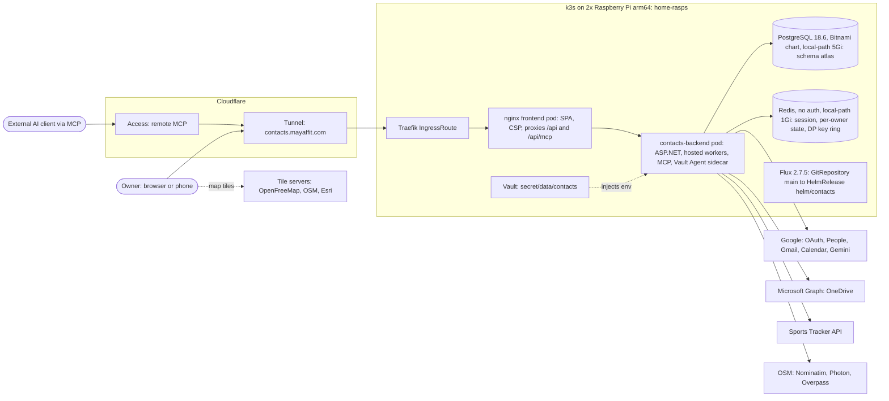
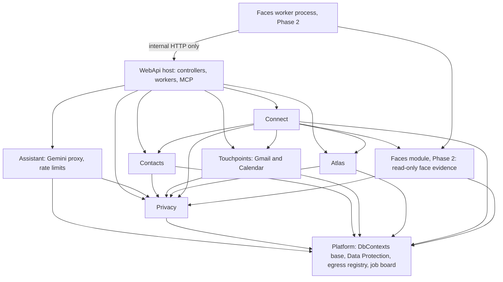
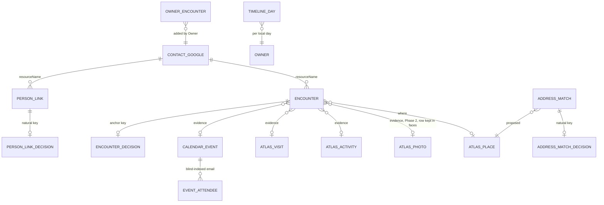
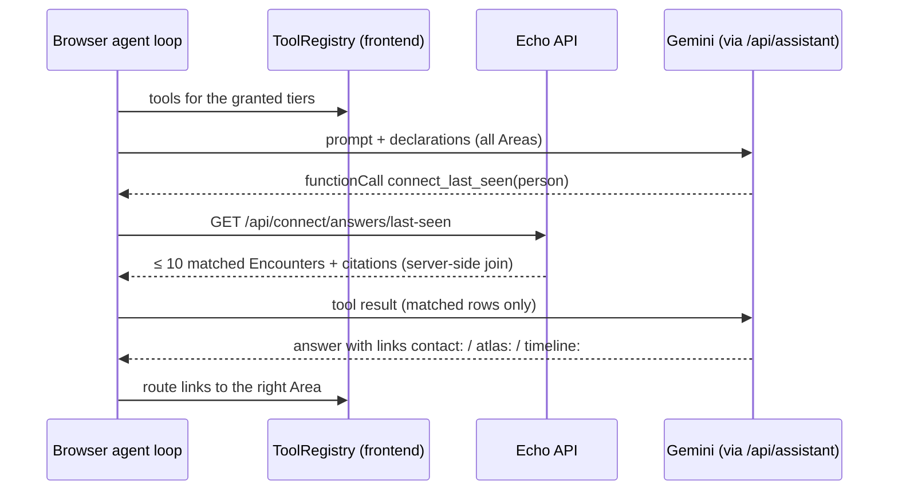
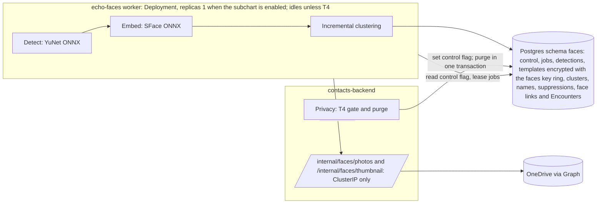
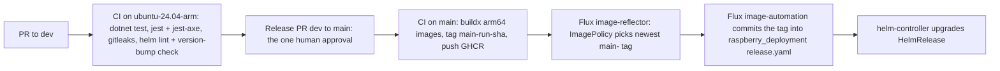

# Architecture: Echo

## 0. How to Read This Document

This is the brownfield architecture for **Echo**, derived from the PRD ([prd.md](prd.md)), its addendum ([prd-addendum.md](prd-addendum.md)), the as-built inventories ([contacts-as-built.md](contacts-as-built.md) and [atlas-as-built.md](atlas-as-built.md)), and a check of the code at `dev @ 1e05abc`. Where this document needed a requirement changed, the change was made in the PRD; the architecture does not narrow a requirement on its own. It does three things:

1. It describes the system **as it is** (§2), so nobody re-decides what the code has already settled.
2. It fixes the **invariants** that every future Echo feature must keep (§3). These are binding.
3. It defines the **target architecture** for the Proposed and Planned requirements (§4, §5).

Every decision is an `AD-n` block. Its **Binds / Prevents / Rule** lines are the contract. **Context / Decision / Alternatives / Consequences** give the ADR record. `[ADOPTED]` means the existing code already settled it, and the decision ratifies it. Where a PRD Open Question blocks a decision, the AD states the **default** chosen and how to **reverse** it. AD ids are stable: amend a Rule in place and never renumber. AD-28 to AD-31 were added after the Owner's answers of 2026-10-28 and sit in the section they belong to, not in id order.

Echo has **several users** (PRD Q-1, answered 2026-10-28). Each one is **the Owner** (they/them) of their own data, and no user sees another's. The first Owner is also the **admin** (manages the allowlist) and the **operator** (runs the cluster and the system backups). Tenancy is a first-class invariant (AD-28). No secret value appears here. Secrets are named by their Vault path only.

## 1. Design Paradigm

**A modular monolith, layered per module, in which immutable source records feed rebuildable projections.**

- **Modular monolith.** There is one ASP.NET backend process (`ContactsApi`) and one React SPA. Echo grows by adding **modules**, not services: Contacts, Touchpoints, Atlas, Connect, Assistant, Privacy, Platform. The one exception is the Phase 2 face worker (AD-20), which is a separate process because of its compute and its isolation.
- **Layered per module.** Each module keeps the three-project layering the solution already has:

  | Layer | Project | Holds |
  |---|---|---|
  | Domain and integration logic | `ContactsApi.Infrastructure/<Module>/` | entities, DbContext, pure algorithms (fusion, derivation), third-party clients |
  | Host | `ContactsApi.WebApi/` | controllers, hosted workers, MCP tools, middleware, DI wiring |
  | Shared kernel | `ContactsApi.Core/` | exception types and the cross-module interfaces in AD-2 (`ITierGate`, `IOwnerDataContributor`, and so on) |

  In practice, `Core` is thin today and Atlas logic lives in `Infrastructure/Atlas`. This is ratified: new modules follow the Atlas pattern, with no repository or unit-of-work abstractions on top of EF Core.
- **Sources feed projections.** Data flows one way: *Source Records* (imported, never edited) → *Derived projections* (fusion, Person Links, Encounters, Timeline digest, Face Clusters), which can be dropped and rebuilt → read models. The Owner's decisions sit in their own tables and are re-applied on every rebuild (AD-4). This is the pipes-and-filters shape that Atlas fusion already uses, extended to all of Echo.

## 2. The System as Built

*This section is descriptive. It records `dev @ 1e05abc` and the live Flux manifests, and the code owns these facts from here on.*

### 2.1 Context and Deployment



### 2.2 Facts the Architecture Starts From

| Concern | As built |
|---|---|
| Backend | `ContactsApi` on `net9.0`: Core / Infrastructure / WebApi; Swagger at `/`; `/health`; Serilog compact JSON to the console and to files |
| Frontend | WebKit/BlueFiber template running standalone: React 18.3.1, TS 5.7.2 strict, MUI 6, Redux Toolkit 2.4 (Contacts), `useState` in `AtlasHome.tsx` (Atlas), react-router 7, one `BackendApiClient` |
| Shell | `SiteShell` with a rail for `/contacts` and `/atlas`; `/` opens the last Area used |
| Identity | Google OAuth code flow on the server; the `sub` is the Owner id; a 7-day Redis session; `app.UseAuthentication()` is commented out, and each controller resolves the Owner through `GoogleTokenService`; any Google account that completes sign-in gets a session (no allowlist, no roles) |
| Contacts store | Google People API, with no local copy. Per-owner state is in Redis under `refresh-token:`, `optins:`, `activity:` and `self-emails:` keys; dismissals are in localStorage |
| Atlas store | Postgres schema `atlas`: 16 migrations, `OwnerId` on every row, indexes that lead with `OwnerId`, no PostGIS, EF history table `atlas.__ef_migrations`; `AtlasMigrator` applies migrations at startup |
| Workers | `ActivityWorker` (Gmail/Calendar scans, 3 at once); `AtlasFusionWorker` (fusion queue, then idle tasks: photo placement 500 per batch with 400 ms pauses, efforts, place identification); `AtlasSyncWorker` (Sports Tracker); `PhotoSyncWorker` (OneDrive delta every 30 min) |
| Assistant | The agent loop runs in the browser (`assistant/agent.ts`). The backend proxies Gemini (`/api/assistant/generate`, `/search`). Each Area passes its own `Toolset` (`declarations`, `systemPrompt`, `execute`). Rate limits are counted in memory |
| MCP | `/api/mcp`, ModelContextProtocol.AspNetCore 2.3.0, stateless HTTP; `atl_` bearer tokens stored as SHA-256 hashes; Atlas tools only |
| Errors | The `ApiResponse{success, data, error{code, message, details, timestamp}}` envelope from `ExceptionHandlingMiddleware` and from controllers; MCP returns plain 401/503 text |
| Secrets | The Vault Agent Injector renders `secret/data/contacts` into env vars (the HelmRelease sets `vault.enabled: true`; the chart default is `false`, with a K8s Secret as fallback); `VaultConfigurationService` serves local development |
| Encryption at rest | ASP.NET Data Protection protects refresh tokens, the Activity Snapshot, own addresses and source secrets; **the key ring is in the same Redis** (`DataProtection-Keys`) |
| Deployment | Helm umbrella `helm/contacts` 0.4.2. Flux in `raspberry_deployment` tracks branch `main` of this repository. Images `contacts-frontend` and `contacts-backend` on GHCR, tag `latest`, `pullPolicy: Always`, built by hand with `docker buildx` for arm64, then `kubectl rollout restart`. There is no `.github/workflows` |
| Resources | backend 500m CPU / 512Mi; Postgres 500m / 512Mi; Redis 200m / 128Mi. rasp02 has 3.7 GiB of RAM in total and hosts Postgres and Redis `[ASSUMPTION AA-11: node memory and placement come from the live cluster, not from either repository]` |
| Observability | The ConfigMap sets `OTEL_EXPORTER_OTLP_ENDPOINT` and `JAEGER_ENDPOINT` (pointing at another app's namespace), but no OpenTelemetry package is referenced, so the config is dead |
| Degradation | Without a DB connection string, Atlas switches itself off and Contacts keeps working; Redis uses `AbortOnConnectFail=false`; a session-load failure returns 503 `SESSION_STORE_UNAVAILABLE` instead of a sign-out |

## 3. Invariants and Rules

*Every future Echo feature must keep these. A change to any of them is an architecture update, not a story-level call.*

### Module Dependency Direction



An arrow means "may call or reference". There is no reverse edge. In particular, **Atlas, Contacts and Touchpoints never reference Connect**, and the server-side **Assistant** module (the Gemini proxy and its rate limits) references no domain module: the browser agent loop composes the domain tools (AD-17). The **Faces worker** process reaches Echo data only through the backend's `/internal/**` API and its own `faces` tables (AD-20). Where they must notify Connect (a Contact merge, an ingest window), they raise a signal through an interface declared in `Core` that Connect implements (AD-2).

### AD-1 — One backend process; Echo grows by modules [ADOPTED]

- **Binds:** all modules; FR-31 to FR-50; NFR-09, NFR-10.
- **Prevents:** a feature team adding its own service, database or auth path, which would split the Owner's session and identity, and add a third container to a 3.7 GiB node (AA-11).
- **Rule:** New capability is a module inside `ContactsApi`, with its own folder in `Infrastructure/` and controllers or workers in `WebApi/`. A new deployable needs a new AD. The only one sanctioned so far is the face worker (AD-20).
- *Context:* Contacts and Atlas already share one process, session, shell and Gemini proxy. *Alternatives:* microservices per Area (rejected: memory, auth duplication, no operational benefit at a handful of users). *Consequences:* one release unit; a heavy feature competes for the same 500m CPU, which AD-8 governs.

### AD-2 — Module boundaries and cross-module contracts

- **Binds:** Contacts, Touchpoints, Atlas, Connect, Assistant, Privacy, Platform, Faces; FR-28, FR-31, FR-33, FR-38, FR-39, FR-47 to FR-49.
- **Prevents:** Connect reaching into `AtlasDbContext` internals and breaking with every Atlas migration; Atlas growing references to people; two modules each owning a table.
- **Rule:** Each table is owned by exactly one module and lives in that module's schema (AD-10). Another module reads it only through the owning module's service (for example `AtlasService` query methods), never through the other module's DbContext. Notifications that run against the dependency arrow go through interfaces in `ContactsApi.Core`: `IContactMergeListener`, `IIngestWindowListener` and `ITierRevocationHandler`. Every module that stores owner data implements `IOwnerDataContributor` (export and erase, AD-19).
  - The **Assistant** module owns `GeminiService`, `/api/assistant/*` and the rate-limit counters. It is a pass-through: it never calls another module to fetch data for the model. Domain data reaches Gemini only as tool results the browser fetched from the owning module's API (AD-17).
  - The **Faces** module owns the `faces` schema (AD-20). Connect reads face evidence only through `IFaceEvidenceReader` (declared in `Core`, implemented by Faces), which returns nothing unless T4 is granted.
- *Alternatives:* a shared single DbContext (rejected: it couples migrations and blocks dropping the `faces` schema whole). *Consequences:* Connect reads Atlas through query methods that are added to `AtlasService` as needed. Joins across schemas are done in C# over time windows that each module can bound.

### AD-3 — Owner scoping and authentication on every path [ADOPTED for scoping]

- **Binds:** every table, query, worker, REST route, Assistant tool and MCP tool; NFR-07, NFR-16; FR-01, FR-29, FR-32.
- **Prevents:** a query or tool that trusts an owner id from a request body or tool argument; a new route left unauthenticated.
- **Rule:**
  1. Every stored row carries `OwnerId` (the Google `sub`), and every index leads with it.
  2. The Owner is resolved **only** from the session (REST) or from the token (MCP), never from input.
  3. In Phase 0, authentication becomes middleware. Two schemes are registered, `EchoSession` (the Redis session cookie) and `EchoPat` (the `atl_` bearer token), and `app.UseAuthentication()` and `UseAuthorization()` are enabled; Phase 2 adds a third, `EchoService` (AD-20). A **fallback policy requires an authenticated principal** on `/api/**` **and** `/internal/**`. Only `api/auth/*`, `/health` and the legal pages are marked `[AllowAnonymous]`; nothing under `/internal/**` ever is. The `EchoPat` scheme is accepted only on `/api/mcp`. `/internal/**` accepts only `EchoService`, and `EchoService` is accepted nowhere else. A test enumerates every endpoint and fails if one under `/api/**` or `/internal/**` lacks a policy.
  4. A test fixture with two Owners proves that neither a session nor a token can read or change the other Owner's rows, and that the `EchoAdmin` policy (AD-29) reads no Owner's data. It runs for every module, route, MCP tool, worker queue and cache (AD-28). It is a **hard gate** (NFR-07): it runs on every PR, blocks the merge on a failure, and must pass before any user other than the first Owner is allowlisted.
- *Context:* today the scoping is correct, but it is enforced per controller by hand. *Alternatives:* keep the per-controller helpers (rejected: a new route can silently skip them). *Consequences:* `GoogleTokenService.UserIdKey` becomes a claim; MCP owner resolution moves from inline middleware into the `EchoPat` handler.

### AD-4 — Three data tiers: Source, Derived, Decision [ADOPTED for fusion]

- **Binds:** Atlas fusion, Person Links, Encounters, address matches, the Timeline digest, Face Clusters; P-1, P-5; FR-19, FR-20, FR-33 to FR-36, FR-44; NFR-12.
- **Prevents:** a derivation that edits a source record; an Owner decision lost on rebuild because it was stored as a flag on a derived row.
- **Rule:**
  - **Source** tables are written only by import, sync or an Owner edit of that record. Derivations never update them.
  - **Derived** tables are written only by the derivation worker (AD-15). Each one can be truncated per Owner and rebuilt from Sources plus Decisions with an identical result, apart from evidence timestamps.
  - **Decision** tables (`fusion_decisions`, `person_link_decisions`, `encounter_decisions`, `address_match_decisions`, owner-created Encounters, face cluster names and suppressions) are keyed by **natural keys** (resourceName, identifier hash, anchor kind and anchor id), never by a derived row's surrogate id. They are re-applied on every run.
  - Each derived row records the `rule_version` that produced it.
- *Alternatives:* status columns on derived rows (rejected: they are lost when the rows are rebuilt). *Consequences:* "Rebuild all" is always safe. It is a Privacy and debugging tool as well as a recovery path.

### AD-5 — Proposals and etags; Echo-derived data never enters Google [ADOPTED]

- **Binds:** Contacts writes, the Assistant, enrichment, Connect (FR-36, FR-37), MCP; P-2, P-3; FR-05, FR-10, FR-15, FR-28; SM-C4.
- **Prevents:** a silent overwrite of a Contact; Person Links or Encounters written into Google custom fields, which would then sync to the phone.
- **Rule:**
  - Every write to Google People goes through `ContactsController` with the etag the Owner saw. A 412 becomes `CONTACT_CONFLICT` and is never retried with a fresh etag without the Owner seeing it.
  - The Assistant, enrichment and Connect produce **Proposals** (a diff plus the base etag) that only the Owner applies.
  - Echo-derived data (links, Encounters, matches, clusters) is stored only in Echo's Postgres.
  - MCP direct writes are allowed **only** on the `atlas` schema (the P-3 exception). MCP tools for people and Connect are read-only (AD-18).
- *Consequences:* FR-37 ("write my home address") goes through the same Proposal apply path as an Assistant change.

### AD-6 — One tier gate decides what Echo may read

- **Binds:** T1 to T4, the background place-lookup switch and the address-lookup switch; every reader of tier-gated data: workers, REST, the Timeline, Assistant tools, MCP, export; FR-31, FR-40, FR-43, FR-46, FR-47; P-6.
- **Prevents:** a Connect join or a Timeline row that shows T1 or T4 data after revocation; each feature keeping its own opt-in flag (today `optins:` in Redis plus scope checks).
- **Rule:**
  - `ITierGate` (implemented in the Privacy module, backed by `privacy.tier_state`) is the only authority on whether a tier is granted.
  - Every tier-gated read checks it **at read time**, as well as at derivation time. Items from a tier that is not granted are **omitted**, not masked. An endpoint that needs a missing tier returns 403 `TIER_NOT_GRANTED` with the tier in `details`.
  - Revoking a tier calls every registered `ITierRevocationHandler` for that tier, synchronously, before the revocation is reported as done (AD-19).
  - Google scope checks stay as a second line of defence, not the first.
- *Consequences:* a derived row can briefly outlive its tier until the purge finishes, but it is never served.

### AD-7 — Third-party egress is registered, counted and switchable

- **Binds:** every outbound call to a third party: Google APIs, Gemini, Nominatim, Photon, Overpass, Microsoft Graph, Sports Tracker and any future source; PRD §5.2; FR-47; NFR-11; SM-C3.
- **Prevents:** a new feature adding an unlisted third party or sending new kinds of data; a Privacy Center whose counts miss a path.
- **Rule:**
  - Server-side egress uses **named `HttpClient`s registered in the Platform egress registry** (`EgressParty`: id, purpose, data kinds, tier, kill-switch key). Each one carries a `DisclosureCountingHandler` that increments `privacy.disclosure_counters` (owner, party, kind, UTC day, calls, Gemini tokens) and refuses when its tier or switch is off.
  - The browser talks to third parties directly only for map tiles, which are listed in the register.
  - Adding a party, or a new data kind sent to an existing party, needs a registry entry **and** an update to PRD §5.2 in the same PR.
  - Face data (detections, templates, cluster centroids) is never placed in a payload to any registered party (AD-20).
- *Consequences:* the existing named clients (`gemini`, Sports Tracker, OneDrive, `GeoLookupClient`) are wrapped, with no change in behaviour. The background-lookup switch (FR-47) is the kill-switch of the place-identification idle task.

### AD-8 — The Raspberry Pi resource envelope [ADOPTED]

- **Binds:** all workers and queries, the Timeline, derivation, faces; NFR-09, NFR-10; the PRD risk "Pi capacity".
- **Prevents:** a background job that starves interactive requests; a design that assumes PostGIS, a GPU or more memory.
- **Rule:**
  - No PostGIS and no Postgres extensions beyond core. Use bounding-box and `(OwnerId, Lat, Lon)` index pre-filters with exact distance in C#, as `Geo.cs` does.
  - Background work runs in **bounded batches with pauses** (the reference is 500 items with 400 ms pauses). It is single-flight per Owner, resumable from persisted progress, shared **round-robin across Owners** (AD-30), and yields while an interactive request for any Owner is in flight.
  - Echo is sized for **a handful of users** (PRD A-10, default allowlist maximum 10). Adding users beyond that is an architecture update, not an allowlist edit.
  - Every list endpoint and tool has a hard cap (§6).
  - Compute that needs more than 256 MiB of working set, or minutes of CPU per item, runs outside the API pod (AD-20).
  - Every new pod declares requests and limits and fits the node budget recorded in `raspberry_deployment`.
- *Consequences:* first passes take hours or days (A-4). This is accepted and made visible through the job board (AD-25).

### AD-9 — One error envelope and code vocabulary [ADOPTED]

- **Binds:** all REST endpoints, new and old; frontend error handling; NFR-10.
- **Prevents:** Connect or Privacy returning ProblemDetails or bare strings that the shared `BackendApiClient` cannot handle.
- **Rule:**
  - REST answers use `ApiResponse<T>` `{success, data, error{code, message, details, timestamp}}`.
  - Codes are `UPPER_SNAKE`, unique across modules, and documented beside the existing ones.
  - New codes: `TIER_NOT_GRANTED` (403), `DECISION_CONFLICT` (409, a decision made against a stale derived state), `EXPORT_IN_PROGRESS` (409), `FACES_DISABLED` (403), `DERIVATION_NOT_READY` (503), `NOT_INVITED` (403, sign-in by an account not on the allowlist, AD-29), `USER_CAP_REACHED` (409, the allowlist maximum, AD-29), `OWNER_QUOTA_EXCEEDED` (429, a per-Owner cap, AD-30).
  - MCP keeps MCP-native tool errors, with the same code strings in the message text.
  - Unavailability is 503 with `Retry-After`, never a sign-out.

### AD-10 — Postgres is the only durable store; one schema per module; Redis can be lost

- **Binds:** all Owner state; NFR-04, NFR-05, NFR-12; FR-12, FR-13, FR-33 to FR-49.
- **Prevents:** new durable state put in Redis or localStorage again; cross-module foreign keys that block a per-schema purge.
- **Rule:**
  - Durable Owner state lives in Postgres, in the owning module's schema: `atlas` (as is), `people` (Contacts and Touchpoints state), `connect`, `privacy`, `platform`, and `faces` (Phase 2).
  - Each schema has its **own DbContext and migration history table** in that schema. A generalised startup migrator (`EchoMigrator`, the successor of `AtlasMigrator`) applies them in a fixed order. There are no foreign keys across schemas; references are plain id columns, as `photos.ActivityId` already is.
  - Redis holds only the session, short caches, rate-limit counters and the read mirror of the Data Protection key ring (AD-12). Losing it costs at most a sign-in.
  - localStorage holds only UI preferences.
- *Context:* the refresh tokens, opt-ins, Activity Snapshot and own addresses exist only in Redis, with expiries; dismissals exist only in localStorage. *Alternatives:* Redis with persistence (AOF) as the system of record (rejected: no backup story, no queries, a single local-path PVC); one shared `echo` schema (rejected: blocks the atomic purge of `faces`, and blurs ownership). *Consequences:* see the migration plan in §4.4. If Postgres is down, Contacts still runs (sign-in included, because the key ring is mirrored, AD-12), but Touchpoints, Connect, Atlas and the Assistant's people tools answer 503. The PRD's NFR-10 states this behaviour as test (a); §4.4 gives the mechanism.

### AD-11 — Sensitive text about other people is encrypted, with blind indexes for lookup

- **Binds:** the `people`, `connect` and `faces` schemas; NFR-08; FR-12, FR-33, FR-34, FR-36, FR-44.
- **Prevents:** plain-text email addresses, names, event titles, locations or postal addresses of third parties sitting in a Postgres dump; each module inventing its own crypto.
- **Rule:**
  - Columns holding third-party PII text (email addresses, display names, calendar titles and locations, postal addresses, evidence snippets) and all secrets are stored **encrypted with a Data Protection protector** whose purpose names the module and column, for example `Echo.Connect.PersonLinks.Value.v1`.
  - Equality lookup uses a separate **blind-index column**: HMAC-SHA256 over the normalised value, keyed from Vault (`secret/data/contacts`, key `Echo__BlindIndexKey`).
  - Face templates are encrypted the same way, but with the separate faces key ring (AD-20), never the main one.
  - Times, coordinates, ids, counts and confidences stay in plain form so they can be queried.
  - The `atlas` schema stays as it is: it holds the Owner's own movements, and its secrets are already protected.
- *Consequences:* joins on an email address are equality joins on the blind index. "Contains" search over these columns happens in memory after a time-bounded fetch, which is acceptable at the Owner's scale.

### AD-12 — The Data Protection key ring lives apart from the data, protected by Vault

- **Binds:** Platform; NFR-08, NFR-05, NFR-10; every encrypted column; the session and OAuth cookies.
- **Prevents:** a single Redis loss making every encrypted value unreadable; keys stored in plain form beside the data they protect; a Postgres outage taking Contacts sign-in down with it.
- **Rule:**
  - **Record.** Keys are persisted to Postgres `platform.data_protection_keys` and **wrapped with `ProtectKeysWithCertificate`**, using an X.509 certificate held in Vault (`secret/data/contacts`, key `DataProtection__Certificate`) and injected as a file.
  - **Mirror.** A composite `IXmlRepository` (`MirroredKeyRepository`) also writes every wrapped key to Redis (`DataProtection-Keys`, the key it uses today, no expiry). Reads go to Postgres first and fall back to the Redis mirror when Postgres is unreachable. A new key is written to Postgres first and to Redis second, so a key never exists only in Redis. At start, and after Postgres comes back, the mirror is reconciled from Postgres.
  - **No key creation without the record.** If Postgres is unreachable when Data Protection wants a new key, the write fails, the current key stays in use (Data Protection creates keys about two days before expiry and retries), and a `job_runs` error is raised. Keys are never minted into Redis alone.
  - The application name `ContactsApi` is kept, so existing ciphertext stays readable.
  - Before cut-over, a one-shot migration copies the existing keys out of Redis into Postgres and wraps them.
  - Backups contain the wrapped keys. A restore therefore needs Vault's copy of the certificate, and that certificate is kept in Vault's own backup.
  - Only the API process reads this ring. The face worker has its own ring (AD-20).
- **Failure modes (explicit):**

  | State at backend start or during operation | Key ring from | Result |
  |---|---|---|
  | Postgres up, Redis up | Postgres | normal |
  | Postgres down, Redis up | Redis mirror | session and OAuth cookies readable; Contacts sign-in, browse and edit work (NFR-10 a); Postgres-backed modules answer 503 |
  | Postgres up, Redis lost | Postgres | sessions lost, so the Owner signs in again; mirror rebuilt; no data lost |
  | Postgres down, Redis lost or emptied | none | Echo down: `/health` reports not ready and the SPA shows "unavailable"; recovers when Postgres returns (NFR-10 d). Contacts needs Redis for its session anyway, so it was down regardless |
  | Vault sealed | n/a | the pod does not start (Vault Agent init); this is the one manual step NFR-10 c allows |
- *Alternatives:*
  - Postgres only (rejected: a backend started during a Postgres outage cannot read any cookie, so Contacts goes down with the database, which breaks NFR-10).
  - A Vault KV-backed key ring (rejected for now: the app would need its own Vault write credentials at runtime instead of the injector's read-only rendering; reconsider with Vault Transit).
  - A K8s Secret volume or file-backed ring (rejected: keys could not roll, and a file on a local-path PVC pins the backend to one node).
  - Vault Transit (rejected for now: no transit engine is set up; reconsider if one is).
- *Consequences:* losing Redis no longer loses data, and losing Postgres no longer stops Contacts. Losing the Vault certificate loses data, so the Vault backup becomes part of NFR-05. The Redis mirror holds only wrapped keys, which are useless without the Vault certificate (NFR-08 holds).

### AD-28 — Tenancy is a first-class invariant: everything is scoped to one Owner

- **Binds:** every table, Redis key, worker queue, cache, MCP token, Assistant tool, file, log line and backup; every module; NFR-07, NFR-08; FR-01, FR-44, FR-46 to FR-49, FR-51; PRD §2.2 (Q-1).
- **Prevents:** one Owner's data reaching another through a shared cache, a queue item processed under the wrong owner, a geocode or name cache keyed only by its input, a face template compared across Owners, or a file or export that mixes Owners.
- **Rule:**
  - **Tables.** Every table that holds user data has `OwnerId` (AD-3). The only tables without it are **system tables**, listed here and nowhere else: `platform.data_protection_keys`, `faces.data_protection_keys`, `platform.allowlist` and `platform.user_roles` (AD-29), and the EF history tables. A test fails if any other entity lacks `OwnerId`.
  - **Redis.** Every key that holds user data starts with `echo:{OwnerId-hash}:` (sessions, rate-limit counters, name cache, any future cache). Purging an Owner is a prefix scan. Only the Data Protection mirror is unscoped.
  - **Queues and jobs.** Every queue item and job (`fusion_queue`, `connect.derivation_queue`, `faces.jobs`, Touchpoints scans, source syncs) carries `OwnerId`, and the worker sets the ambient owner from the item, never from a previous item. A worker never holds two Owners' data in one batch.
  - **Caches.** Caches are per Owner even where the input looks neutral: `connect.geocode_cache` is keyed by (OwnerId, text blind index), so one Owner's lookups never reveal another's addresses.
  - **Tokens and grants.** PATs, Google grants, Microsoft grants and Sports Tracker sessions are per Owner and resolve to exactly that Owner (AD-3, AD-18).
  - **Faces.** Clustering and matching run over one Owner's templates at a time. No query or job compares templates across Owners (AD-20).
  - **Files.** Exports are streamed per Owner (AD-19). No user data is written to shared disk.
  - **Backups** are system-level: one encrypted dump holds every Owner's data (AD-24). A restore is all-or-nothing, and re-applies every Owner's consent ledger and erase receipts before serving (AD-24).
  - **Logs** carry the Owner id hashed, never in clear (§6).
  - **Admin is not an Owner role.** The admin role (AD-29) manages the allowlist and reads usage counters. It never reads another Owner's rows.
- *Context:* the code is already scoped per `sub` (AD-3), but with one Owner a leak had nowhere to go. *Alternatives:* a schema or a database per Owner (rejected: migrations multiply and the Pi's memory does not allow it at a handful of users; row scoping plus the hard-gate tests suffices); Postgres row-level security (deferred: a second line of defence worth adding if a leak is ever found, but EF Core with one app role does not need it to pass NFR-07). *Consequences:* a shared cache that is "obviously harmless" still needs the owner prefix.

### AD-30 — Per-Owner fairness and caps in workers and egress

- **Binds:** every hosted worker and idle task, the face worker, the egress registry (AD-7), `GeminiService`; NFR-09, NFR-11, NFR-18; FR-28, FR-52.
- **Prevents:** one Owner's first photo pass or full re-fusion starving everyone else on the Pi; one Owner using up the global Nominatim rate or the global Gemini cap.
- **Rule:**
  - **Round-robin.** Each worker keeps one queue per Owner and takes **one bounded batch per Owner per turn**, in round-robin order (the AD-8 batch size and pauses). An Owner with a large backlog gets no more than one batch per turn. A newly queued Owner is served on the next turn, which keeps a new import's start under 5 min (NFR-18).
  - **Concurrency.** Touchpoints scans stay at 3 concurrent overall, at most 1 per Owner.
  - **Caps.** Gemini (as today) and geocoder lookups have **per-Owner** per-minute and per-day caps, plus a global daily cap, counted in Redis under the owner prefix (AD-28) so they survive a pod restart. A cap returns `OWNER_QUOTA_EXCEEDED` (429) to that Owner only.
  - **Shared rate.** The global Nominatim limit of 1 req/s is a single token bucket shared round-robin across Owners, so one Owner's backlog cannot hold it.
  - **Scheduled syncs** (OneDrive every 30 min, Sports Tracker every 6 h, FR-52) are spread across Owners with jitter, not fired together.
  - The admin page shows each Owner's queue depth and usage against caps (AD-29), not their data.

## 4. Target Echo Architecture

### 4.1 Connect Layer (Phase 1)



`CONTACT_GOOGLE` is the Google People record. It is not stored (P-1). `CALENDAR_EVENT` and `EVENT_ATTENDEE` belong to the `people` schema (Touchpoints). The `ATLAS_*` entities belong to `atlas`. Everything else is in `connect`.

### AD-13 — A Person is anchored on the Contact's resourceName; Person Links follow merges

- **Binds:** Connect; FR-10, FR-33, FR-38, FR-39, FR-41; P-5, P-8; NFR-13.
- **Prevents:** a second "person" id space that drifts from Google; links orphaned by a merge; a twin pair counted as two people.
- **Rule:**
  - The **Person id is the primary Contact's `resourceName`**. `connect.person_links` holds (OwnerId, resourceName, kind ∈ `email | attendee | contact`, value encrypted + blind index, status ∈ `confirmed | proposed`, evidence JSON, rule_version). Links of kind `face_cluster` have the same shape but live in `faces.person_links` (AD-14, AD-20).
  - A `contact` link joins an unmerged Hebrew/English twin to the primary (P-8).
  - Rejections live in `person_link_decisions`, keyed by (OwnerId, resourceName, kind, value blind index), and suppress the proposal for ever.
  - Links that follow from the Contact's own fields are re-derived as `confirmed`. Name matches reuse `Activity/NameMatcher` (bilingual) and are only ever `proposed`.
  - **Merge:** after Google confirms a merge, `ContactsController.merge` calls `IContactMergeListener`. Connect then re-points links, decisions, owner-created Encounters and address matches from the deleted resourceNames to the kept one, in one transaction. The re-point is idempotent.
  - **Deletion outside Echo:** a People API sync token detects deleted resourceNames on the next derivation run. Their links are removed, and their decisions are kept for 30 days in case of a restore, then removed.
  - Connect never persists Contact fields. It reads the Contacts it needs through People API at derivation time (with the stored refresh token) and keeps them in memory.

### AD-14 — Calendar events are stored under T1; Encounters come from a deterministic, versioned rule

- **Binds:** Touchpoints (`ActivityWorker`), Connect; FR-12, FR-34, FR-35, FR-36, FR-41, FR-42, FR-47 (address lookup); PRD §5.2; P-4, P-6, P-9; SM-2, SM-3; A-7, A-8.
- **Prevents:** Encounters that cannot be explained; thresholds that differ between the Assistant and the UI; rejected Encounters coming back.
- **Rule:**
  - **Events.** `ActivityWorker` persists the calendar events it already reads to `people.calendar_events`: event id, start and end, status, the Owner's response, title and location (encrypted), plus `people.calendar_event_attendees` (blind-indexed emails). Rows are written only while T1 is granted, cover the same 365-day window, and are purged on T1 revocation. Reading all calendars (FR-16) only adds rows.
  - **Rule `encounter.v1`** (defaults from A-8, held per Owner in `connect.settings` JSON, editable like fusion settings):
    - candidate = event with an attendee who has a Person Link × an Atlas Visit or Fused Activity;
    - overlap ≥ 50% of the shorter interval;
    - declined or cancelled events are excluded;
    - if the event has a location **and the address-lookup switch is on**, the location text is geocoded once (cached in `connect.geocode_cache` through the registered Nominatim client) and must be ≤ 500 m from the Visit or track. With the switch off, or when geocoding finds nothing, the event is treated as having no location;
    - confidence = time agreement × location agreement, as in fusion; it is capped at 0.6 with no location; nothing is stored below 0.5;
    - a confirmed address match (FR-36) adds `address_match` evidence.
  - **Address matches (FR-36), rule `address.v1`.** Runs only while the address-lookup switch is on. Each postal address of a Contact (read through People API at derivation time, never stored in plain text, AD-11) is geocoded through the same cached Nominatim client. A match is proposed when the geocoded point is **≤ 100 m** from a Place (default, editable in `connect.settings`), and only the nearest Place within that radius is proposed. Places the Owner typically stays at for 6 h or more (their home and work) are never proposed for another person. Matches go to `connect.address_matches` as `proposed`, and `address_match_decisions` (keyed by OwnerId, resourceName, address blind index, Place id) holds confirm and reject.
  - **Address lookup switch (PRD FR-47, §5.2).** It is an entry in the consent ledger (AD-19), **off by default**. The Nominatim registry entry (AD-7) lists three data kinds: `coordinates` (background place lookup, its own switch), `event_location_text` and `postal_address_text` (both behind address lookup; event locations also need T1). Turning it off stops new lookups at once; cached geocodes for free text are deleted, and derived rows that used them are rebuilt without location evidence.
  - **Anchor key.** Each Encounter is keyed by (OwnerId, resourceName, anchor kind, anchor id). The anchor kinds are `calendar_event`, `visit` (address evidence, or an Owner attachment to a Visit), `activity` (an Owner attachment to an Activity, FR-35), `day` (an Owner attachment to a day, anchor id = the local date `yyyy-mm-dd`, FR-35) and, in Phase 2, `photo`. `encounter_decisions` uses the same key, so a confirm or reject survives a rebuild.
  - **Origins and evidence kinds** (one list, used by the addendum and §6): `origin` ∈ `derived | owner`; evidence kinds ∈ `calendar_event | visit | activity | address_match | photo_face`. A "face-only" Encounter is a `derived` one whose only evidence kind is `photo_face`.
  - **Owner-created Encounters** (FR-35) are decision-tier rows with `origin = owner`, anchored on an Activity, a Visit or a day. They are never touched by derivation.
  - **Face evidence stays in `faces`.** No row in `connect` holds face evidence. `face_cluster` Person Links, Encounters with any `photo_face` evidence, and the Owner's decisions on them live in `faces.person_links`, `faces.encounters` and `faces.encounter_decisions`, in the same shapes and with the same keys as their `connect` counterparts. Connect's read APIs, the Timeline digest builder and the answer endpoints merge them in through `IFaceEvidenceReader` (AD-2) only while T4 is granted. A calendar-anchored Encounter in `connect` and a photo-anchored one in `faces` for the same Person and overlapping time are shown together under "Why?". This keeps the whole face footprint in the schema that backups exclude (AD-20, AD-24).
  - **Tiers.** Each Encounter stores the set of tiers its evidence needs (calendar → T1, Visit or Activity → T3, Photo face → T4; address evidence also needs the address-lookup switch). Owner-created Encounters need T0 only. Tier revocation removes an Encounter whose remaining evidence no longer meets its threshold, and the read path hides it at once (AD-6).
  - **Disagreeing evidence** is stored in `conflicts` JSON and shown under "Why?" (FR-42).
  - **What answers may cite:** confirmed Encounters, and derived ones labelled "likely". Rejected Encounters are never cited.
  - Changing the rule bumps `rule_version` and queues a full rebuild.

### AD-15 — One derivation worker runs all projections, in order

- **Binds:** `AtlasFusionWorker` (renamed `DerivationWorker`), Connect, the Timeline; NFR-09, NFR-12, NFR-14; FR-19, FR-27, FR-33, FR-34, FR-36, FR-40.
- **Prevents:** several hosted workers racing over the same Owner's data and the same CPU; Connect derivation reading half-fused Atlas data.
- **Rule:**
  - One hosted worker drains per-Owner queues, round-robin across Owners (AD-30). `fusion_queue` stays as it is, and `connect.derivation_queue` holds time windows plus a `full` flag, with backoff.
  - When idle, it runs the registered `IIdleTask`s in a fixed order: fusion → source clock calibration (AD-31) → photo clock and placement → efforts → place identification (gated by the AD-7 switch) → **Person Links → address matches → Encounters → Timeline digest**.
  - Producers enqueue windows through `IIngestWindowListener`: Atlas ingest, a OneDrive sync, a Touchpoints scan or refresh, a decision, or a settings change.
  - Each task follows AD-8 (batches, pauses, progress) and publishes to the job board (AD-25).
  - Fusion for a window always completes before Connect derives over it.

### 4.2 Unified Timeline (Phase 1)

### AD-16 — The Unified Timeline is a per-day digest, filtered by tier when it is read

- **Binds:** Connect (owner of `connect.timeline_days`), the Timeline Area, the Assistant and MCP timeline tools; FR-40, FR-38, FR-39; NFR-09; Q-6.
- **Prevents:** a `UNION` over seven tables per request on the Pi; a cached day that still shows data from a revoked tier.
- **Rule:**
  - `connect.timeline_days` holds (OwnerId, local_date, items JSON, built_at, rule_version). Each item has: kind, start and end, source module, source id, **tier**, and resourceNames. Names are not stored. Item kinds: Activity, Visit, Encounter, meeting, email-touchpoint aggregate, photo group, health highlight.
  - Email touchpoints are a **count per Person per day**. Message rows are never stored (Q-6, answered 2026-10-28: the Owner chose the count).
  - Days are cut in the Owner's configured time zone, default `Asia/Jerusalem`, stored in `connect.settings`.
  - The worker rebuilds the days touched by each queued window.
  - `GET /api/timeline/days?from&to&person&place&type&area` (≤ 31 days per call) reads the digest, **drops items whose tier is not granted now** (AD-6), and resolves names from the client's loaded Contacts or from a short Redis cache.
  - **Name cache.** Key `echo:{OwnerId-hash}:names:{resourceName}` (AD-28 prefix), value = display name and phonetic name only, **encrypted with the protector `Echo.Connect.NameCache.v1`** (AD-11: third-party names are never stored in plain text, Redis included), **TTL 15 minutes**, no sliding. It is a cache only (AD-10): a miss reads People API. It is purged per Owner on sign-out, on T0 revocation and by erase (AD-19), and it is never exported.
  - Detail views are fetched from the owning Area's API.
- *Alternatives:* a `UNION` query with time paging (rejected under NFR-09); a SQL materialised view (rejected: a full refresh, no per-day rebuild). *Consequences:* the Timeline lags ingest by one worker cycle (≤ 5 min idle wake), and shows "building" through `DERIVATION_NOT_READY` until a day exists.

### 4.3 One Assistant and MCP (Phase 1)



### AD-17 — One Assistant: a frontend tool registry, with Connect joins done on the server

- **Binds:** `assistant/agent.ts`, every Area's toolset, Connect answer endpoints, `GeminiService`; FR-28, FR-31, FR-41, FR-42; NFR-11; P-3, P-4; Q-5; SM-C3.
- **Prevents:** Gemini receiving bulk lists of people with places; Areas each building their own Assistant; links that open the wrong Area; the token budget growing without anyone noticing.
- **Rule:**
  - The agent loop stays in the browser [ADOPTED]. A **`ToolRegistry`** composes `Toolset`s from every Area: contacts, `atlasToolset`, and new `connectToolset` and `timelineToolset`. Each tool registers its name (prefixed by Area), its tier, its declaration and `execute`. Tools whose tier is not granted are left out of the declarations, and the system prompt states which tiers are missing, so the model says so rather than working around it.
  - **Connect tools execute on the server.** `/api/connect/answers/*` (last-seen, who-was-at, where-with) does the join and returns **at most 10 matched records with citations** (record kind, id, confidence, status). These endpoints never return lists that pair people with places beyond the matched rows. With no evidence, they return the nearest touchpoint instead (FR-41).
  - Contacts tools that run outside `/contacts` lazily load the Redux contacts slice.
  - **Links** use one scheme, routed by a single `linkRouter`: `contact:<resourceName>`, `atlas:activity/<id>`, `atlas:place/<id>`, `atlas:visit/<id>`, `timeline:<yyyy-mm-dd>`.
  - Writes remain Proposals (AD-5).
  - The Gemini disclosure text is extended per FR-31.
  - **Per-Owner switch (Q-5).** `connect_*` tools read the Owner's "Let Gemini word answers about people and places" entry in the consent ledger (AD-19, default on). With it off, the tool result is rendered in the UI as plain cards with citations and is **not** returned to the model; the model receives only "results shown to the user".
  - The Gemini rate-limit counters move from memory to Redis, per Owner (AD-30), so they survive a pod restart.
  - A unit test fails if the serialised declarations of the composed registry are larger than 2× the largest single-Area toolset at `1e05abc` (a proxy for NFR-11). The real per-question tokens are recorded in `privacy.disclosure_counters`.
- *Alternatives:* moving the agent loop to the server (deferred: larger change, no requirement needs it yet); router-selected tool subsets per question (deferred until the 2× budget is breached). *Q-5 (answered 2026-10-28):* the model sees matched results only, and each Owner can switch that off (plain cards, above).

### AD-18 — MCP tokens carry scopes; people and Connect are read-only over MCP

- **Binds:** `access_tokens`, the `EchoPat` scheme, MCP tool classes; FR-29, FR-32, FR-41; NFR-16.
- **Prevents:** an Atlas-only token reading people; MCP writing to Contacts with no Proposal review; face data reaching an external AI.
- **Rule:**
  - `atlas.access_tokens` gains `Scopes` (`atlas`, `people`). Existing tokens migrate to `atlas`.
  - MCP tools are split into classes per module: `AtlasMcpTools` (as is), plus `PeopleMcpTools` and `TimelineMcpTools`, which are read-only. Each tool checks its scope **and** `ITierGate`.
  - People tools mint Google access from the Owner's stored refresh token (now in Postgres, §4.4). If none exists, they answer `TIER_NOT_GRANTED`.
  - MCP never returns face boxes, templates or cluster data. A face-evidenced Encounter cites only the photo id.
  - Remote clients still pass Cloudflare Access. `[ASSUMPTION AA-10: the Access policy is configured in Cloudflare and is not visible in either repository; PRD A-9.]`

### 4.4 Contacts State Moves from Redis to Postgres (Phase 0)

This applies AD-10 and AD-11 to the existing state. The shapes are kept, so the change is a storage swap behind the existing services (`GoogleTokenService`, `ScopePreferences`, `ActivityStore`).

| Today (Redis or browser) | Target (`people` / `privacy`) | Encrypted |
|---|---|---|
| `refresh-token:{sub}` (180 d sliding) | `people.google_grants` (refresh token, granted scopes, updated_at); no expiry, deleted on revoke | yes |
| `optins:{sub}` (365 d) | `privacy.tier_state` + `privacy.consent_events` (AD-19) | no (contains no PII) |
| `activity:{sub}` (90 d sliding) | `people.activity_snapshots` (one encrypted JSON blob per Owner, same `ActivitySnapshot` shape) | yes |
| `self-emails:{sub}` | `people.own_addresses` (value + blind index) | yes |
| dismissals (localStorage) | `people.dismissals` (kind, key blind index, until) | key only |
| session | stays in Redis | n/a |

- **Cut-over.** On first read, a service that finds no Postgres row copies the Redis value (lazy migration). After one release with no reads from Redis, the Redis paths are removed.
- **Degradation (PRD NFR-10 test a).** Contacts browsing and editing need only Google, the session (Redis) and the key ring, which is mirrored in Redis (AD-12). If Postgres is down:
  - Cookies stay readable, so existing sessions continue and a new sign-in completes.
  - The refresh token cannot be read or written, so silent refresh fails. When the session's Google access token expires (about hourly), the backend sends the Owner to sign in again instead of returning an error. The OAuth callback tolerates a failed refresh-token write: it logs it, raises a `job_runs` error and completes a session-only sign-in. The next sign-in after Postgres returns stores the token.
  - Contacts browsing and editing need only T0, which every signed-in session has, so they do not consult `privacy.tier_state`. Features that need T1 or above answer 503 while it is unreachable.
  - Touchpoints, Connect, the Timeline, Privacy and Atlas answer 503 `DERIVATION_NOT_READY` or `ATLAS_NOT_READY` with `Retry-After`, and the SPA shows "temporarily unavailable". The Owner is never signed out by a 503 (AD-9).
  - This is exactly what the PRD's NFR-10 now requires (the PRD was amended to allow the hourly re-sign-in); the architecture does not narrow it further.

### 4.5 Privacy Center, Consent, Export and Delete

```mermaid
sequenceDiagram
  participant O as Owner (Privacy Center)
  participant P as PrivacyController
  participant G as TierGate / consent ledger
  participant H as ITierRevocationHandler[] (modules)
  participant Goo as Google OAuth revoke
  O->>P: revoke T1
  P->>G: append consent_event(revoked T1); tier_state = off
  P->>H: purge(owner, T1): snapshot, calendar events, own addresses, attendee links, derived Encounters
  H-->>P: counts deleted
  P->>Goo: revoke grant (full token)
  P-->>O: receipt; re-consent T0 plus the tiers still granted
```

### AD-19 — The consent ledger, revocation orchestrator and per-module export and erase contributors

- **Binds:** the Privacy module (`privacy` schema), every module that stores Owner data; FR-46, FR-47, FR-48, FR-49, FR-50; NFR-04, NFR-08; P-6.
- **Prevents:** a new table that export or delete forgets; revocation that deletes data but leaves the Google grant, or the reverse; an export left on disk.
- **Rule:**
  - **Consent ledger (per Owner).** `privacy.consent_events` is append-only and keyed by `OwnerId`: tier, action, scopes, at, actor. `privacy.tier_state` is its current projection per Owner. The background-lookup switch, the address-lookup switch (off by default, AD-14), the Gemini-wording switch (on by default, AD-17) and per-source connections are entries in the same ledger. One Owner's ledger never changes another's state.
  - **Revoking a tier** runs its handlers (AD-6), then, if the tier is a Google one, **revokes the whole Google grant** (Google does not revoke scopes one by one) and asks the Owner to re-consent T0 plus the tiers that remain. It writes a receipt to `privacy.receipts`.
  - **Register.** The Privacy Center reads `privacy.disclosure_counters` (AD-7), PAT metadata and source connections. It never reads content.
  - **Contributors.** Each module implements `IOwnerDataContributor` with `ExportAsync(owner, ZipWriter)` and `EraseAsync(owner)`. A **test enumerates every EF entity type with an `OwnerId` across all DbContexts** and fails unless its module's contributor covers it.
  - **Export (FR-48).** `GET /api/privacy/export` **streams** a zip to the browser: JSON per table, GPX per Activity, CSV for health, and `manifest.json` with counts and a note on where Contacts and Photos live (Google Takeout, OneDrive). Nothing is written to disk on the server. Secrets, token hashes and blind indexes are excluded. Face data is included only with `?faces=true` (AD-20). nginx gets a dedicated `location /api/privacy/export` with `proxy_buffering off` and a 600 s timeout.
  - **Export is per Owner (FR-48).** It contains only the calling Owner's rows; the contributor test also checks that a two-Owner fixture exports nothing of the other Owner (AD-28).
  - **Erase (FR-49, Phase 1).** Erase runs every contributor's `EraseAsync` for one Owner in dependency order, then revokes that Owner's Google and Microsoft grants and Sports Tracker session, deletes their PATs, sessions and Redis prefix (AD-28), and returns a receipt. The receipt's `OwnerId` hash is the only row kept, and a restore re-applies it (AD-24). The admin can start erase for a user removed from the allowlist (AD-29); the admin gets only the receipt.
  - **Legal pages (FR-50)** are static routes in the SPA (`/privacy-policy`, `/terms`), served by nginx without authentication.

### 4.6 People in Photos (Phase 2, T4)



### AD-20 — Face recognition runs in its own worker, on Echo's own hardware, in a schema that can be dropped

- **Binds:** the Faces module, the `faces` schema, the echo-faces image and Deployment, Connect (face-cluster links and face evidence), Privacy; FR-43, FR-44, FR-45, FR-48; NFR-08, NFR-09, NFR-12, NFR-14; PRD §5.3; A-4; Q-2.
- **Prevents:** face compute starving the API pod or the 3.7 GiB node; templates leaving Echo's infrastructure; face data surviving revocation in backups, derived rows or the export; unnamed faces kept beyond review; one Owner's faces matched against another's.
- **Rule:**
  1. **Process.** A separate .NET worker (`EchoFaces`, same solution, image `contacts-faces`, arm64) uses Microsoft.ML.OnnxRuntime on the CPU. Default models: **YuNet** for detection and **SFace** for embeddings, from the OpenCV Zoo (MIT and Apache-2.0 licences). InsightFace weights are not used, because they are licensed for non-commercial research only. It runs at a low `PriorityClass` with requests of 50m CPU and 64Mi, limits of 1000m CPU and 1Gi, on a node chosen by a values key.
  2. **On and off without replica toggling.** Flux owns the replica count, so the app never scales the Deployment: a runtime scale would be reverted on the next reconcile. The faces subchart has `faces.enabled` (default `false`), set in `raspberry_deployment`; when enabled, `replicas: 1` is fixed. At runtime the worker is switched by a flag in the database: the T4 handler in the Privacy module writes `faces.control` (OwnerId, enabled, changed_at). The worker polls it every 60 s. While no Owner has `enabled = true`, it holds no models in memory, leases no jobs and causes no Graph traffic, so it stays within its 64Mi request. When T4 is granted it loads the models and starts leasing; on revocation, the purge (rule 7) runs first, then `enabled = false` makes the worker drop its in-memory state within one poll. The backend also refuses every `/internal/faces/*` call for an Owner without T4, so a worker that has not yet seen the flag gets nothing.
  3. **Photos and pixels through the internal API only.** The worker never reads another module's tables. It gets photo ids from `GET /internal/faces/photos?after=&limit=` (ids, taken-at and video flag only, paged, ≤ 500) and pixels from `GET /internal/faces/thumbnail/{photoId}` (a medium thumbnail fetched through Graph). Both are **cluster-internal**, authenticated by the `EchoService` scheme with a service token (`secret/data/contacts`, key `Faces__ServiceToken`), and not routed by nginx (AD-3). Pixels exist only in memory and are never stored. **Photos only:** `/internal/faces/photos` never returns videos, and the worker never requests them (Q-2, answered). New photos reach the worker as jobs that the backend enqueues in `faces.jobs` through `IIngestWindowListener` after a OneDrive sync.
  4. **Database access.** A DB role `echo_faces` may read and write only the `faces` schema. It has **no** grant on `atlas`, `platform`, `people`, `connect` or `privacy`.
  5. **Its own key ring.** Face templates and suppression centroids are encrypted with a **separate Data Protection ring**: application name `EchoFaces`, persisted in `faces.data_protection_keys`, wrapped with a separate certificate (`secret/data/contacts-faces`, key `Faces__DataProtection__Certificate`), protector purpose `Echo.Faces.Templates.v1`. Only the face worker and the backend's Faces module can unwrap it. The worker never sees the main ring (AD-12), so it cannot decrypt tokens, snapshots or Connect columns. Dropping the Owner's `faces` rows deletes the ring's ciphertext with them.
  6. **Jobs and storage.** Jobs are leased from `faces.jobs` in batches of 50 with pauses, round-robin across Owners (AD-30), and are resumable. Progress goes to the job board. Clustering runs over one Owner's templates only; no job or query compares templates across Owners (AD-28). Clusters are never linked to a Contact without an Owner action. Naming a cluster writes `faces.cluster_names` and a `face_cluster` Person Link in `faces.person_links`. Encounters with face evidence are written to `faces.encounters` by the derivation worker through the Faces module (AD-14). "Never recognize" deletes the cluster and keeps only a minimal suppression centroid inside `faces`.
     - **Named people only (Q-2, answered).** New unnamed clusters are offered in a **review session** (`faces.review_sessions`: OwnerId, opened_at, closed_at). When the Owner closes the session, or 30 days after it opened if it is left open, every cluster from it that was not named is deleted with its detections and templates, and its photos are marked scanned. Only named clusters, their faces and suppression centroids remain.
  7. **Revocation** is **synchronous**, in one transaction over the `faces` schema: delete every Owner row (detections, templates, clusters, names, suppressions, face Person Links, face Encounters and their decisions, jobs), and set `faces.control.enabled = false`. Then rebuild the affected Timeline days without face items and write a receipt. Nothing in `connect` holds face data, so nothing there needs purging. This is far inside the 24 h window.
  8. **Backups exclude the `faces` schema** (`pg_dump --exclude-schema=faces`). Because every face-derived row lives there (rule 6, AD-14), no backup holds face data, and deletion is complete when the receipt is written. The schema can be rebuilt from Photos plus consent.
  9. Faces never pass through AD-7 egress, Gemini or MCP.
- *Alternatives:* running inside the API pod (rejected: the 512Mi limit, AD-8); cloud face APIs (rejected by the PRD); Python with insightface (rejected: the licence, plus a second runtime and crypto stack); scaling the Deployment between 0 and 1 from the app (rejected: Flux reverts it, and the app would need RBAC on its own Deployment); sharing the main key ring and SELECT on `atlas.photos` (rejected: the worker could decrypt all of Echo's secrets and would bypass AD-2); keeping face links and face Encounters in `connect` and purging them (rejected: `connect` is backed up, so copies would outlive revocation by up to the 8-week retention of AD-24). *Default for "offload":* on the cluster. *Reverse* by running the same image on an operator-owned machine joined to the headscale tailnet, with Postgres reachable only over the tailnet. That still counts as Echo's own infrastructure. *Consequences:* the first pass over 157k Photos is a sizing assumption to validate with a 1,000-photo spike before Phase 2 is committed (a few days at about 1 Photo/s, including the Graph fetch).

## 5. Phase 0 Platform Decisions



### AD-21 — Secrets live only in Vault; committed values are removed and rotated

- **Binds:** this repository, `raspberry_deployment/apps/contacts`, the chart; NFR-01; SM-6.
- **Prevents:** credentials in tracked files; drift between the chart defaults and Vault.
- **Rule:**
  - No tracked file holds a credential. `appsettings.json` keeps keys with empty values only, and the Google OAuth client id moves to configuration. `values.yaml` drops `dbPassword` and `googleClientSecret` defaults. The chart default becomes `vault.enabled: true`, and the K8s Secret fallback takes only `existingSecret`.
  - The Postgres password comes from an `existingSecret` that is created outside git. The inline Postgres password in `raspberry_deployment/apps/contacts/release.yaml` is in scope too.
  - **Rotate:** the Vault dev token found in `appsettings.json`, the Postgres application password, and any OAuth client secret that has ever been committed. New values are written to `secret/data/contacts` only.
  - **gitleaks** (`gitleaks/gitleaks-action@v3`) runs on every PR and blocks on a finding.
  - Rewriting git history is optional after rotation.

### AD-22 — CI builds arm64 images; Flux image automation deploys them

- **Binds:** `.github/workflows`, GHCR images, `raspberry_deployment`; NFR-02; SM-6.
- **Prevents:** hand builds; the `latest` tag with `pullPolicy: Always`, where a pod restart silently changes the version; chart edits that Flux ignores.
- **Rule:**
  - GitHub Actions on **native `ubuntu-24.04-arm` runners**. `[ASSUMPTION AA-9: these runners are available to this private repository on the Owner's GitHub plan (reported generally available for private repositories since 2026-01-29); this cannot be checked from the repository. Fallback: QEMU buildx on x64, below.]`
  - Every PR runs xUnit, Jest with jest-axe, gitleaks, `helm lint`, and a check that fails when `helm/**` changed without a chart version bump.
  - A push to `main` builds `contacts-frontend` and `contacts-backend` (and `contacts-faces` from Phase 2), tagged `main-<run>-<shortsha>`. `latest` is no longer deployed.
  - In `raspberry_deployment`, enable the image-reflector and image-automation controllers. They are absent from the Flux 2.7.5 install today; the image APIs went GA in 2.7. Add an `ImageRepository` and `ImagePolicy` per image, and an `ImageUpdateAutomation` that writes the tag into `release.yaml` through setter markers, with `pullPolicy: IfNotPresent`.
  - The one human approval is the dev → main release PR. Merge-to-running is ≤ 30 min.
- *Alternatives:* QEMU buildx on x64 (slower, kept as a fallback); a self-hosted runner on the Pi (rejected: it competes for the node budget). *Consequences:* a rollback is a revert of the tag commit in `raspberry_deployment`.

### AD-23 — Move to .NET 10 LTS in Phase 0

- **Binds:** every backend project and image, including the face worker; NFR-17 (supported runtimes, PRD Phase 0), NFR-02, NFR-16.
- **Prevents:** running an unsupported runtime. .NET 9 support ends on **2026-11-10**, and .NET 10 LTS is supported to 2028-11-14.
- **Rule:** `TargetFramework` becomes `net10.0`. `Microsoft.AspNetCore.*`, EF Core and Npgsql move to their 10.x lines, and the base images to `mcr.microsoft.com/dotnet/aspnet:10.0` (arm64). Do this first in Phase 0, before the new DbContexts are added.

### AD-24 — Nightly encrypted off-node backups with a restore drill each phase

- **Binds:** Platform operations, `raspberry_deployment`; NFR-05, NFR-10; FR-49; PRD §5.2; Q-8 (answered 2026-10-28); SM-6.
- **Prevents:** losing data when a node or a local-path volume is lost; backups that cannot be decrypted (keys missing) or that resurrect face data or erased users; the backup key sitting beside the backups.
- **Rule:**
  - **System-level, not per user.** One backup job, run by the operator, dumps the whole database, so each backup holds every Owner's data, encrypted (AD-28). Owners do not configure or see backups.
  - A CronJob runs `pg_dump -Fc --exclude-schema=faces` at 03:00 Asia/Jerusalem and encrypts the dump with `age` before it leaves the pod. The CronJob holds only the `age` **recipient** (public key). The `age` **identity** (private key) is held in Vault, `secret/data/contacts-backup`, and is **never stored in Drive**.
  - It uploads to the **operator's Google Drive** through rclone, into one backup folder. It keeps 14 daily and 8 weekly copies, so any backup expires at most about 8 weeks after it was taken.
  - **Drive access (decision, logged 2026-10-28): OAuth with the `drive.file` scope**, not a service account. `drive.file` reaches only the files the backup job created, not the rest of the operator's Drive, and is a non-sensitive scope, so it needs no Google verification. It uses a **separate OAuth client** from Echo's sign-in client, so the Drive scope never appears on any user's consent screen and is never mixed with the exact-scope sign-in (AD-26). The operator consents once; the refresh token is stored in Vault (`secret/data/contacts-backup`). A service account was rejected: it has no Drive storage of its own outside a Workspace shared drive, so it cannot simply write into a personal Drive.
  - The upload is a Google Drive disclosure, listed in PRD §5.2 and registered as a system egress party (AD-7), counted under a system owner, not under any user.
  - **What erasure means for backups.** Face data never enters a backup (AD-20). Other data deleted by a tier revocation or by erase (FR-49) stays in older backups until they expire, at most about 8 weeks later. A restore re-applies, before the backend serves anything, every Owner's consent ledger (every tier revoked after the backup was taken has its handlers re-run) and every erase receipt (that Owner's rows are erased again). Restored data from a revoked tier or an erased Owner is purged again and never served.
  - The Vault data and its unseal material are backed up separately, and **never to the same Drive folder**, so Drive alone never holds both ciphertext and key. Vault holds the DP certificate (AD-12), the blind-index key (AD-11) and the `age` identity.
  - A restore into a scratch namespace is run and recorded once per phase.
- *Alternatives:* OneDrive (replaced by the Owner's answer to Q-8); per-user backups into each user's own Drive (rejected by the Owner: backups are system-level); a NAS or a bucket (not chosen). *Reverse* by changing the rclone remote. Nothing else changes.

### AD-25 — Observability: delete the dead OTel config; make background jobs visible

- **Binds:** chart ConfigMap, Platform, all workers; NFR-14; FR-47.
- **Prevents:** config that claims tracing that does not exist; workers whose failures the Owner cannot see.
- **Rule:**
  - Remove `OTEL_EXPORTER_OTLP_ENDPOINT` and `JAEGER_ENDPOINT` from the chart. They point at another app's collector, and no SDK uses them. OpenTelemetry is **deferred** until a collector runs for Echo (see Deferred).
  - Serilog compact JSON to the console is the log contract. The file sink (`logs/contacts-api-.log`) is removed. The root filesystem is read-only, and only `/tmp` is writable, so it cannot write anyway. Container logs are already shipped by the cluster's Fluent Bit DaemonSet to Seq.
  - `platform.job_runs` holds (owner, job, state ∈ queued, running, succeeded, failed, progress, last_success, last_error). Every worker and idle task writes to it, and `GET /api/platform/jobs` serves the job board and the usage view (from `disclosure_counters`).

### AD-26 — Google OAuth in Production, unverified, with exact-scope requests [ADOPTED for scopes]

- **Binds:** `AuthController`, `ScopePreferences`, the Google Cloud project; NFR-03, NFR-19; FR-01, FR-46, FR-47, FR-51; Q-1, Q-3 (both answered 2026-10-28).
- **Prevents:** the forced weekly re-consent caused by Testing mode; a token that carries both `gmail.metadata` and `gmail.readonly`, on which Gmail refuses content reads (T2 would break).
- **Rule:**
  - Publish the OAuth app to **Production, unverified**, in Phase 0 (Q-3). Every user sees Google's "unverified app" warning, and the app may have **at most 100 users in its lifetime**. This needs the FR-50 pages first. Keep `access_type=offline`.
  - **Restricted scopes.** `gmail.metadata` (T1) and `gmail.readonly` (T2) are restricted. They stay available to invited users under the unverified warning. Verification plus a yearly CASA assessment is the gate before opening beyond the invited circle (NFR-19); AD-29's allowlist maximum keeps Echo well under the 100-user cap until then.
  - **Keep exact-scope requests [ADOPTED].** Every sign-in asks for exactly the scope set of the tiers the Owner holds, computed by `ScopePreferences.ScopesFor` (T0 base, plus T1, or T2 with `gmail.readonly` replacing `gmail.metadata`). **Do not set `include_granted_scopes`.** Adding a tier re-requests the full set, so no tier is dropped; the existing two-step "ask again for the missing scopes" flow in `AuthController` stays.
  - Revoking a tier revokes the whole grant and re-consents with the remaining set (AD-19), which follows from exact scopes.
  - The source of the tier set moves from `optins:` in Redis to `privacy.tier_state` (§4.4); the request logic does not change.
- *Context:* the code avoids `include_granted_scopes` on purpose: `ScopePreferences.cs:25-28` and `AuthController.cs:74-75` record that Gmail refuses content reads when the token also carries `gmail.metadata`. Ending the 7-day expiry depends only on the publishing status, not on incremental scopes.
- *Alternatives:*
  - `include_granted_scopes=true` (rejected: the token would accumulate `gmail.metadata` and `gmail.readonly` together after a T1 → T2 upgrade, and T2 content reads would fail; it also makes the token's scopes depend on history rather than on the tier state).
  - One Google grant per tier, with separate refresh tokens (rejected: Google issues one grant per client and account, so a second consent replaces or merges the first; it would also double the revocation paths).
  - Dropping `gmail.metadata` and using `gmail.readonly` for T1 as well (rejected: T1 would then hold a permission that can read every message body, against PRD §5.1).
- *Consequences:* Epic 7's claim that `include_granted_scopes` is used is **superseded**, not made true (§13; PRD NFR-06).
- *Next step (NFR-19, not scheduled):* submit for verification of the Contacts and Calendar scopes, and pass CASA for the Gmail scopes, before Echo opens beyond the invited circle. If CASA is not pursued, T1 and T2 cannot be offered beyond that circle.

### AD-27 — "Echo" is the product name in the app only

- **Binds:** the SPA shell, the signed-out home, `<title>`, the Assistant system prompt; FR-03; Q-4 (answered 2026-10-28: in-app name only).
- **Prevents:** a partial rename that breaks Flux, OAuth redirects or Vault paths.
- **Rule:** The product name comes from one constant (`ECHO_PRODUCT_NAME`). The repository, chart, images, namespace, Vault path `secret/data/contacts`, the DP application name `ContactsApi`, cookie names and `global.publicUrl` (`https://contacts.mayaffit.com`) keep their names. No infrastructure rename is planned (Owner decision, Q-4).

### AD-29 — Invite-only sign-in: an allowlist and an admin role

- **Binds:** `AuthController` (OAuth callback), the `EchoSession` scheme, a new `AdminController`, the `platform` schema; FR-01, FR-49, FR-51; NFR-07, NFR-18, NFR-19; PRD §2.2 (Q-1).
- **Prevents:** any Google account getting a session; an admin role that can read users' data; the user count drifting toward Google's 100-user lifetime cap.
- **Rule:**
  - **Allowlist.** `platform.allowlist` (email encrypted + blind index, AD-11; status ∈ `invited | active | removed`; invited_by; invited_at; first_sub). It is a system table (AD-28). In the OAuth callback, before anything is stored, the backend checks the ID token's verified email against the blind index. If it is not `invited` or `active`, the callback revokes the grant it just received, stores nothing, and returns `NOT_INVITED` (403) to a static "invitation needed" page. On the first successful sign-in, `first_sub` is bound, and later sign-ins match on `sub`.
  - **Admin role.** `platform.user_roles` (OwnerId, role = `admin`). The first admin is bootstrapped from configuration (`secret/data/contacts`, key `Echo__BootstrapAdminEmail`) on first sign-in; there is no UI to grant the role. An `EchoAdmin` authorization policy guards `/api/admin/**` only.
  - **What the admin sees.** Allowlist entries, last sign-in, queue depth and usage against caps (from `privacy.disclosure_counters` and `platform.job_runs`), and the lifetime count of distinct users. Admin endpoints never call a module's data API, and the AD-3 isolation fixture asserts this.
  - **Limits.** `Echo__MaxUsers` (default 10, PRD A-10) caps `invited + active` entries; adding beyond it returns `USER_CAP_REACHED` (409). The lifetime distinct-user count is kept because removed users still count toward Google's cap.
  - **Removal.** Marking an entry `removed` deletes that Owner's sessions and Redis prefix, disables their PATs and stops their scheduled syncs. The admin can then start that Owner's erase (AD-19) and receives only the receipt.
- *Alternatives:* open sign-up (rejected by the Owner, Q-1); Google Workspace domain restriction (not applicable to personal accounts); an allowlist in Helm values (rejected: every invite would be a deploy, and emails would sit in git).

### AD-31 — Samsung Health times are calibrated against matched GPS sources

- **Binds:** Atlas import (Samsung Health parser), `AtlasFusionService`, the derivation worker; FR-19, FR-26, FR-34, FR-53; P-1, P-9; AD-4.
- **Prevents:** health trends and Encounters built on shifted times; correcting a source record in place, which would break P-1.
- **Rule:**
  - **Calibration set.** Fused pairs of a Samsung Health exercise session with a Sports Tracker or GPX track (fusion already records their start-time conflicts).
  - **Detect.** Per Owner and per period (split at DST changes), the median signed start-time difference over the pairs. A median near a whole number of hours with a tight spread is taken as a clock offset (for example local time stored as UTC). Periods without pairs take the nearest period's offset, as `PhotoClock` does.
  - **Store and apply.** Offsets live in `atlas.source_clock_offsets` (OwnerId, source, period start and end, offset, pair count, rule_version), a derived table (AD-4). The raw source time is never edited; the importer and fusion read the corrected time through one function. New imports apply the current offsets; a change in offsets enqueues re-fusion of the affected windows, so existing rows are corrected by recomputation.
  - **Visible.** Each corrected record shows its raw and corrected time ("Why?", P-9), and the job board reports the median absolute difference vs matched GPS sources. The Phase 0 exit is under 60 s.
  - It runs as an idle task right after fusion (AD-15) and never compares across Owners (AD-28).

## 6. Consistency Conventions

| Concern | Convention |
|---|---|
| Owner id | `OwnerId` (string, Google `sub`), the first column of every index. Never accepted from input (AD-3). Redis keys start `echo:{OwnerId-hash}:`; queue items and jobs carry `OwnerId`; only the system tables in AD-28 lack it |
| Person reference | `ResourceName` (`people/c…`) of the primary Contact (AD-13). No Echo person GUID |
| Ids | Atlas and Connect rows use `Guid` PKs. Cross-schema references are plain columns, with no FK (AD-10) |
| Time | Stored as UTC `timestamptz`. Local days are computed in the Owner's time zone setting (AD-16). API uses ISO 8601 with offset |
| Coordinates | `Lat`/`Lon` as `double` (WGS84). Distances in metres via `Geo.cs` |
| Confidence | `double` in [0, 1], with `rule_version` beside it (AD-4) |
| Statuses | Lowercase string enums: `confirmed`, `proposed`, `rejected`, `derived`. Encounter `origin` ∈ `derived`, `owner`. Evidence kinds ∈ `calendar_event`, `visit`, `activity`, `address_match`, `photo_face` (AD-14; the addendum uses the same lists) |
| Evidence | `evidence` JSON array of `{kind, id, detail}`; `conflicts` JSON array of `{field, values}` (P-9) |
| Schemas | `atlas`, `people`, `connect`, `privacy`, `platform`, `faces`; snake_case table names; EF history table `__ef_migrations` in each schema |
| Encryption | Data Protection purpose `Echo.<Module>.<Table>.<Column>.v<n>`; blind index column `<column>_bidx` (AD-11) |
| Errors | `ApiResponse` envelope, `UPPER_SNAKE` codes (AD-9) |
| Routes | `/api/<module>/…` (`/api/connect`, `/api/timeline`, `/api/privacy`, `/api/platform`); `/api/admin/…` under the `EchoAdmin` policy (AD-29); internal-only routes under `/internal/…`, never proxied by nginx |
| Caps | Lists ≤ 2,000 per kind (as in Atlas); timeline ≤ 31 days per call; Connect answers ≤ 10 records; export streamed |
| Assistant tools | Name prefix by Area (`contacts_`, `atlas_`, `connect_`, `timeline_`); each declares its tier (AD-17) |
| Links | `contact:`, `atlas:activity/`, `atlas:place/`, `atlas:visit/`, `timeline:` (AD-17) |
| Frontend state | New Areas (Timeline, Privacy) use Redux Toolkit slices and `BackendApiClient` with zod at the service layer, like Contacts. Atlas `useState` stays as it is |
| Frontend routes | `/contacts`, `/atlas`, `/timeline`, `/privacy` in `SiteShell`; `/privacy-policy`, `/terms` public |
| Logging | Serilog structured, with `OwnerId` hashed in log properties, never email addresses or names |
| Tests | xUnit per module, including the two-Owner isolation fixture (AD-3, a merge-blocking hard gate, NFR-07), the `OwnerId` coverage test (AD-28), the round-robin fairness test (AD-30) and the contributor coverage test (AD-19); Jest + jest-axe for every new view (NFR-15) |
| Docs | Each PR that changes behaviour updates the as-built docs in the same PR (NFR-06) |

## 7. Stack

*Seed: verified on 2026-10-28. The code owns these values from here on.*

| Name | Version |
|---|---|
| .NET (target after AD-23) | 10.0 LTS (currently 9.0; end of support 2026-11-10) |
| EF Core / Npgsql EF provider | 9.0.10 / 9.0.2 today, moving to the 10.x lines with AD-23 |
| ModelContextProtocol.AspNetCore | 2.3.0 (repo pin) |
| StackExchange.Redis | 2.10.1 |
| Serilog.AspNetCore | 10.0.0 |
| Google.Apis (Auth, Calendar, Gmail, People) | 1.77.x / 1.72.x |
| Microsoft.ML.OnnxRuntime (Phase 2) | latest 1.2x at Phase 2 start; pin when the spike is done |
| Face models (Phase 2) | OpenCV Zoo YuNet 2023mar, SFace 2021dec |
| React / React DOM | 18.3.1 |
| TypeScript | 5.7.2 |
| MUI | 6.1.10 |
| Redux Toolkit | 2.4.0 |
| react-router | 7.12.0 |
| maplibre-gl / leaflet | 5.24.0 / 1.9.4 |
| webpack | 5.97.1 |
| PostgreSQL server | 18.6 (bitnami/postgresql pinned by digest; chart postgresql 16.4.1) |
| Redis chart | 25.3.9 |
| Helm chart `contacts` | 0.4.2 |
| Flux | 2.7.5 |
| gitleaks-action | v3 |
| GitHub runner | ubuntu-24.04-arm |

## 8. Structural Seed

```text
ContactsApi/src/
  ContactsApi.Core/                  # exceptions; cross-module interfaces (ITierGate, IOwnerDataContributor,
                                     #   IContactMergeListener, IIngestWindowListener, ITierRevocationHandler, IIdleTask)
  ContactsApi.Infrastructure/
    Platform/                        # PlatformDbContext (DP keys, job_runs), egress registry, blind index
    Google/  Activity/               # Contacts + Touchpoints logic; PeopleDbContext (schema people)
    Atlas/                           # as built (schema atlas)
    Connect/                         # ConnectDbContext, links, encounters, address matches, timeline digest
    Privacy/                         # PrivacyDbContext, tier gate, consent ledger, export/erase orchestration
    Faces/                           # FacesDbContext (Phase 2), shared with the worker
  ContactsApi.WebApi/                # controllers per module, DerivationWorker, MCP tool classes, auth schemes
  EchoFaces.Worker/                  # Phase 2 face worker (own image)
src/entries/Contacts/
  assistant/registry.ts              # ToolRegistry + linkRouter (AD-17)
  connect/  timeline/  privacy/      # new Areas and panels
helm/contacts/charts/faces/          # Phase 2 subchart, faces.enabled: false by default; replicas 1 when enabled (AD-20)
.github/workflows/                   # ci.yml, release.yml (AD-22)
```

| Schema | Owner module | Tier gate | In backup | Phase |
|---|---|---|---|---|
| `atlas` | Atlas | T3 per source (plus `source_clock_offsets`, AD-31) | yes | built |
| `people` | Contacts / Touchpoints | T0 grants, T1 snapshot and events | yes | 0 |
| `privacy` | Privacy | n/a | yes | 0–1 |
| `platform` | Platform | n/a (holds the system tables: DP keys, allowlist, user roles) | yes (wrapped keys) | 0 |
| `connect` | Connect | inherits from its evidence; never holds face evidence | yes | 1 |
| `faces` | Faces | T4 (also holds face Person Links, face Encounters and the faces key ring) | **no** | 2 |

## 9. Traceability and Coverage

### 9.1 Functional Requirements

| FR | Status | Lives in | Governed by | Phase |
|---|---|---|---|---|
| FR-01 Google sign-in | Built | `AuthController`, `EchoSession` scheme | AD-3, AD-26, AD-28, AD-29 | 0 (auth middleware, allowlist, Production unverified) |
| FR-02 Area shell | Built | `SiteShell` | §6 routes | — |
| FR-03 Echo branding | Proposed | SPA shell constant | AD-27 | 0 |
| FR-04 Hebrew UI | Planned | SPA i18n layer (deferred) | §10 | 3 |
| FR-05 Edit fields safely | Built | `ContactsController` | AD-5 | — |
| FR-06, FR-07, FR-08, FR-09 | Built | Contacts SPA and API | AD-5, AD-9 | — |
| FR-10 Merge | Built; extended | `ContactsController.merge` → `IContactMergeListener` | AD-5, AD-13 | 1 |
| FR-11 Workspace productivity | Planned | Contacts SPA; undo uses Proposal history | AD-5, §10 | 3 |
| FR-12 Last in touch | Built; re-homed | `ActivityWorker`, `people.activity_snapshots` | AD-10, AD-11, AD-6 | 0 |
| FR-13 Reach out | Built; re-homed | dismissals → `people.dismissals` | AD-10 | 0 |
| FR-14, FR-15 | Built | Touchpoints, `EnrichController` | AD-5, AD-7 | — |
| FR-16 Relationship extras | Planned | Touchpoints; write tier deferred | AD-5, AD-6, §10 | 3 |
| FR-17, FR-18 Imports and sources | Built | Atlas | AD-4, AD-7, AD-19, AD-28 | — |
| FR-19, FR-20 Fusion | Built | Atlas, `AtlasFusionWorker` today (to be renamed `DerivationWorker` by AD-15 in Phase 1) | AD-4, AD-15 | — |
| FR-21 Pin a field's source | Planned | `fusion_decisions` (new kind `pin`) | AD-4 | 3 |
| FR-22 to FR-25, FR-27 | Built | Atlas | AD-8, AD-7 | — |
| FR-26 Deeper self-insight | Planned | Atlas insights and tools | AD-8, AD-17, AD-18 | 3 |
| FR-28 Assistant | Built; extended | `assistant/agent.ts`, `GeminiService` | AD-17, AD-7 | 1 |
| FR-29 MCP | Built; extended | `/api/mcp` | AD-18, AD-3 | 1 |
| FR-30 History and streaming | Planned | deferred (server-side conversations) | §10, AD-10 | 3 |
| FR-31 One Assistant | Proposed | `ToolRegistry`, `/api/connect/answers` | AD-17, AD-6 | 1 |
| FR-32 MCP for people | Proposed | `PeopleMcpTools`, `TimelineMcpTools` | AD-18 | 1 |
| FR-33 Person Links | Proposed | `connect.person_links`, decisions | AD-13, AD-4, AD-11 | 1 |
| FR-34 Encounters | Proposed | `people.calendar_events`, `connect.encounters` | AD-14, AD-15 | 1 |
| FR-35 Owner-created Encounters | Proposed | `connect.owner_encounters` | AD-14, AD-4 | 1 |
| FR-36 Addresses ↔ Places | Proposed | `connect.address_matches`, geocode cache, address-lookup switch | AD-14 (rule `address.v1`, ≤ 100 m), AD-7, AD-5, AD-19 | 1 |
| FR-37 Owner's home and work | Proposed | Connect proposal → Contacts apply | AD-5 | 1 |
| FR-38 People in the card | Proposed | Contact card + `/api/connect/persons/{rn}` | AD-13, AD-16 | 1 |
| FR-39 People in Atlas | Proposed | Atlas panels + Connect read API | AD-2, AD-13 | 1 |
| FR-40 Unified Timeline | Proposed | `connect.timeline_days`, `/timeline` | AD-16, AD-6 | 1 |
| FR-41 When/where/with-whom | Proposed | `/api/connect/answers/*`, MCP | AD-17, AD-14 | 1 |
| FR-42 Explain a link | Proposed | evidence and conflicts JSON, "Why?" panel | AD-4, AD-14 | 1 |
| FR-43 Biometric opt-in | Proposed | Privacy T4, echo-faces | AD-20, AD-6, AD-19 | 2 |
| FR-44 Face Clusters | Proposed | `faces` schema | AD-20, AD-13 | 2 |
| FR-45 Faces as evidence | Proposed | Connect evidence kind `photo` | AD-14, AD-20 | 2 |
| FR-46 Per-feature opt-ins | Built; re-homed | `privacy.tier_state` | AD-6, AD-19 | 0–1 |
| FR-47 Privacy Center | Proposed | Privacy module, `/privacy` | AD-19, AD-7, AD-6 | 1 |
| FR-48 Export | Planned | `IOwnerDataContributor.ExportAsync` | AD-19 | 1 |
| FR-49 Delete everything | Planned | `IOwnerDataContributor.EraseAsync`; admin-started erase | AD-19, AD-24, AD-28, AD-29 | 1 |
| FR-50 Legal pages | Planned | SPA public routes | AD-19, AD-26 | 0 |
| FR-51 Invite-only sign-up | Proposed | `platform.allowlist`, `platform.user_roles`, `AdminController` | AD-29, AD-3, AD-28 | 0 |
| FR-52 Scheduled Sports Tracker sync | Planned | `AtlasSyncWorker` schedule, connection status | AD-8, AD-30, AD-25 | 1 |
| FR-53 Samsung Health time alignment | Proposed | `atlas.source_clock_offsets`, calibration idle task | AD-31, AD-4, AD-15 | 0 |
| FR-54 LinkedIn connections import | Planned | Atlas-style import into a `people` source table; Person Links of kind `linkedin` | AD-4, AD-13, AD-5 (P-7; detailed AD when scheduled) | 3 |

### 9.2 Non-Functional Requirements

| NFR | Status | Architectural home | Phase |
|---|---|---|---|
| NFR-01 No secrets | Proposed | AD-21 | 0 |
| NFR-02 Automated build and test | Planned | AD-22, AD-23 | 0 |
| NFR-03 Sign-in does not decay | Planned | AD-26 | 0 |
| NFR-04 Durable Owner state | Planned | AD-10, §4.4 | 0 |
| NFR-05 Backup and restore | Proposed | AD-24 (Google Drive, `drive.file`), AD-12 | 0 |
| NFR-06 Docs match reality | Proposed | §13, §6 Docs convention (no AD) | 0 |
| NFR-07 Owner isolation (hard gate) | Built for scoping; Proposed for tests and the gate | AD-3, AD-28 | 0 |
| NFR-08 Encryption at rest | Partial | AD-11, AD-12, AD-20 | 0–2 |
| NFR-09 p95 ≤ 2 s on the Pi | Proposed | AD-8, AD-15, AD-16 | 1 |
| NFR-10 Graceful degradation | Partial | AD-9, AD-10, AD-12, §4.4 | 0 (tests a, c, d), 1 (test b) |
| NFR-11 Etiquette and cost caps | Partial | AD-7, AD-17, AD-30 | 0 (per-Owner caps), 1 (budget) |
| NFR-12 Recomputable derived data | Partial | AD-4, AD-15 | 1 |
| NFR-13 Bilingual correctness | Partial | AD-13 (NameMatcher reuse) | 1 |
| NFR-14 Background job observability | Partial | AD-25 | 0–2 |
| NFR-15 Accessibility | Partial | §6 Tests convention (no AD) | 1–2 |
| NFR-16 Security of external access | Partial | AD-3, AD-18 | 0–1 |
| NFR-17 Supported runtimes | Proposed | AD-23 | 0 |
| NFR-18 Per-user fairness and capacity | Proposed | AD-30, AD-8, AD-29 | 0 (caps, allowlist maximum), 1 (worker fairness) |
| NFR-19 Google verification before opening up | Planned | AD-26, AD-29 | gate, not in a phase |

**Coverage result:** all 54 FRs and 19 NFRs have an architectural home in this document. FR-54 (LinkedIn, Phase 3) is governed by existing ADs and gets its own AD only when it is scheduled. Most Proposed and Planned requirements map to at least one AD. The exceptions are governed by a convention or a deferral instead of an AD: **FR-04** (Hebrew UI, deferred in §10 until Phase 3 planning chooses an i18n library), **NFR-06** (the §6 Docs convention and the §13 correction list) and **NFR-15** (the §6 Tests convention). Each of these needs an AD only if its design turns out to constrain other modules.

## 10. Deferred

| Item | Why it can wait | Revisit when |
|---|---|---|
| OpenTelemetry traces and metrics | No collector serves Echo; logs plus the job board meet NFR-14 | a collector exists, or a latency issue needs tracing |
| Server-side agent loop; persistent chat history (FR-30) | No Phase 0–2 requirement needs it; AD-17 works in the browser | FR-30 is scheduled; this needs a new `assistant` schema under AD-10 and AD-19 |
| Tool subsets per question | Only needed if the 2× token budget test fails | the AD-17 budget test fails |
| Hebrew UI (FR-04) | Phase 3; the data side is already bilingual | Phase 3 planning; choose an i18n library then |
| Write tier above T2 (FR-16 actions) | PRD §5.1: not defined until scheduled | FR-16 actions are scheduled; needs a new tier under AD-6 |
| Later sources (§4.11) | P-7: they map into Source tables of existing schemas. LinkedIn (FR-54) is first (Q-7) | Phase 3 planning; LinkedIn first |
| Replacing the Bitnami Postgres and Redis images | Pinned by digest, with no forced change today; the images are no longer maintained | a CVE, or the next Postgres major; candidates: official `postgres` and `redis` images or CloudNativePG |
| Postgres HA or replication | A handful of users; NFR-05 off-node backup covers node loss | RPO under 24 h is needed |
| Postgres row-level security | AD-28 row scoping plus the NFR-07 hard gate suffice at this scale | an isolation leak is ever found, or the user count grows |
| Google verification and CASA (NFR-19) | Production, unverified covers the invited circle | Echo is to open beyond the invited circle, or the lifetime user count nears 100 |

## 11. Assumptions

| Id | Assumption | Used by |
|---|---|---|
| AA-1 | *Withdrawn 2026-10-28:* the Owner decided the backup target (Google Drive, Q-8). | — |
| AA-2 | The face worker runs on the cluster by default, on the node with more free memory; rasp01's capacity is not recorded. | AD-20 |
| AA-3 | Timeline days use `Asia/Jerusalem` unless the Owner sets another zone. | AD-16 |
| AA-4 | *Withdrawn 2026-10-28:* the Owner decided that branding is in-app only (Q-4). | — |
| AA-5 | The Redux store already spans the whole shell, so Contacts tools can load lazily in Atlas. | AD-17 |
| AA-6 | YuNet and SFace give enough accuracy for family-scale clustering; a 1,000-photo spike confirms it before Phase 2. | AD-20 |
| AA-7 | The PRD assumptions A-3 to A-10 are inherited as stated (A-1 and A-2 were withdrawn in the PRD). A-4 and A-6 are validated by the Phase 2 spike and the Phase 1 p95 measurement; A-10 (a handful of users) by the allowlist maximum. | AD-8, AD-14, AD-20, AD-29, AD-30 |
| AA-8 | A Google People sync token is enough to detect Contacts deleted outside Echo. | AD-13 |
| AA-9 | Native `ubuntu-24.04-arm` GitHub runners are available to this private repository on the Owner's plan. Not checkable from the repository. | AD-22 |
| AA-10 | Remote MCP clients pass a Cloudflare Access policy. The policy lives in Cloudflare, not in either repository (PRD A-9). | AD-18, NFR-16 |
| AA-11 | rasp02 has 3.7 GiB of RAM and hosts Postgres and Redis. Taken from the live cluster, not from either repository. | §2.2, AD-1, AD-8, AD-20 |
| AA-12 | Address lookup is off by default (PRD FR-36, FR-47, §5.2). With it off, event locations count as absent and address matches do not run, which lowers SM-2. | AD-14 |
| AA-13 | The operator's Google Drive has room for 14 daily and 8 weekly encrypted dumps, and an rclone remote with the `drive.file` scope works with a separate OAuth client in Production without verification (`drive.file` is a non-sensitive scope). | AD-24 |
| AA-14 | Samsung Health errors, if any, are systematic per period (time zone or DST), so a per-period offset is enough to reach the < 60 s target. If not, FR-53 needs a per-record method. | AD-31 |

## 12. Open Questions

*All PRD questions (Q-1 to Q-10) were answered by the Owner on 2026-10-28. The ones this document had tracked are recorded first; the architecture's own open items follow.*

1. **Q-2 (PRD), faces. — Answered (2026-10-28):** storing non-consenting people's faces is acceptable; only named people are kept (unnamed clusters are discarded when the review session ends); photos only; face data is per user and never matched across users (AD-20, AD-28). Still to do: confirm the YuNet and SFace licences against the upstream LICENSE files before the Phase 2 spike.
2. **Q-5 (PRD). — Answered (2026-10-28):** Gemini receives the matched Connect results and their citations and writes the reply; a per-user switch shows them as plain cards instead (AD-17).
3. **Q-8 (PRD). — Answered (2026-10-28):** Google Drive, system-level, encrypted with a key held in Vault and not in Drive; access through `drive.file` with a separate OAuth client (AD-24).
4. **Node capacity.** Which node can host the face worker (1Gi) beside its current load? The other node's RAM is not recorded in `raspberry_deployment`. With several users, the face worker's first passes are serial per Owner (AD-30), so the time to finish all Owners grows with the user count.
5. **Image controllers.** Can the Flux image-reflector and image-automation controllers (about 100 MiB in total) be enabled within the node budget? If not, the fallback is a CI job that opens a tag-bump PR in `raspberry_deployment`.
6. **Bitnami images.** When should Postgres and Redis move off the unmaintained Bitnami images? Should it happen during Phase 0, while the backups are being set up?
7. **Release trunk.** The process is feature → `dev` → `main`, and Flux tracks `main`. Confirm that the dev → main PR is the release approval (AD-22).
8. **Q-3 (PRD). — Answered (2026-10-28):** yes, Production, unverified, in Phase 0, with the multi-user constraints of PRD §2.2 (AD-26).
9. **Q-1 (PRD). — Answered (2026-10-28):** multi-user, invite-only (AD-28, AD-29, AD-30). Q-4, Q-6, Q-7, Q-9 and Q-10 are answered too (AD-27, AD-16, §10, FR-52, AD-31).

## 13. Corrections to Earlier Documents

To be fixed in Phase 0 (NFR-06), in the same PR as the related change:

- `DEPLOYMENT.md`: rewrite it for the Helm umbrella, Flux, Vault and the CI of AD-22.
- `project-context.md`: remove `PATCH /api/contacts/{rn}/fields` and the axios retry interceptors. Add the backend, the Atlas schema and the invariants from §3.
- `docs/index.md`: regenerate it.
- Epic 11: tolerances (Google Fit 300 m, plus Samsung Health and "other"); table names `activity_fusion` and `fusion_decisions`; `activity_visit_links` was never built.
- Epic 7: its claim that sign-in uses `include_granted_scopes` is **superseded**. The code requests exact scopes on purpose (`ScopePreferences.cs:25-28`, `AuthController.cs:74-75`), and AD-26 keeps it that way. Mark the claim superseded by the as-built inventory and AD-26; do not change `ScopePreferences.cs`.
- Epic 6.2: the scope is `calendar.events.readonly`.
- Any document that says "Bitnami Postgres 16": 16.4.1 is the version of the `postgresql` chart. The server runs **PostgreSQL 18.6** (pinned by digest). (The PRD addendum has been corrected.)
- Code to clean up: the token-encryption to-do comments in `AuthController` (resolved by AD-10 and AD-11), the commented-out `UseAuthentication` (AD-3), the unused `ITokenRepository`, `User`, `UserToken` and `Core/Services/GooglePeopleService.cs`, and the dead OTel variables (AD-25).
